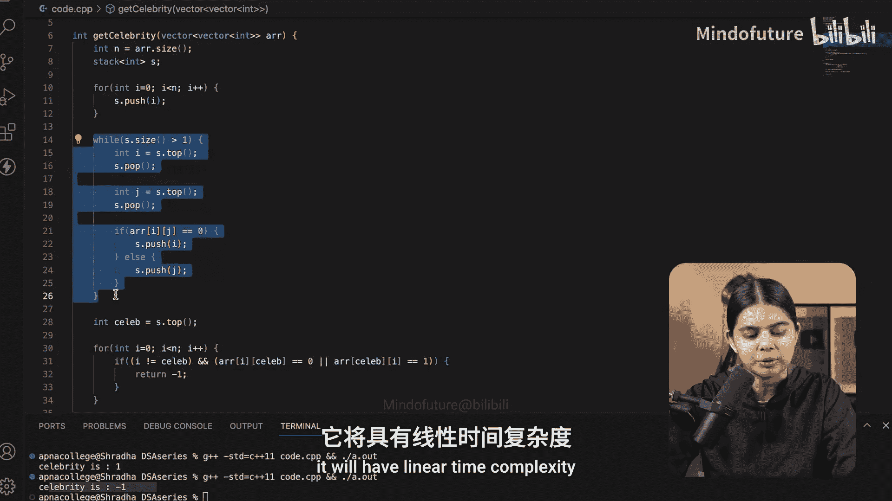

# C++-DSA课程-｜-数据结构-｜-leetcode-｜-Apna-College-｜--Complete-C++-Dsa-Course-p75-P77_L75._名人问题-栈和队列--BV18oUGBkEmV_p75-

Hi everyone， and welcome to the complete D series。 And today。

 we are going to solve an interesting DA problem， which is called the celebrity problem。

 Abik co concept is Kjaga。 Also， there is a link for a company D sheet in the description box star question this is called the celebrity problem。

ander we are given a2 D E basically matrix given here。

 which is a square matrix N cross Nki and her matrix can Yatobi value0va Abi0 values E connections who represent Katheem between people。

 Just example， Kipas matrix given him to by visualize Kleem。😊。

So this is the matrix that we have just my subse values 010， then triple 0 and 010。

0s and ones value given of Ijaeth person knows theeth person and0 n celebrity and who is the celebrity celebrity is basically a person who is known to all but does not know anyone celebrity if this is the celebrity celebrityh person will know the celebrityari of celebrity but the celebrity does not know anyone E of celebrity。

😊，Com1 no conditions which a celebrity will abide to possiblebrity to return suppose is person is person is person2 celebrity because the celebrity does not know anyone 1 and2 because it cannot be the celebrity because Similarlyly celebrity or person is to be the answer and is the celebrity that we were looking for。

😊，identify problem k who is going to be the celebrity in the matrix。

 I information basically piece of information sub discussse celebrity of celebrity and second condition。

😊，Celebrityas value is equal because the celebrity does not know anyone。

 Those case may be for all index Iari y values possible conditions call the we are going to identify the celebrity celebrity identify elimination logic use elimination logicaris is n cross nipas basically n candidates he celebrity n1ari values。

 which can be the potential candidate for being a celebritygique in candidates pairs basically。

 let us suppose n value  k equalas the potential candidates01 and2inoque in the form of pair Pe candidates analyze in celebrity and。

😊，what we are going to do。So this is the matrix that we have right now。 justippas index values in 0。

1，2 and 0，1，2 up me first Perko， which is 01 given of I value depending upon keip Ca let us suppose ofeth person does not know the person j celebrity name cebrity celebrity that we can eliminate。

😊，J， because J cannot be a final answer。 Simply is opposite be true celebrity eliminate because I can never be the celebrity because it knows one person。

 case eliminate simply in andgi basically and is equal to1 celebri candidates and next pairgi。😊。

Jma I I is going to be one and J is going to be2。 The next time of1 of1 value0 celebrity eliminate which is with a single value which is equal to candidate who can be the celebrity in the single candidate makes single candidate but celebritygar11 would have known0ino candidates may say celebrity candidate candidate。

😊，conditions for such discrepanciesbribri logic basis all。

and and cebrity andbri candidate and start by n are to greater than。

Fus element co pop King same cheesy upper K next dual element Sta toppper Ho， Mo andga and ferus pop。

 thenme in conditions go apply Kai any array of I comma G0 head J co eliminate K to basically if array of。

😊，I becomes equal to 0 eliminate are going to push and this is going to be at celebrity is this our final answer or not help is equal to1 will run a loop from i equal0 i than n i plus。

😊，Ia celebrity of I celebrity0ja array of。😊，Celebrity guaranteed that will be equal to to celebrity potential candidate celebrity celebri return which is basically equal to celebrity I equal celebrity basically we put another which is not equal to celebrity and celebrity is equal to cebrity simply return。

😊，answer value and our answer is basically this celebrity shortlist。

 So this is the entire logic disk basis let us convert the pseudo code into actual code visual Studio but this code is going to get submitted platform this is the function complete vector vector of integer given in the form of and answer value sub let us start by creating an inte Sariari from I equal0 i than。

😊，In fact， let us also create n， which is equal to a dot size I less than n I plus less H sub is and push King game Sariari index value Jesse index valuegiskibalham looprun apt stack size。

😊，Is greater than one。Subip hum pop cutting only in the values score in teacher I is going to be stack dot top and S dot。

😊，宝。Similarly， hum upne J value Co， pop Carring is tax。And。

 we are going to decide the con candidate co eliminate Kna a array of I comma J K value 0 k equal casem J eliminate Karum value co。

😊，Else， stack and， we are going to push the Jeth value at the end of this loop Humi guaranteed Patgaki stack as size equal to1 Yafeusic come。

 Those case may Hamari stack at upperpper Jobi value him。

Vo basically Hamara potential celebrity him the Staet。

 topsse Hamas vnealingi and Oski Absri Kisari conditions gocheinggi。 So from I equals 0， I less than。

N I plus this Hamhabaarringi if。I is not equal to celebrity。And， and。

E of Ia celebrity becomes equal to 0。 Ya E of celebrity I becomes equal to one。

Inno he cases1 he told me celebrity So this is how the entire process is going to look like and then we analyze the time space complexity。

 So the celebrity for this particular example is oneham is equal time and complexity the time complexity iseration index eliminate and single overall n times linear time complexity is linear complexity overall complexity that time complexity is equal to complexity。

😊。

Tokimni stack spacequa additional useari space complexity is also big of This that gives a linear time complexity the solve。

 which is the optimal way to solve the celebrity problem。

 So if you have successfully completed today's lecture you can market in is now in the comments。

cusmi can also share your progress with me on Twitter just callingku description box can Ask Mil lecture can and keep learning and keep exploring。

😊。