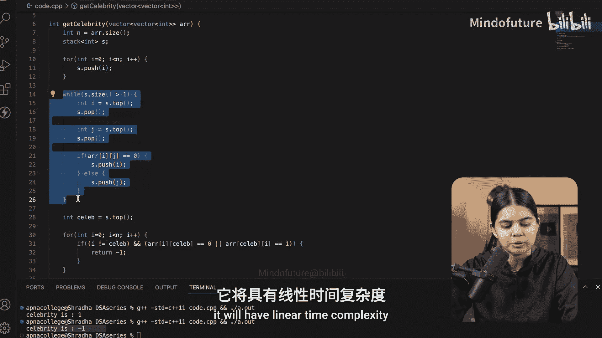

# C++ 数据结构与算法课程：75：名人问题 - 栈和队列 🎭


在本节课中，我们将学习一个有趣的数据结构问题——名人问题。我们将理解其核心概念，并使用栈和队列来设计一个高效的解决方案。

名人问题的核心是：在一个由 N 个人组成的群体中，名人被定义为**所有人都认识他，但他不认识任何人**的人。题目会给出一个 N x N 的矩阵 `M`，其中 `M[i][j] = 1` 表示第 `i` 个人认识第 `j` 个人，`M[i][j] = 0` 则表示不认识。

## 问题分析

我们需要从 N 个人中找出可能存在的名人。名人必须满足两个条件：
1.  除自己外，其他所有人都认识他。即，在矩阵中，名人所对应的**列**（除了对角线位置）全部为 1。
2.  他不认识任何人。即，在矩阵中，名人所对应的**行**全部为 0。

例如，给定以下矩阵：
```
0 1 0
0 0 0
0 1 0
```
在这个例子中，第 1 号人物（索引从 0 开始）是名人。因为：
*   第 0 行：`[0, 1, 0]`，表示 0 号认识 1 号。
*   第 2 行：`[0, 1, 0]`，表示 2 号认识 1 号。
*   第 1 行：`[0, 0, 0]`，表示 1 号不认识任何人。
*   第 1 列：`[1, 0, 1]`，表示所有人都认识 1 号（除了他自己）。

上一节我们分析了名人的定义和条件，本节中我们来看看如何使用“淘汰法”来寻找潜在的名人。

## 解决方案：淘汰法

我们的思路是逐步淘汰不可能成为名人的人选，直到剩下一个**潜在候选人**，最后再验证他是否真的满足名人条件。

以下是使用栈来实现淘汰法的步骤：

1.  **初始化候选人**：首先，将所有 N 个人的编号（0 到 N-1）压入栈中。
2.  **两两比较与淘汰**：当栈中元素多于一个时，重复以下操作：
    *   从栈顶弹出两个人，记为 `A` 和 `B`。
    *   检查 `A` 是否认识 `B`：
        *   如果 `M[A][B] == 1`，说明 `A` 认识 `B`。根据名人定义（名人不认识任何人），`A` 不可能是名人，淘汰 `A`，将 `B` 压回栈中。
        *   如果 `M[A][B] == 0`，说明 `A` 不认识 `B`。那么 `B` 就不可能是名人（因为名人是所有人都认识的），淘汰 `B`，将 `A` 压回栈中。
3.  **得到潜在候选人**：经过多轮淘汰后，栈中会剩下一个候选人。这个人是**唯一可能**成为名人的人。
4.  **最终验证**：最后，我们需要验证这个候选人是否真的满足名人的两个条件：
    *   检查他对应的行是否全为 0（除了自己）。
    *   检查他对应的列是否全为 1（除了自己）。
    *   如果都满足，他就是名人；否则，群体中没有名人。

## 代码实现

让我们将上述逻辑转化为 C++ 代码。函数接收一个二维向量 `M` 作为参数。

```cpp
int findCelebrity(vector<vector<int>>& M) {
    int n = M.size();
    stack<int> s;

    // 步骤1: 将所有候选人入栈
    for(int i = 0; i < n; i++) {
        s.push(i);
    }

    // 步骤2: 两两比较，进行淘汰
    while(s.size() > 1) {
        int a = s.top(); s.pop();
        int b = s.top(); s.pop();

        if(M[a][b] == 1) {
            // a 认识 b，淘汰 a，保留 b
            s.push(b);
        } else {
            // a 不认识 b，淘汰 b，保留 a
            s.push(a);
        }
    }

    // 步骤3: 得到潜在候选人
    int potentialCeleb = s.top();

    // 步骤4: 验证候选人
    for(int i = 0; i < n; i++) {
        // 检查条件1: 候选人不认识任何人 (行全为0，除了自己)
        // 检查条件2: 所有人都认识候选人 (列全为1，除了自己)
        if(i != potentialCeleb) {
            if(M[potentialCeleb][i] == 1 || M[i][potentialCeleb] == 0) {
                return -1; // 不满足条件，没有名人
            }
        }
    }
    return potentialCeleb; // 找到名人
}
```

## 复杂度分析

*   **时间复杂度**：`O(N)`。淘汰过程需要进行 N-1 次比较，验证过程需要检查 N 个元素，总体是线性时间。
*   **空间复杂度**：`O(N)`。我们使用了一个栈来存储候选人。



这种方法以线性的时间复杂度和空间复杂度，优雅地解决了名人问题。

本节课中我们一起学习了如何使用栈和淘汰策略来解决“名人问题”。我们首先理解了名人的定义，然后设计了一个逐步淘汰候选人的算法，最后用代码实现了这个逻辑并分析了其效率。这是一个巧妙运用基本数据结构解决实际问题的经典案例。