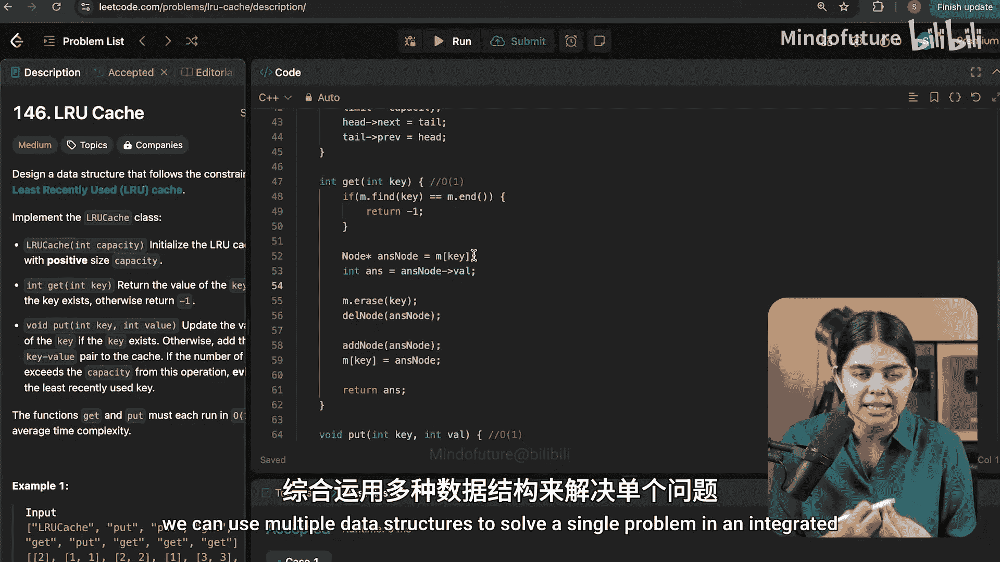

# C++-DSA课程-｜-数据结构-｜-leetcode-｜-Apna-College-｜--Complete-C++-Dsa-Course-p76-P78_L76._实现LRU缓存-链表--BV18oUGBkEmV_p76-

Hi everyone and welcome to the complete D series。 and today we're going to solve an interesting DA problem。

 which is to design and implement an L concept there is a link for company sheet in the box is to design a least recently used and this is also problem number146 solution question they can also directly jump to the optimal solution of problem given is basically like a temporary storage for data which is used for fast retrieval or。

😊，Wch capacity is at C Kanggi is cash k from data store Karani Val in the form of key value pairs to Jobi data I Gm put Kagi cache ker Ume subserias data can the keyho and Ukeba Ukiki corresponding which value of Gm can the store Krangi now this cache is a special type of cache。

 which is least recently used。😊，L in the problem stands for least recently recently use because probability recently So this is what least recently used stands for complete two functions in and are the two functions。

recently used when we are talking about the usage of data operations least used of recent。

And least recent use and and which。pair recently used value of to pair pair of value of exist of of by4。

to get the value of4 the4 k value equal and most print no important functions and and question functions complete with time complexity of Any constant time functions for complete Now let us in with help of and for the sake simplicity order looks something like nodes and all of these nodes are connected with each other。

ers and other will use end use basically recently use。😊。

Nigh data insert k to insert cur at the head of the linked list to the maintain k the order of data。

 and that is how we are going to track he con pair pale insert tona con pairna linkmi key value pair to linkri node star pointers next in previouspa in teacher me。

😊，Key value pairs Scby data on to a char information had you her8 class node canner from a store graanni here。

 Just class node say hum up me w link list go create cur。

 So this is the basic structure of what the w link list is going to look like。 If we want。

 we can directly create the structure in the code to basically up me allow you cache class canner。

 We are going to create a public class。 We call it node node can。😊。

Public he create Kleam sari properties go Eas keyja E valuejagi Sa kipas node star previous pointerga and a node star next pointerga Im Chinao is class I constructor by Asander will get the key and will get the value。

 the key co key value assign K and value co value assign King and sari previous and next pointer initialize Kingham Nat。

😊，So this is what the basic structure of the node is going to look like。 in fact。

 and and second point andmmy with value ofmmy going to initialize new node。😊。

With values-1 and -1 and similar manner may tailco initialize k new node with values-1 n-1 head and tail an unordered map unorder map basically is get operation co smooth banana get operation corresponding value in constant a constant value constant valueverse constant value pair we always prefer using a map specifically an unorder mapi unorder map map visual。

😊，Key value Perscoham key store k valuejatokiippa direct access Hokiub linkless is key corresponding Kci node direct node search k via this map。

 So map has just con code can inm will create an unored map， which will store integer and node star。

😊，Key value pairs this theory is sum up nearly， though data structures go initialize cutting up bath cut a first operation key。

 which is the put operation put operation can come at the be surewa of cutting。😊，Toari。

 we have a dummy head and dum and a is equal let us call this variable limit toari limit a maximum possible size equalse operation prefer at the start of the So well create a new note。

😊，With the values1 comma1 and I head K next to me push because head hamishmi start of theless scan push headka next new node we can also call this new node to basically if we talk about the pseudo code functionmaipas key value pair and subse sub node star new node create and new node。

😊，value pair us。establishedjo we can simply do let's call it next nextse and that will be equal to the connection second connection case establish basically is is simply nextju next。

😊，C previous is now going to point to the new node and new node K previous and X B above change Kringa new node Cajo nextvogavo old nextco point Kaga and new node Cajo previous vgavohamari headco point Kariga。

 So we can write the same thing。 key new node。😮，Com next is going to point to old next。

And the new node cap previous is going to point to the head node。

 to y jar connections and jinkohamme change Kai to be able to insert or add a node at the heads next Iura function createari X insert Kna and this is the function that we have created to ya9 node simply function called kam。

 which is called add node or add node function new nodepa orariarijoari link X insert any connectionsme reim K simply is linkless imagine。

 we have three different nodes which is the which are interconnected with each other。😊。

First node canmmi last node can be dum insert1 and1。

 which is and we are always inserting in the middle of the j middle of the link insert here and now it looks something like this ander n in the form of this pointer to insert map insert that is now。

😊，Pointing to our new node though obvious co casesse obvious1 by let us suppose ye operation put1 I with the same key and put with key of with valuese Anyway delete from map and and delete a new node of So what will basically do is。

😊，insert that if the data already exists exists is equal to map dot n exists in that corresponding So we now have to delete let us call it delete node and delete node and map basically delete and mapinert with and address reinser delete node function which will be very similar to this node function。

😊，delete node function Let us remove this function from here and paste this function here and function delete node delete node node delete let us call this old node delete delete transformnana Let us suppose this is our old node delete is delete deletena previous node and node store previous node previous。

😊，Next node go hum old next ks。 and basically to delete this node。

 Hammene old previous go old next k ofvanaga， old next old previous ofvanagaarijo connections to node go delete Carne subse will create this old previous gcanander old node car。

😊，Previous tour Kaangi。And old next， jque underham of me。Old nodga。

Next stole Kaanggi and connections scope change Carnile Hamme simply old previous k next to Co point Kvanahe to old next。

😊，Jiskalahe Hamara ye Allah connectionsions B Hojagaasi。

 And this node will now start pointing to T and fillham old in next key。😊，Previous school。

Pointva to old previous jskaa connection breakjaga and old next will now start pointing to old previous Jeke bath up in though no nodes pass up old nodei connection Se old nodes of point is say simply delete cur from memory node automatically deletegee memoryki connections to wherever So。

 So these are the four operations to basically。 let us cut them。😊，And paste them here。

The delete node function can E Kneari Jovi old node Ho delete K jabiani node with the same key pal era Carringgikeba map deval and Uske what we will do9 node create Car with the new key value pair and insert K in the map1 and3 k。

😊，We will start by creating a new node here with the values 1 and3 and tobarra say upne function K add node function call call Karinggi add node K Karega in Connect establish Karega pranni corrections code delete Karega。

😊，And one comma 3 v data insert map insert will handle a special case Ja same key rein case exist and the co case example let us come to the previous example node insert node insert ho most recently used at the start of the next node insert Ho insert ho。

😊，With two comma and is theari would the k after inserting two nodes Ja2 most recently used data and one least recently used data1 most recently used or least recently used which insert will need to remove the least used node from this which is least recently used node I delete from the end of the basically key node node least recently node before inserting a new nodeari key let us reduce this case is basically。

😊，ま city here。already that is equal to node function node function and map delete basically。😊。

F A is2 to v node go delete Kringgi and Fjora Naya No I say insert Kinghi。😊。

In the beginning of the most recently used data with node。

 So this is how we are going to execute the function with the help of two helper methods basically put recently use delete and So let us start by creating a variable limit。

😊，In our constructor hum limit co initialize King with the capacity andosba head tail k connect King in the link list to head ca next head initialization K time tail k connect and tail cap previous will get connected to the head note the2 connection commonly established sub completeneput function。

 which is to insert a new key value pair9 key value pair insertne sub already to existingta to map can check K if map key。

😊，Is equal to。Y is not equal to M dot n。 Those case may already exist Kaatta。

 This case may already exist Kaatta Maer sub delete Kna Kci node delete Kna node delete Kna addressas map they say delete Kneham function call Ki delete node node pass and delete node call call Knem simply map save erase K。

😊，ki Ikva a core corner case existstamaariki reach。

 which basically means key mapjus adjustment total key that becomes equal to the limit deletena least recently used data least recently used data previous perhamvari delete node co call for tail previous note in fact。

 map to map era tail Jobi previous nodeki map node delete function call And at the end。

 new node create K it will be a new node of。😊，Yian。

Value Okeab is new node co add K in the link list to have a new node pass and map can store the address of the new node corresponding to this key function co complete function can delete node and add node function use complete So to write these helper functions functions in fact cache constructor U add node function wide add node add node can basically new node I new node insert head next will now start pointing to the new node and old next previous will also start pointing to the new node。

😊，New node can next will become equal to old next and new node cap previous will become equal to the head node So eachr connections in Jinkome established Kai to add a node Similarlyly a core function create k called delete node justanderpaari node Ajagi which is the old node justkome delete Kna node called delete Kneque next and previous co trackknaara to old previous ojaga old node cap previous。

And old next Hojaga， old Norka， next Osqueba up the old previous k Neco hum point kvaing to the old next。

And old next k previous co point to the old previous。

 And this is how we delete a node by reestablishing the connections between the previous and the next node and add node function keys may ask such constant delete node function simple instructions constant this is a simple condition。

 This is a simple condition。 This is a simple operation。

 So put function with constant constant function basically get function to get the keys value Jo plus Jobi most recently use say for example。

 when we started with this we had this。😊，Copy this and paste it here and corresponding of stored is basically answer。

Haari mapander Jubi키。W keyki corresponding value。 And at the end， hum return Kingi is answer。

 Ugggar map cannder who key exists in Nith casema we going to return-1 The y let us suppose Ugar get phi futa the5 to map can exist inta keys me Those case mam simply -1 return they showed us a base case I just me It is very simple。

 The U map cannderham find Kna Charni key。 And this becomes equal to map dot n is key exists Neti Those casemem simply return Khenge-1。

 which basically means the key does not exist。😊，In fact。

 technique code can there be shorter sum change correctly Yper。Map dot。Find key Hammeekna。

 We need to call the fine function of the unored map A。

 but Agar key exists Kthat whose case may answer km S Galia answer km return Ki y already but。

Uper return let us supposem least recently use is node at start of pair node node with the same key value pair pair and insert function to delete this node and function to add node function calls and there will be a new connection。

😊，establish with this particular node with new connections and address get of answer let us call answer answer node is basically available in the map answer delete for answer and delete map and answer。

😊，Upni link canander and the barraay map canander key K corresponding Ani Jobi new node Ya Jobi answer node say Kingge reinsert。

 So this is how we are going to make the least recently used item as the most recently used item。

 O no code delete Kna Oi noinsert Kna Takeword the start of the linkta up is Pe pseudodo code Kobe Ebar actual code canander convert k in the get function subseom checkake If M dot find。

😊，For the key is equal to map dot n。 those case may， the key doesn't exist。 Im return calling a -1。

 Those three case may etop the answer to caleier。 answer is going to be map candledle Jubiquihe in fact。

 subseni answer。Notode star answer node co store cale。

 this will be equal to map caner key K corresponding Jobi value here and answer node key Jobi value H。

That is equal to the answer。 Last Mehamme I he answer go returned Knaim。

Aan quo return Gneip upne most recent item Hamme banana polygami Norco。

 most recent item bananas subse maps a eras Caami An Nordco and Oskeba we are going to delete this node with the delete node function。

😊，To Yaha Ani nodeko delete Ka I see nodedko Miri insert Carringi with add node add node kander Ani answered noded go pass Kingi This is nodeko a Carringgi and map kar the barrase Ani key value pairco。

😊，Reinsert with the new connections we are going to complete the get function and as get function can general operations delete node add node function overall I that will be do simply corresponding and let us now run and submit it we complete the problem of designing cache and least used cache design this is an interesting and an important because is a design this is not a cache design real life systems can use and design multiple data link data use map structure use to multiple data。

😊，knowledgeledge system design and second thing which is interesting about this question is and completely functions and that is why the fundamental knowledge of data is this is a crucial and when we talk about coding in manner have completed lecture share progress with on and exploring。

😊。

