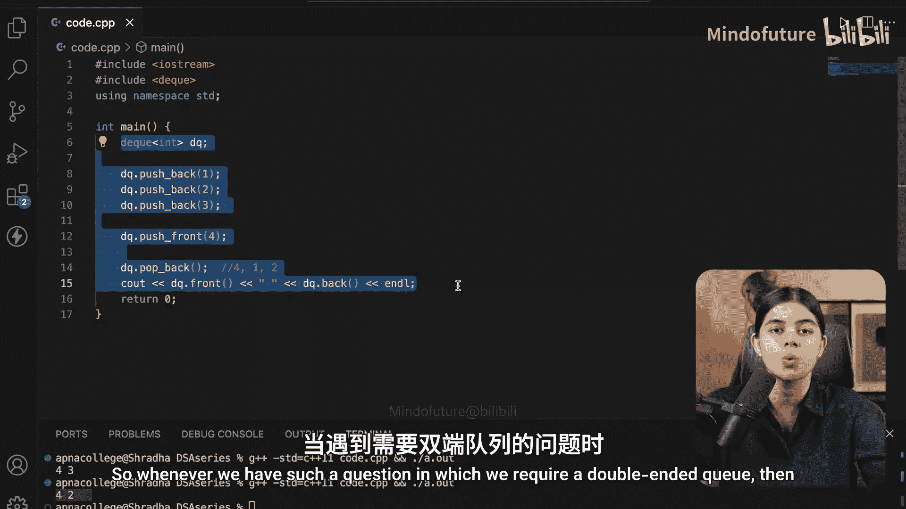

# C++-DSA课程-｜-数据结构-｜-leetcode-｜-Apna-College-｜--Complete-C++-Dsa-Course-p77-P79_新章节-队列数据结构--BV18oUGBkEmV_p77-

Hi， everyone， And today， we are going to start with a new data structure。

 which is called Q A bicalagmy Dika co concept the worm is playless scanner available Mozaga。 Also。

 there is a link for a company by D sheet in the description box。

 A Q is a very special data structure。 just detail Maam study Kneval a Q K individual standal alone D C questions to are the interview scan plus Qs co graphph K questions may B F S K A B Uki Ob Q Q is basically a first in。

😊，First out data structure， Jseam case said think this is a fi for type of structure。

 Jabim cuo imagine Cat。 we imagine it to be like this。 And Hamari cuki， though enzote a。

and a operations first is the push operation or from end which is called operation pop them from the front of theham or。

😊，top for this case that is equal to。real are to from scratch and we also see its implementation in is element from。

operation basically functions with the help my assumption like multiple nodes all the nodes are connected with basically is are visual is visual is the first node of is the last node。

😊，easy function is the front of。We data me insert Kna for example4 say tail per insert K and then we are going to update the tail to push function can we are going to insert data。

😊，At。Til off function If we talk about the pop function。

 the delete delete automatically and and internally are basically going to delete from。

Head of the linked in functions implement or in functions implement So let us try to implement a inside visual class and class Now to implement a we basically need from scratch show you the which is to create a new from scratch class to implement all of the nodes of the are going to create some properties the node is going to have some。

😊，Just canner hum data can value assign K a G node create Knaat and her node carx pointer Uga that will be initialized within the null value。

 So this is a single node of a link list Obium Q Q v k Q canander Hampa those special nodes only ahamra head of the Q and ahamra tail of the Q a public canar humpna constructor create Katam。

 let us call this Q constructor。😊，Q constructor canander， humm me head。

Until Ta go initially carrying with her。Nll value。 This the Abmaipas。

 a cua basic structure ready here。 just May we already have a linkless node。

 A yeah Kisi cua implement canmi8 function implement Kanotta， which is push。😊。

Do star function implement can now there， which is the pop function。

function implement which is in function function， which isole function So this is how we are going to implement the withs call。

The empty function cananderham return kcene， if the linkedless head is equal to null whose case memory linkedless empty and Neoneium to push cabiham check kne if。

😊，Agarhamari linklist empty A and else May linkist empty A。😊。

Toq let us suppose element1 andja and of the head is going to become equal to is going to become equal to the node the link but us suppose second operation。

😊，Push Kna a value tohammus nodeal noralia atuham said tail per insertgi tail per insert k tail ca next pointer。

 It will now start pointing to the new note and tail assign King a new node value degi and cuco imagine Kase de。

😊，Tilka next is going to become the new node and Tka new node valueo assign we can push the data inside a queue and to function complete here with a time complexity ofgo fun I see similar theri pop functionbi element link empty if the empty function。

😊，Returns to excuse me hum simply see out her Se him linked list is。Empty。And Yahasi。

 we can simply return。NO， Hammne link say front value go popcor the gift。😊。

Kbi Agaham popanranka data deletejaga front data delete Tony Kalabes head valuecom delete K head code delete Kala basically ahamra head update Hoki next perla Jaga。

 And we are going to simply delete this node just per head Pa Kalaya dejaga orari。😊。

H temporary candle up head car data toward k or head go point Caringay to headcar next。

 And we are simply going to delete this temporary node。

 So that have my pop function co implement Car with a time complexity of Biggo fun empty function。

 B implement Hoge with a time complexity of Bego fun F is going to be very easy。

 H simply return Carthingay。😊，Up knee head came。Datam can check if the is empty or not case going to return front B implement with a time complexity of So this is how we have implemented the queue in the form of which was the node of the and functions function This is how we create functions implement let us try to。

😊，Push some data inside the queue and jab tuak Hamari Q Klijadi Tp tukham is data called popkanival to while not of Q dot。

Empty tuup tuuck humsy out carrying a cuc of front。With some space。

 And then and of basically output should be 1，2，3 order is why we structure。

 which is first in first Now along with default us delete all of and that。From C plus St。

A Q Que use K。 I'm simply like Q just me Q create Kya to impte your Tki Q here Mariipas and his sari sri functions Samipas seem at them。

 So this is a sea St cube of a mu cur。😊，I segram data Co cur it tovahi same fi format me Americapas data array Sa Sa functions be internally。

 see the re implement and their time complexities are also constant。

 So this is how a c plus S T L Q looks like A J C plus S Tl K Q Ho。

 There is also one more data structure。 Stl Kar that， which is called a D Q。

 D Q basically stands for a double。😊，Ended。叫。😡，Double ended k cua front。

Andip and inserted generally and and function available is function and function double ended from back12 and。

😊，there exists a is from state which will and in and。

ry from the front4 from the front value verify front， which will be 4。And Ani decuka back。

Which will be3。To verify carryingander4 and three values let us suppose Dham element from the back。

 Let's saygiander。and print and print values。 So this is how we implement in was all about the basics of studied using studied which is called lecture we are going to solve completed todays lecture。

Can mark our attendance down in the comments。 I says S me can also share your progress with me on Twitter。

 just calling upkuche description box scan' Ja Ask late9 multi next lecture can them keep learning and keep exploring。

😊。