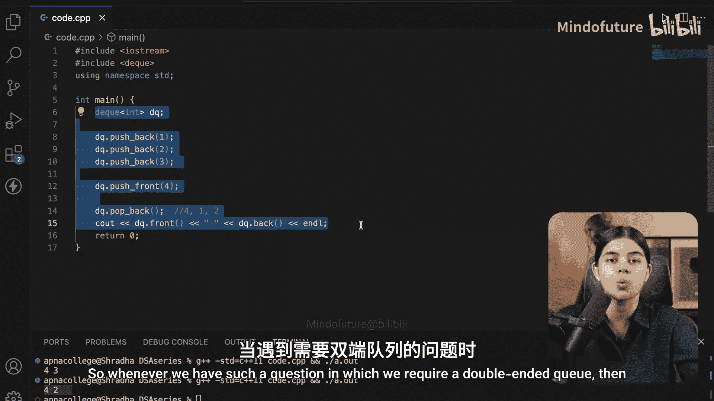

# C++ 数据结构与算法课程：77：队列数据结构


在本节课中，我们将要学习一种新的数据结构——队列。队列是一种非常重要的数据结构，在解决许多算法问题时都会用到，特别是在处理广度优先搜索（BFS）和图相关的问题时。我们将从零开始理解队列的概念，并用链表实现它，最后也会介绍C++标准模板库（STL）中现成的队列。

## 概述：什么是队列？🚶‍♂️🚶‍♀️

队列是一种遵循**先进先出**原则的数据结构。你可以把它想象成一个排队等候的队伍：最先加入队伍的人会最先被服务，新来的人则排在队伍末尾。

在队列中，我们主要执行两种操作：
*   **入队**：在队列的末尾添加一个元素。
*   **出队**：从队列的前端移除一个元素。

此外，我们还需要一些辅助操作来查看队列前端元素或检查队列是否为空。

上一节我们介绍了队列的基本概念，本节中我们来看看如何用代码实现它。

## 从零开始实现队列（使用链表）🔗

我们将使用链表作为底层结构来实现队列。链表由节点组成，每个节点包含数据和指向下一个节点的指针。

以下是实现一个队列所需的步骤：

### 第一步：定义节点结构

首先，我们需要定义构成链表的基本单元——节点。

```cpp
class Node {
public:
    int data;       // 存储数据
    Node* next;     // 指向下一个节点的指针

    // 构造函数
    Node(int value) {
        data = value;
        next = nullptr; // 初始化为空指针
    }
};
```

### 第二步：创建队列类

接下来，我们创建一个队列类。这个类需要管理两个特殊的指针：`head`（指向队列前端）和 `tail`（指向队列末尾）。

```cpp
class Queue {
private:
    Node* head; // 指向队列前端的指针
    Node* tail; // 指向队列末尾的指针

public:
    // 构造函数
    Queue() {
        head = nullptr;
        tail = nullptr;
    }

    // 接下来将在这里实现队列的各种操作函数
};
```

### 第三步：实现核心操作函数

现在，我们将在 `Queue` 类中实现四个核心函数：`push`（入队）、`pop`（出队）、`front`（查看队首）和 `empty`（检查是否为空）。

#### 1. `empty()` - 检查队列是否为空

这个函数很简单，只需检查 `head` 指针是否为 `nullptr`。

```cpp
bool empty() {
    return head == nullptr; // 如果head为空，则队列为空
}
```

#### 2. `push(int value)` - 入队操作

入队操作在队列末尾添加一个新元素。需要考虑队列为空和不为空两种情况。

```cpp
void push(int value) {
    Node* newNode = new Node(value); // 创建新节点

    if (empty()) {
        // 如果队列为空，新节点既是头也是尾
        head = newNode;
        tail = newNode;
    } else {
        // 如果队列不为空，将新节点链接到当前尾节点之后，并更新尾指针
        tail->next = newNode;
        tail = newNode;
    }
}
```

#### 3. `pop()` - 出队操作

出队操作移除队列前端的元素。同样需要先检查队列是否为空。

```cpp
void pop() {
    if (empty()) {
        cout << "队列为空，无法出队" << endl;
        return;
    }

    // 保存当前头节点
    Node* temp = head;
    // 将头指针移动到下一个节点
    head = head->next;

    // 如果出队后队列变空，也需要更新尾指针
    if (head == nullptr) {
        tail = nullptr;
    }

    // 删除原头节点，释放内存
    delete temp;
}
```

#### 4. `front()` - 获取队首元素

这个函数返回队列前端元素的值，但不移除它。

```cpp
int front() {
    if (empty()) {
        cout << "队列为空" << endl;
        return -1; // 返回一个错误值，实际应用中可能需要更健壮的处理
    }
    return head->data; // 返回头节点的数据
}
```

我们已经完成了队列的基本实现。接下来，让我们看看如何使用C++标准库中现成的队列。

## 使用C++ STL中的队列📦

C++标准模板库提供了一个现成的 `queue` 容器适配器，它内部已经实现了所有队列操作，使用起来非常方便。

以下是使用STL队列的示例：

```cpp
#include <iostream>
#include <queue> // 包含队列头文件
using namespace std;

int main() {
    queue<int> q; // 声明一个整数队列

    // 入队操作
    q.push(1);
    q.push(2);
    q.push(3);

    // 检查队列是否为空
    cout << "队列是否为空: " << (q.empty() ? "是" : "否") << endl;

    // 获取队首元素
    cout << "队首元素: " << q.front() << endl;

    // 出队操作
    q.pop();
    cout << "出队一次后，新的队首元素: " << q.front() << endl;

    // 遍历并清空队列
    cout << "按顺序出队所有元素: ";
    while (!q.empty()) {
        cout << q.front() << " ";
        q.pop();
    }
    cout << endl;

    return 0;
}
```

STL队列的 `push`、`pop`、`front`、`empty` 等操作的时间复杂度都是常数时间 O(1)。

## 扩展：双端队列（Deque）🔄

除了普通队列，STL还提供了**双端队列**。它允许在队列的前端和后端都能进行插入和删除操作。

```cpp
#include <iostream>
#include <deque> // 包含双端队列头文件
using namespace std;

int main() {
    deque<int> dq;

    // 从后端插入
    dq.push_back(1);
    dq.push_back(2);
    dq.push_back(3);

    // 从前端插入
    dq.push_front(0);

    cout << "前端元素: " << dq.front() << endl; // 输出 0
    cout << "后端元素: " << dq.back() << endl;  // 输出 3

    // 从后端删除
    dq.pop_back();
    cout << "弹出后端后，新的后端元素: " << dq.back() << endl; // 输出 2

    return 0;
}
```

## 总结

本节课中我们一起学习了队列数据结构。我们从队列**先进先出**的核心概念讲起，然后一步步地用链表实现了队列的 `push`、`pop`、`front` 和 `empty` 操作。接着，我们介绍了如何使用C++ STL中现成的 `queue`，它让队列操作变得非常简单高效。最后，我们还简要了解了功能更强大的双端队列 `deque`。



队列是算法中一个基础且强大的工具，理解其原理和实现对于解决LeetCode等平台上的许多问题至关重要。

---

