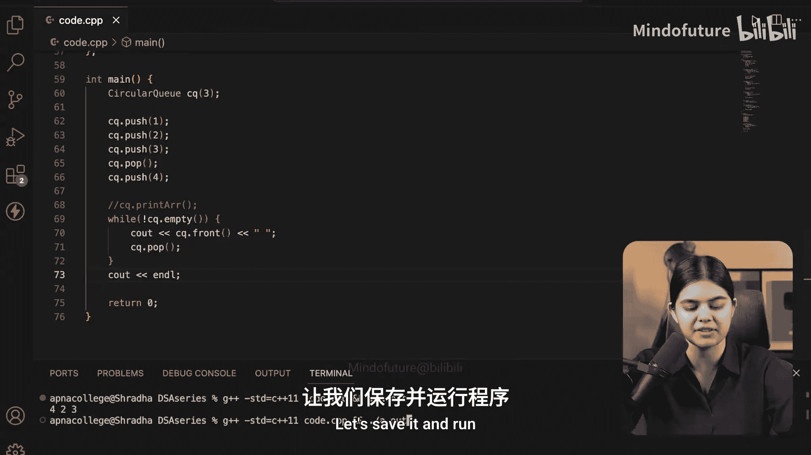

# C++-DSA课程-｜-数据结构-｜-leetcode-｜-Apna-College-｜--Complete-C++-Dsa-Course-p78-P80_L78._数据结构中的循环队列--BV18oUGBkEmV_p78-

Hi everyone， And today we are going to understand the concept and implementation of a circular cu your question is。

 Also there is a link for a company sheet in the description box to start concept today we are going to understand the concept of a circular of circular Q let us talk about a normal Q Q Q we generally have a friend and we have a rear end element insert elements So this is how a normal Q functions。

 and this is a fi of structure circular Qthe to we imagine a structure like this。

 which is circular in different different elements quo。😊，Is circular and we also have a and。😊。

but there is a slight difference between a normal Q and a circular Q。

 that is generally circular cuium implement fixed circular to circular Q elements circular manner may insert elements insert it has a fixed capacity and generallyju element element So this is how the concept of a circular circular implement basically implement。

😊，general structure capacity that is going to be the capacity of the circular and we into straight line which is basically two make two let us suppose with of。

😊，and rear case and initialize with1 so that we know that they are not pointing to any value current size or size value of0 which is basically equal to which is the size of the functions with a time complexity of at the rear end for example。

 let us suppose will start by pushing。😊，1 element， which is equal to1 a single elementush element at the rear end。

 now our rear pointer is currently pointing to this index and basically will Similarlyly and now will push element which is equal to basic concept concept of function from the front。

😊，Up frontki initialize him with valid index initial initial initial initial initial initial initial always front value basic manner and is also one more important thing let us suppose。

😊，equal to。N with any number answer01 is basic mathematics primary plus mod equal what do R is going to be r plus mod。

So this is how we are going to insert equal to equal。

circular manner move pushham next operation perform is fham or plus with help operations function pop function plus mod which basically。

6 laam Agarhama current size is equal to 0。 meari Q empty those case me Yam simply return Kajaang because the Q is empty Hki C B element Co Ya delete name though major functions engine income circular cu implement k。

 we can also create a third function， which is the front function scan front element return K front K Yaha。

😊，This is of integer。Type and Yahapper simply ham return Karing A A R， R of frontho。

 So this becomes the front of the circular Q and Yahabiri Q empty he hamka additionallaakam12 functions co implement Kanei hamki circular Qku implement k。

 So this is how the general pseudo code is going to look like。 Let us convert it into actual code。

 actual code k Ham class when just say ham circular Q circular Q and。😊。

Q implement inri in the form of dynamically memory to this pointer current size propertyki and we should have two pointers minus。

😊，Though now let us create some public properties。 Sub Eletoham Cir Qki Uska a constructor Valanni Val。

 Jbiium circularir cuku initialize Karingme Ua Sa Pascar Naga， Yaipasaiigga。

 which will become the capacity。😊，Of R Eri and Eri Kander memory go initialize Kani。

 which is the a memory allocate kte， the capacity Ga equals Ska Erilitojaam。 In fact。

 Im China to a front and rear Ca initialization here I say actually Yahaur Kaneval。😊。

To from though pointers clicking in F and R showing R front。And rear value。

 this the I say this is the constructor justkome create K。 and Sakaad。

 we have to implement three main functions。 A kmara wide push function oja just came up a data coin server Kgi。

 a wide pop function ojaga。 This will be integer data。 and a kpa Kara integer front function oja。

 Sa Caatam Chahi to a Boolean empty function Co B。😊，Implement k Ham empty function case A work。

 simply check Kingi。😊，Jb B， the current size of the array is going to be equal to 0。

 O caseme Hamari Jew circular Q here。 that is empty Subsceptple implement curt push function go push function can the subscept to check Kring a K current size capacity K equal to N yogaga a current size capacity K equal those case mayme C out Kna that the circular Q is full。

😊，But of all Naya data scan the insert N Usata Yahaim Kajagi return。

 This case may Hamappas capacity exists Ktier， whose case may subse P Tom Qki Hamishah insert Ktea from the rear end。

 Ham R pointer quo update Kingi with r plus 1。😊，Moullo capacity and Ukeba Era of R per insert Kni deta co and current size cuiumneium plus plus pop function co implement K subseelium circular Q empty toium Agggar empty him。

 Those case name I k simply print her vam that the circular Q is empty Mala co element poposta or othergar element poppoide to subse ofni front co。

K update the front plus less to automatically J pointer update we know data and current size co minus minus front return case may we simply return array of front key value and empty v check is in case value case Q we are to return minus1 time complexity function key function is constant time complexityju function constant time complexity implement Similarlyly pop function constant time complexity front co constant time complexity and empty function co be constant time complexity implement to let us create a new circular Q。

😊，With a fixed size is car fixed size。 I'm looking a 3 k equal sub circular Q and the hamch deta kkani。

 Let us suppose how many1 kuskia。😊，Letsk about 2，3。Thisri will try to push。 Let's suppose 4 elements。

 Hammiari circular Q can 1，2，3 to pushja persium 4 kbu Kpa Sajaga Q is full。

 to say Raneseel a or what are such changes Com Knaga up constructor canander。

 We also need to initialize the current size with a value of 0。 This say save Carle。😊。

And let us run this。12 is full basically operations perform which is push1，2。

3 operations is equal to and we try to1 element and dot next which is equal to4 and will become equal to operations do and now。

To print our Eri orari elements exactly I order print call extra function let us call this print E just elements let us create a loop I equal 0 I less than the capacity。

 I plusish C out。😊，A R， R of Ico， with some space。And see， out and of line。

The circular Q k print E function go calledpa 42，3 I see similar order elements Q according to a Q print Q elements order front I elements23。

4 I elements I will run a loop circular Q is not empty have to print the circular front with some space and circular Q values and last me end of。

😊，9ine， let's save it and run。

The 2，3，4 Joe order circular visual234 I order interviews circular concept So that is why the concept of circular is also important for us to understand concept and successfully completed today's lecture in in share progress with me on lecture learning and keep exploring。

😊。