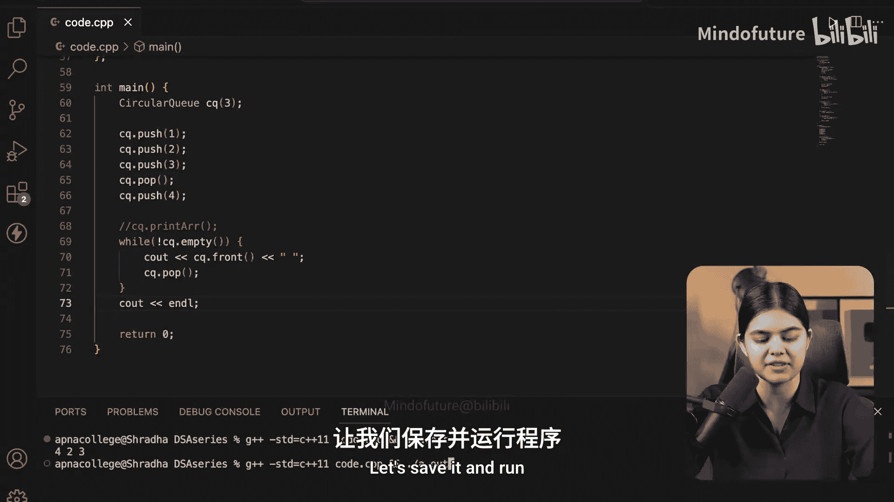

# C++数据结构课程：78：循环队列 🌀


在本节课中，我们将要学习循环队列的概念与实现。循环队列是一种特殊的线性数据结构，它克服了普通队列在空间利用上的局限性。我们将从普通队列的局限性入手，逐步理解循环队列的工作原理，并最终用C++代码实现它。

## 普通队列的局限性

上一节我们介绍了队列的基本概念。普通队列通常有一个**队首**和一个**队尾**。元素从队尾插入，从队首删除。这种结构在数组实现中，随着元素的出队，队首指针会不断后移，导致队列前端出现无法使用的“空洞”，造成空间浪费。

## 循环队列的概念

为了解决上述空间浪费问题，我们引入了循环队列。想象一个首尾相连的环形结构，这就是循环队列的直观形态。它同样有**队首**和**队尾**指针。

循环队列与普通队列的主要区别在于，它通常基于一个**固定容量**的数组实现。当指针移动到数组末尾时，它会绕回到数组的开头，从而形成一个逻辑上的“环”，实现空间的循环利用。

## 循环队列的实现原理

下面我们来具体看看如何实现一个循环队列。其核心是几个关键变量和一个用于存储的数组。

以下是循环队列的核心属性：
*   **数组**：一个固定大小的数组，用于存储队列元素。
*   **容量**：数组的大小，即队列的最大容量。
*   **队首**：指向队列第一个元素的索引。
*   **队尾**：指向队列下一个插入位置的索引。
*   **当前大小**：队列中当前元素的数量。

初始化时，我们将队首和队尾指针设置为-1，表示队列为空，当前大小为0。

## 核心操作与算法

循环队列的核心操作包括入队、出队、查看队首元素和判断队列是否为空。所有操作的时间复杂度都是O(1)。

### 入队操作

入队操作在队尾插入一个新元素。

以下是入队步骤：
1.  检查队列是否已满（`当前大小 == 容量`）。若满，则无法插入。
2.  如果队列为空（`队首 == -1`），则将队首和队尾都设置为0。
3.  否则，使用公式 **`队尾 = (队尾 + 1) % 容量`** 来更新队尾指针。这个取模运算确保了指针在到达数组末尾后能循环回到开头。
4.  将新元素放入`数组[队尾]`。
5.  当前大小加1。

### 出队操作

出队操作移除并返回队首的元素。

以下是出队步骤：
1.  检查队列是否为空（`当前大小 == 0`）。若空，则无法出队。
2.  获取`数组[队首]`的值作为要返回的元素。
3.  如果出队后队列变为空（`当前大小 == 1`），则将队首和队尾重置为-1。
4.  否则，使用公式 **`队首 = (队首 + 1) % 容量`** 来更新队首指针。
5.  当前大小减1。
6.  返回之前保存的元素值。

### 辅助操作

除了入队和出队，我们还需要两个简单的辅助函数。

以下是两个关键的辅助函数：
*   **查看队首**：如果队列不空，直接返回`数组[队首]`的值。
*   **判断为空**：检查当前大小是否为0。

## C++代码实现

现在，让我们将上述逻辑转化为实际的C++代码。我们将创建一个`CircularQueue`类。

```cpp
#include <iostream>
using namespace std;

class CircularQueue {
private:
    int *arr;        // 动态数组
    int front;       // 队首指针
    int rear;        // 队尾指针
    int currentSize; // 当前元素数
    int capacity;    // 队列容量

public:
    // 构造函数
    CircularQueue(int size) {
        capacity = size;
        arr = new int[capacity];
        front = -1;
        rear = -1;
        currentSize = 0;
    }

    // 入队函数
    void push(int data) {
        if (currentSize == capacity) {
            cout << "Queue is full. Cannot push " << data << endl;
            return;
        }
        if (front == -1) { // 队列为空时初始化
            front = 0;
            rear = 0;
        } else {
            rear = (rear + 1) % capacity; // 循环移动队尾
        }
        arr[rear] = data;
        currentSize++;
    }

    // 出队函数
    int pop() {
        if (currentSize == 0) {
            cout << "Queue is empty. Cannot pop." << endl;
            return -1;
        }
        int poppedValue = arr[front];
        if (currentSize == 1) { // 弹出后队列变空
            front = -1;
            rear = -1;
        } else {
            front = (front + 1) % capacity; // 循环移动队首
        }
        currentSize--;
        return poppedValue;
    }

    // 查看队首元素
    int getFront() {
        if (currentSize == 0) {
            cout << "Queue is empty." << endl;
            return -1;
        }
        return arr[front];
    }

    // 判断队列是否为空
    bool isEmpty() {
        return currentSize == 0;
    }

    // 打印队列当前所有元素（按存储顺序，辅助理解）
    void printQueue() {
        if (currentSize == 0) {
            cout << "Queue is empty." << endl;
            return;
        }
        cout << "Current Queue (from front to rear): ";
        int count = 0;
        int index = front;
        while (count < currentSize) {
            cout << arr[index] << " ";
            index = (index + 1) % capacity; // 循环遍历
            count++;
        }
        cout << endl;
    }

    // 析构函数
    ~CircularQueue() {
        delete[] arr;
    }
};

// 主函数用于测试
int main() {
    CircularQueue q(3); // 创建容量为3的循环队列

    q.push(1);
    q.push(2);
    q.push(3);
    q.push(4); // 应提示队列已满

    q.printQueue(); // 输出: 1 2 3

    cout << "Popped: " << q.pop() << endl; // 弹出1
    q.printQueue(); // 输出: 2 3

    q.push(4); // 成功插入，队尾循环到开头
    q.printQueue(); // 输出: 2 3 4

    cout << "Front element is: " << q.getFront() << endl; // 输出: 2

    while (!q.isEmpty()) {
        cout << "Popping: " << q.pop() << endl;
    }
    q.pop(); // 尝试在空队列弹出

    return 0;
}
```

运行上述代码，你将看到队列如何循环利用空间。例如，在弹出元素1后，插入元素4，队列中的元素顺序在逻辑上是2, 3, 4，尽管它们在数组中的物理存储位置可能不是连续的。



## 总结

本节课中我们一起学习了循环队列。我们首先指出了普通队列在数组实现中的空间浪费问题，然后引入了循环队列的概念，它通过将队列视为一个环来解决这个问题。我们详细讲解了其**入队**和**出队**操作中利用取模运算实现指针循环的核心公式，并最终用C++完整实现了一个循环队列类。循环队列是理解更复杂数据结构和解决许多算法问题（如CPU任务调度）的重要基础。