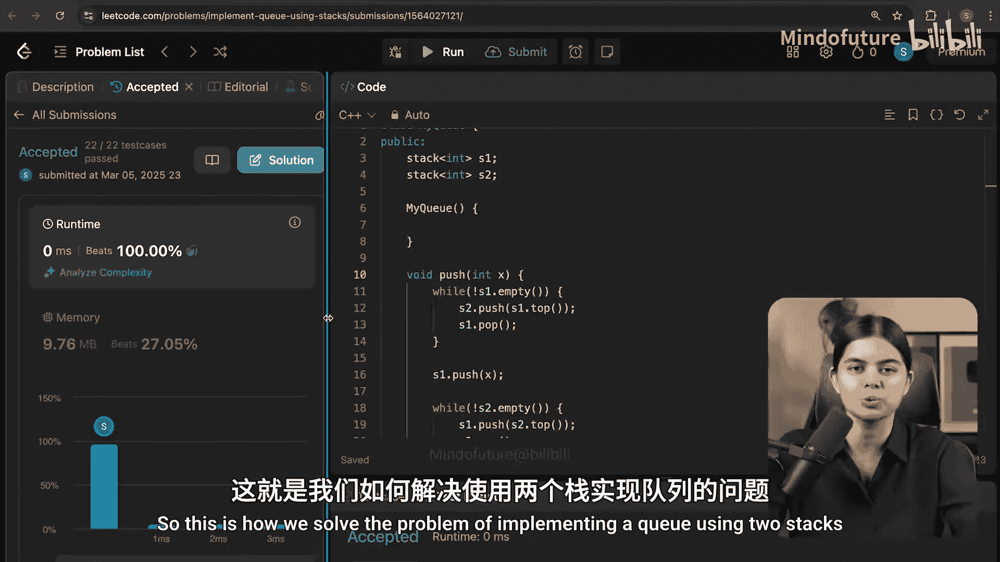

# C++-DSA课程-｜-数据结构-｜-leetcode-｜-Apna-College-｜--Complete-C++-Dsa-Course-p79-P81_L79._用栈实现队列_用队列实现栈--BV18oUGBkEmV_p79-

Hi， everyone， And today， we are going to solve two important questions。

 how to implement a stack using cues and how to implement a queue using stacks。

 A biscal co concept is playless scanner available miza。

 Also there is a link for a company D sheet in the description box me first problem K。

 which is to implement a stack using two Qs E similar E C parallel problem here how to implement a queue using two stacks。

 If you want to directly jump to the second problem Ache timest miza and you can go to the second problem。

 So this is also problem number 2 to5 on lead code。 basically extract co implement Kai。

 So this is the stack that we need to implement。😊，Stack implement basic basic sub important functions function a function function and a empty stack implement in functions implement in functions implement functionality implement that will be last in first out type of structure but internally structure implement Q implement the using twoq we can create twoq like Q Q andq functionality implement in the code we have to this class called my my the basic。

😊，He for these four functions function delete what of is basically。

or important element front element basic strategy that are to use because the functional are basically what。

😊，St basically visualize In fact， visualization this is the actual implementation that we want to j front because case that should be at the front of our Q1 top top will basically be equal to Q。

😊，Front element up next time Jaham P Knei next element2 co the next element to Yaha Q to at the front push k possible lesson untilippa double ended Qam single ended Qkim at the normal Qkika normal Q we cannot push at the front。

 to is too v data co is3ni Q1 K front perim Uki， what we are going to do sub Yingari Q1 K elements co。

😊，함 copy garden。Upni Q2 kander， justka le Yari1 exists Kt Toham I say Q2 kander copy K or Q1ari Kalijagi。

😊，Oskebakne Q1 kandander，ushnini de the Jobiju2seni Q1 Kander and Uskebar。

 we are going to copy the elements of Q 2。😊，Back Q insertion from us next time know that this should be pushed at top of。

if we look at the order of elements it is the same as the data and that is where the top and this now let us convert this logic。

Igow complete，z。😊，Q of integers Q1 and Q of integer Q2。

 We can leave the constructor as it is subne push function co implement K Just K time complexity big of N value Qki scanrum loop K Ham first step head to copy all the elements of Q1 to Q2 just kmic loops shall ask them and loop basically will be Kju Hama Q1。

😊，Is not empty。 thepttaum Kni Q1 K front per Joby element here。 U say Q2 candleander push cur。

 So Q2 dot push。Q1 k front page U element here and for Q1 finally Sa Q2ba Q1 we are going to push the new element which is x And for finallyhi k repeatari Q2 Ka。

😊，Tt Osqueari elements quo Q 1 K their ham pushkaring。 So Q2 k front per Juby element here。

Sa push and Q2 element pop。 So this is how we are going to implement the push function P function simply element store Q1 dot is and is element top simply return Q element and empty simply return Q1 dot empty value So this is big of one constant time complexity constant complexity constant time complexity and let us now run the and submit it。

😊，This theory we solve the problem of creating a stack using twoqs。 E see Milta juta X second Saval。

 which is to implement a Q using two stacks A second question k to ya those stack key help say Q co implement K same logic Q K come question the which is basically this Let us supposeme a Q co implement Knai。

 So this is the Q that we want to implement Q k first in first out logic elementsgi Qander say important element oai that is basically the front of the Q Q front per element exist let us minimize this a bit。

 And say to kgi Jo stack Q。😊，Udootander ham I primary stack knele pling。

 let us suppose ham S1 hama primary stack is Aham Ko kgiki S1 Ca top element here say ham map K with the front of this Q Mad jabi yogaer S1 K topco consider Kai。

 So this is going to be the front of the Q Jabbiche kga Q emptyka Ham S1 co as the primary Q sum ksari operations who perform Knele to char operations Heinko perform Kna push。

😊，Bop。Front。And empty mis say front operations sub say easy front operation kb front element simply up stack 1 k top element command return the Jobiari cua front element head that is going to become equals to stack one top element and is the mapping hescom jobb B elements go push K start Let us consider the push function first。

😊，Push function can come at the way later suppose and pushk。To will all elements of。😊。

S1 k under data let us consider it to be x and third step and this is what is like and this is now or us suppose next time So three is first。

have this one element copy the elements from and these are。So in Charro functions Co。

 hamkuch is3 case I implement hearing game。 So let us convert this logic into action C plus code。

 The code candle。 This is the class just implement Kna complete Kna upper class can。

 those stack code create k stack of integer S1 and stack of integer。😊，S 2。

 these are the two stacks sub push function go implement K。

 basically S1 K elements square S2 make copy Kna to jub the k S1 empty Nujata。😊。

Tup tu S2 canar humush Kna Cha S1 car top element and S1 C element Cohu。Pop King Ukeba S1 can。

 we are going to push the new element， which is x， and the bars elements go copy back curlling it。

 The Yaer Jept S 2 is not empty。T tu S1 candle。 we are going to push S2 car top element。

And S2 say is element co pop K。 So this is how we implement the push function just linear time complexityity and the push to give us case me n number of elements changena pop function K simply values which is s1 top S value pop and finally will return the answer from this function peak simply return S top element peak basically is the front element and Boolean K simply return S do is empty So this is the entire logic function constant may implement a and this is in linear time let us now run our code and submit it。

 So this is how we solve the problem of implementing a Q using two stacks So important problem data structures and algorithm especially DS stack Q I concept of。

much if you successfully completed the lecture， then you can mark it in is down in the comments becauseat me can also share your progress with me on Twitter just calling Ka description box cantherja Askulate9 Mil lecture can that then keep learning and keep exploring。

😊。