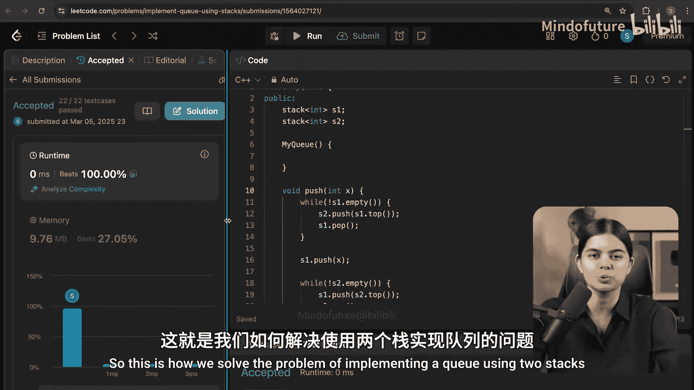

# C++数据结构与算法课程：79：用栈实现队列与用队列实现栈


在本节课中，我们将学习两个重要的数据结构问题：如何使用两个队列实现一个栈，以及如何使用两个栈实现一个队列。这是数据结构与算法中的经典问题，也是LeetCode上的题目。理解这些实现有助于深入掌握栈和队列的核心概念。

## 概述

我们将解决两个问题：
1.  使用两个队列实现栈（后进先出，LIFO）。
2.  使用两个栈实现队列（先进先出，FIFO）。

这两个问题都要求我们在内部使用一种数据结构来模拟另一种数据结构的行为，同时实现其基本操作。

## 问题一：用队列实现栈 🧱

首先，我们来看如何用两个队列实现一个栈。我们需要实现的栈类（例如 `MyStack`）应包含以下基本功能：
*   `push(x)`：将元素 x 压入栈顶。
*   `pop()`：移除并返回栈顶元素。
*   `top()`：返回栈顶元素。
*   `empty()`：判断栈是否为空。

栈的内部结构应遵循后进先出原则，但我们将使用两个队列（`q1` 和 `q2`）来模拟这一行为。

### 核心策略

基本策略是始终让一个队列（例如 `q1`）保持栈的顺序，栈顶元素位于队列前端。`push` 操作是关键的难点，因为我们需要将新元素放到队列的前端，而标准队列只允许在后端插入。

以下是 `push` 操作的逻辑步骤：
1.  将新元素 `x` 推入空的辅助队列 `q2`。
2.  将主队列 `q1` 中的所有元素依次出队，并推入 `q2`。这样，新元素 `x` 就位于 `q2` 的前端（即栈顶）。
3.  交换 `q1` 和 `q2` 的名称，使得 `q1` 再次成为包含所有元素的主队列。

通过这种方式，`q1` 的前端始终是最后插入的元素，即栈顶。

### 代码实现

以下是基于上述逻辑的 C++ 代码实现：

```cpp
class MyStack {
private:
    queue<int> q1, q2;
public:
    MyStack() {}

    void push(int x) {
        // 1. 将新元素推入 q2
        q2.push(x);
        // 2. 将 q1 中所有元素转移到 q2
        while (!q1.empty()) {
            q2.push(q1.front());
            q1.pop();
        }
        // 3. 交换 q1 和 q2
        swap(q1, q2);
    }

    int pop() {
        int val = q1.front();
        q1.pop();
        return val;
    }

    int top() {
        return q1.front();
    }

    bool empty() {
        return q1.empty();
    }
};
```

### 复杂度分析
*   `push` 操作的时间复杂度为 **O(n)**，因为需要转移 n 个元素。
*   `pop`、`top` 和 `empty` 操作的时间复杂度均为 **O(1)**。

---

上一节我们介绍了如何使用两个队列实现栈。接下来，我们看看相反的问题。

## 问题二：用栈实现队列 🚶‍♂️➡️🚶‍♂️

现在，我们来看如何使用两个栈实现一个队列。我们需要实现的队列类（例如 `MyQueue`）应包含以下基本功能：
*   `push(x)`：将元素 x 推入队列末尾。
*   `pop()`：移除并返回队列前端的元素。
*   `peek()`：返回队列前端的元素。
*   `empty()`：判断队列是否为空。

队列的内部结构应遵循先进先出原则，我们将使用两个栈（`s1` 和 `s2`）来模拟。

### 核心策略

基本思路是使用一个栈（`s1`）作为主存储，其栈顶元素映射为队列的**后端**。`pop` 和 `peek` 操作需要访问队列的**前端**，这位于栈 `s1` 的**底部**。为了高效访问，我们需要第二个栈（`s2`）来反转元素顺序。

以下是关键操作逻辑：
*   **`push(x)`**：直接将元素 `x` 压入栈 `s1`。
*   **`pop()` 和 `peek()`**：
    1.  如果栈 `s2` 为空，则将栈 `s1` 中的所有元素依次弹出并压入 `s2`。这个过程反转了元素的顺序，使得 `s2` 的栈顶就是队列的前端。
    2.  从 `s2` 的栈顶执行弹出（`pop`）或查看（`peek`）操作。

### 代码实现

以下是基于上述逻辑的 C++ 代码实现：

```cpp
class MyQueue {
private:
    stack<int> s1, s2;
public:
    MyQueue() {}

    void push(int x) {
        s1.push(x);
    }

    int pop() {
        if (s2.empty()) {
            while (!s1.empty()) {
                s2.push(s1.top());
                s1.pop();
            }
        }
        int val = s2.top();
        s2.pop();
        return val;
    }

    int peek() {
        if (s2.empty()) {
            while (!s1.empty()) {
                s2.push(s1.top());
                s1.pop();
            }
        }
        return s2.top();
    }

    bool empty() {
        return s1.empty() && s2.empty();
    }
};
```

### 复杂度分析
*   `push` 操作的时间复杂度为 **O(1)**。
*   `pop` 和 `peek` 操作**摊还**时间复杂度为 **O(1)**。虽然最坏情况下（当 `s2` 为空时）需要 O(n) 时间转移元素，但每个元素只会被转移一次（从 `s1` 到 `s2`），因此平均下来每次操作是常数时间。
*   `empty` 操作的时间复杂度为 **O(1)**。

## 总结

本节课我们一起学习了两个经典的数据结构互转问题：
1.  **用队列实现栈**：核心在于通过两个队列的协作，在 `push` 操作中确保新元素位于“栈顶”（即队列前端），该操作时间复杂度为 O(n)。
2.  **用栈实现队列**：核心在于使用一个栈（`s1`）处理输入，另一个栈（`s2`）处理输出。通过将 `s1` 的元素倒入 `s2` 来反转顺序，从而在 O(1) 摊还时间内访问队列前端。



理解这些实现不仅有助于解决具体的编程问题，更能加深对栈和队列这两种基本数据结构特性的认识。

