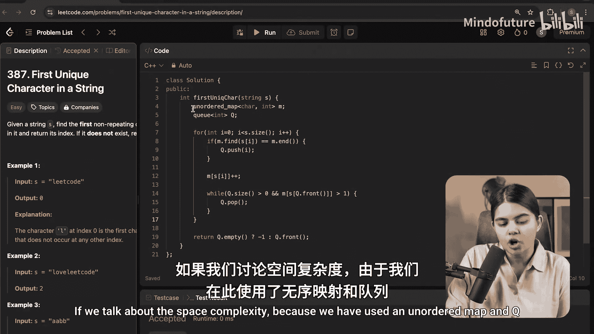

# C++-DSA课程-｜-数据结构-｜-leetcode-｜-Apna-College-｜--Complete-C++-Dsa-Course-p80-P82_L80._字符串中的第一个唯一字符-简单-Leetcode387--BV18oUGBkEmV_p80-

Hi， everyone， today， we' are going to solve an interesting D question。

 which is called first unique character in a string。 Ak your problem K。 the is scanjaga。

 Also there is a link for a company by D sheet in the description box to start k Savalar this is called first unique character in a string。

 And this is also problem number 3，87 on code Ahi same Saval with different form me different nam maybechar and the second form of the problem is called first non repeating。

😊，Character in a stream。solutions and approaches visualization non non。😊。

character return this is a question a of different approaches logical non repeating character character what。

frequency order elementska。 So we are going to use an unordered mapma a characterki frequency is data structure frequencyorder map visual will have all our characters and frequency in first non repeat first unique fashion forward fashionverse elements compared to elements example。

😊，we are talking about second。frequency of repeat frequency now are repeat are。

frequency of yes frequency is we are to move on to the next character which is exist are will now exist with a frequency of repeat frequency。

😊，Then we are going to move on to the next character。

 which is repeating start repeat non and now will a front element which is repeat it non repeating even we are going to pop and。

😊，frequency as and finally the end that is going to be a unique frequency So this is going to be but because we want to return the index value which is and not character is to be very easy for this。

😊，Cellanahe from I equals0 to n。Lop character basically we check stringbi character Agar Ma exists Neta will use the map dot fine function。

 Aru Nila this is equal to map dot n。 thosequem Qander pushing character。 In fact。

 Uke index not the character itself and map character Jobi frequency plus theke will write a loop to remove all of the repeating characters from the Qptaaria size is greater than 0。

😊，Andpari Q Jobi element front pay a front pay element index value index character and character I frequency if the frequency is greater than1 caseq So this is the loop to actually pop all of the repeating elements from the Q case equal and Ija front element is going to be the pseudo of the solution Now let us convert the pseudo into actual function I are going to create an unordered map with character and integer values and of。

😊，Integer subip a K loop Chilani vium from I equals 0 I less than S dot size I plus this Agar Hamraju character M sub current character who map can exists in Hta Mola S dot I K map dot fine becomes equal to map dot n。

😊，Those case may Q kander humush Kneval of news character Ka index and also map k whose character K frequency co K plus this A character already exists katta Toski Jovi frequency Ogi。

 for example，1 headto2jagi exists name Qatar to initialize Ogi0 kat to1jagi。😊，Okbat。

 we are going to remove all of the repeating values。 to Jepta Kaari cua size is greater than 0。

And Hamari Q K， front Pe Jobi1 He， Mo up Jobi indexer。

 subseelletouskeoska character Nikaling and Uskeba。😊，Map Kander Uki frequency in Ka。

 if this frequency becomes greater than one， those case may  Q a pop K of me value Co at the end hum return。

 Kane Val。 If the Q is empty， those case may -1 L hum return Kaingi Qki front per Jubi Val M。

 So this is what the code is going to look like。 This line canander M dot find hum Kle。

 and this should be n。 So this is what the code is going to look like， let us run it。😊，And submit it。

 So this is how we solve the problem of finding unique character in a stringm complexity complexitys out n outer but as basically on average。

 if we think about it the string on average ir n So overall complexity is going to be if we talk about the complexity and complexity is also going to be linear。

 So this is how we solve。😊。

The problem of finding the non repeating or the unique character in a string or a string。

 if you have successfully completed today's lecture。

 then you can mark it hands now in the comments is says me can also share your progress with me on Twitter is calling Kniche description box can the mi Zga Ask time Mil next lecture can then and keep learning and keep exploring。

😊。