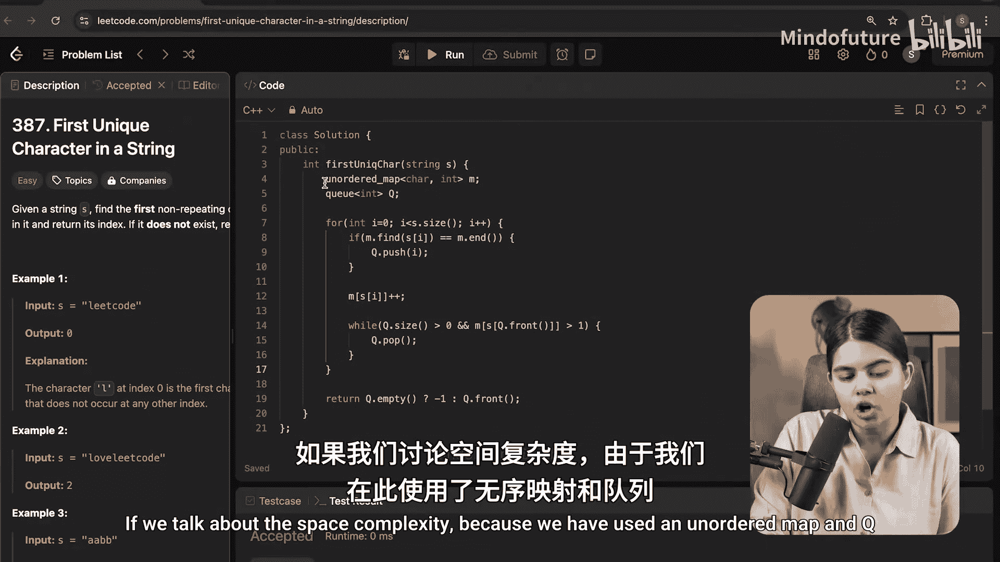

# C++ 数据结构与算法课程：80：字符串中的第一个唯一字符


## 概述
在本节课中，我们将学习如何解决一个有趣的算法问题：**在字符串中找到第一个不重复的字符**。这个问题对应 LeetCode 的第 387 题。我们将探讨不同的解决思路，并最终实现一个高效的解决方案。

## 问题描述
给定一个字符串，需要找到其中第一个**不重复**字符的索引，并返回该索引。如果不存在不重复的字符，则返回 -1。

例如，对于字符串 `"leetcode"`：
*   字符 `‘l‘` 是第一个不重复的字符，其索引为 0。
*   对于字符串 `"loveleetcode"`，第一个不重复的字符是 `‘v‘`，索引为 2。

## 核心思路
解决此问题的关键在于跟踪每个字符出现的**频率**。我们需要一种数据结构来记录字符及其出现次数，然后按字符串的原始顺序检查，找到第一个频率为 1 的字符。

我们将使用 **哈希映射** 来存储字符频率，并使用 **队列** 来维护字符的原始顺序，以便高效地找到第一个非重复字符。

## 算法步骤详解
以下是解决此问题的具体步骤。

### 步骤 1：初始化数据结构
首先，我们创建两个辅助数据结构：
*   **`unordered_map<char, int>`**：用于存储每个字符在字符串中出现的次数。
*   **`queue<int>`**：用于按顺序存储字符在字符串中的索引。

### 步骤 2：遍历字符串并填充数据结构
接着，我们遍历字符串中的每一个字符。

以下是遍历过程的伪代码：
```cpp
for (int i = 0; i < s.length(); i++) {
    char ch = s[i];
    // 如果字符不在映射中，它是首次出现
    if (频率映射.find(ch) == 频率映射.end()) {
        队列.push(i); // 将其索引加入队列
    }
    // 更新该字符的频率（增加1）
    频率映射[ch]++;
}
```

### 步骤 3：清理队列中的重复字符
队列前端存储的索引对应的字符，可能是重复的。因此，我们需要清理队列前端所有频率大于 1 的字符。

以下是清理队列的伪代码：
```cpp
while (!队列.empty()) {
    int frontIndex = 队列.front();
    char frontChar = s[frontIndex];
    // 获取队列前端字符的频率
    int freq = 频率映射[frontChar];
    // 如果频率大于1，说明是重复字符，将其从队列弹出
    if (freq > 1) {
        队列.pop();
    } else {
        // 找到第一个频率为1的字符，停止循环
        break;
    }
}
```

### 步骤 4：返回结果
最后，检查队列是否为空。
*   如果队列不为空，队列前端的索引就是第一个唯一字符的索引。
*   如果队列为空，说明没有唯一字符，返回 -1。

返回结果的伪代码如下：
```cpp
if (队列.empty()) {
    return -1;
} else {
    return 队列.front();
}
```

## 完整代码实现
将以上步骤组合起来，得到完整的 C++ 解决方案。

```cpp
#include <unordered_map>
#include <queue>
#include <string>
using namespace std;

class Solution {
public:
    int firstUniqChar(string s) {
        unordered_map<char, int> freqMap;
        queue<int> indexQueue;

        // 步骤 2：遍历字符串，填充映射和队列
        for (int i = 0; i < s.size(); i++) {
            char currentChar = s[i];
            // 如果是第一次出现，将其索引加入队列
            if (freqMap.find(currentChar) == freqMap.end()) {
                indexQueue.push(i);
            }
            // 更新字符频率
            freqMap[currentChar]++;
        }

        // 步骤 3：清理队列前端的重复字符
        while (!indexQueue.empty()) {
            int frontIndex = indexQueue.front();
            char frontChar = s[frontIndex];
            // 获取该字符的频率
            int frequency = freqMap[frontChar];
            // 如果频率大于1，弹出该索引
            if (frequency > 1) {
                indexQueue.pop();
            } else {
                // 找到第一个非重复字符，停止循环
                break;
            }
        }

        // 步骤 4：返回结果
        if (indexQueue.empty()) {
            return -1;
        } else {
            return indexQueue.front();
        }
    }
};
```

## 复杂度分析
*   **时间复杂度**：O(n)。我们只需要遍历字符串一次来构建映射和队列，再遍历队列一次（最坏情况）来清理重复项。n 是字符串的长度。
*   **空间复杂度**：O(n)。在最坏情况下（所有字符都不同），哈希映射和队列都需要存储 n 个元素。



## 总结
本节课我们一起学习了如何解决 **“字符串中的第一个唯一字符”** 问题。我们掌握了使用 **哈希映射** 记录频率，并结合 **队列** 维护顺序的核心方法。这种方法高效且直观，是处理此类“首次出现”或“唯一性”问题的典型策略。


成功完成本课学习后，你可以在评论区标记。你也可以通过描述框中的链接分享你的学习进度。我们下节课再见，继续学习和探索。