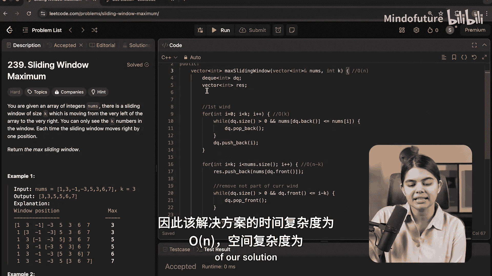

# C++-DSA课程-｜-数据结构-｜-leetcode-｜-Apna-College-｜--Complete-C++-Dsa-Course-p81-P83_L81._滑动窗口最大值-队列--BV18oUGBkEmV_p81-

Hi everyone。 And today， we' are going to solve an important classical DA problem。

 which is called sliding window maximum。 Abbisscaleav amy D car coy of Alcanne woman is s scanner available in nozaga。

 Also， there is a link for a companyized DA sheet in the description box。 to start k Sa al Casa。

 This problem is called sliding window maximum， and this is also question number 2。

39 on lead code Saval Kander Hamri Paic numbers array given here。 So if we want。

 we can also visualize the array like this。 Justcanander， we have different elements。😊。

And as case Ami Hamari pass a K value given here， which is basically the window size。😊。

ander is maximum element example for now this is going to be the first is equal elements equal is still going to equal to elements and elements in。

😊，is going to be 7 to my 7。 So that said this is the final answer that we have to return。

 basically anri Windows maximum value see same E return is problem to redefine we have to return the maximum of all subs。

😊，Of size。 So this is the basic problem that we have to solveive to move to optimal solutionive of if we on to elements or。

Find out the largest or the maximum of those k elements out from i equals0 to n basically starting and is equal to I and i plus this is basically the brute method orive method to solve problem n complexity and and this is the time complexity now we are going to talk about an solution complexity to n and its optimal solution。

c can Dq basically stands for a double ended cu Ham double ended cu use carryingne sliding window maximum find out andne Dq visualize basicallyari Dq function just can up front end up back in rear end bus push。

😊，Pop operations and back So this is a that we are going to use answer maximum So basically is going to represent viable solution or possible is。

first rule second rule for example， if this is the window that we are trying to analyze basically。

future current equal is not is rules all the possible。😊，three elements or which。

elements current is is is greater than。😊，Simply minus current that is going to be available at the front of is available at the first part of equal。

😊，are going to run a loop loop size is greater than are to analyze equal current element is basically numbers of element equal basically and is order value。

Always going to store the values in descending order。

 And why is that decide answered maximum or descending order maintain among the elements So this is basically the element and this is the case made。

😊，And finally， we are going to push our current element。 D Q dot push push operation B backay Kinggi。

 current element co， which is equal to。😊，Numbs of I and is the say Hamara first step complete yogagake end per Hamari D Q K front per will have the first answer Okeba subsequently ak index ak index per jaer。

 Ham of me next windows who analyze K not cur。 Just come at the head。

 let us minimize this and say yahaper laium。 The second part under sliding window maximum calculate cur it for。

😊，Other windows loop from I equals k to n bar first index that is going to be this index or basically we also answer are all。

😊，which。For that we have to remove elements from Dq， which are。Not。Part of。

Current this is an important step second let us copy this。😊，Iire quote。to remove all of the elements。

 And at the end， which is equal to and equal to is is1 part1 is。😊，or。

new element is to be6 is and equal  and。Proverse Klinggi Hamari last window car Jo maximum element here Bohamari D Cuque front Perroga。

 which is equal to 7 So at the end， jobhamariuraura loop complete ojaga to Hamraju last element here。

 Let us minimize this Hamraju last element here。 last answer exist Keigga D Cuque front per。😊。

To hum result canander。Push back front。 So this is the entire logic basically figuring out are going to track the index of all elements let us remove this basically let us all elements is is1。

2，3，4，5 and so on。😊，index0 or in the form of its index elements are going to use this index value index is index。

😊，Japer Abiium k Maab Hammiah Maipassni current index key valuehi， which is this value。

 I Oque Ami Hammari de Cu a front page O B elements through Maapasusska index here to Mariipas。

 though value available here。😊，Aari D Q front pay Jobi index is index key value basically is index key value。

 and we also have the value of the current index I So this is the index of the current elementbi k I key window and Upa ending index starting index kbi if there is a window of k I I k plus1 U starting index example k value4 k equal to 43 plus1。

 This value is going to be equal to2 Matla is window Kaju starting point here that is equal to 2ka window k indexgar those index key value Hammi greater than yeah equal to Hogi This valuekaki kbi index key value less than I k plus1 Ho that element is not part of。

😊，Current window the current window could track basically elements index or only identify which are not part of the current window if this is of or not index value should basically less than equal equal equal than equal to。

😊，is3 or values value equal is than equal to 41。 This is part of the current is remove basically can create。

😊，Andp that is less than equal to descendc the non we were trying to push numbers。😊。

index dot back numbers numbers do change this is how we are going to try to find the。😊。

Part in elements we say plus v elements toward knegi kne viable greater in value zone actuallyari。

 So this is how we solve this slid window maximum problem。 And this is the pseudo code for it。

 Now let us convert the pseudo code into actual c The can is the hard level problem that we have to solve subto Dq co create Dq we are going to store the integer values and vector create of integer values result co subse analyze kne me first window first window analyze loop from I equal0 I than k I plus subto non viable values coya remove totaari Dq size is greater than0。

😊，And Jept Hamari nus of Dq canander back per smaller values exist Kathe。

 as compared to nus of I on smaller values come me remove K any Dq say hum pop back K then give me smaller values score。

 and last may Dcu canander hum push back kne vhe。Up me current valuea index。

 So this is the first window Abbitta come our answer co store N K result kander Fer ak K next Windows co analyze cur it to intesger I equals k I less than n。

 which is basically nus dot size I plus less subse we are going to store the answer to result canander pushback Kingi nus of Jobi Hamri Dq canander front per answer here。

😊，So Herbal， na window start Knese palprani Wincom answer pushback Kneval， Uskeba， remove elements。😊。

Which are not。Part of current window， Gica Malahe Hamic looplangi Jepta kari D Cuka size is greater than 0。

 Tptari D Cuque front per Jobi element hereca index。

 if that is equal less than equal to I minus escape。

Those case made D QK front save and pop Carnivalier was valuable。Okeba。

 we are going to remove the smaller values from the end。 So Sclebi similar Luam Rakainggi。 in fact。

 Yahi same loop here。 just come copy curam。An Pae K the Jobi smaller values unim remove Ker last made Dq can push Kne current element K index。

 So this is how we will find out all of our answers on A K K result pushback Kari Jobi last window Ho U result Alexi pushback Knaga。

😊，we are going to push back Jobira numbers of dot front per value。

 and last may return So this is the first step， and this is the second step to push to maintain the order of all of the elements and now let us run the and submit it solve the problem of sliding windowne first times even though I basically elements elementsne at times。

and part and logic n times because it starts from n and n times function is equal to solution is a complexity solution complexity is going to complexity。

😊。

complexity this is how we solve the sliding maximum question with linear is time share progress。

