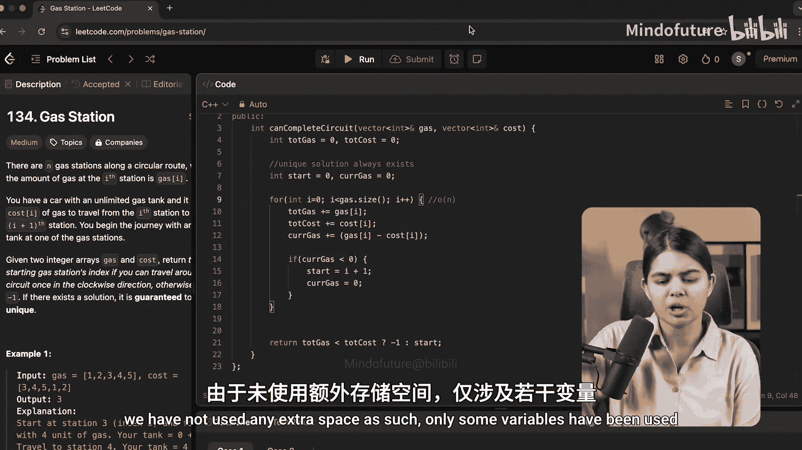

# C++-DSA课程-｜-数据结构-｜-leetcode-｜-Apna-College-｜--Complete-C++-Dsa-Course-p82-P84_L82._加油站-贪心方法-Leetcode_134--BV18oUGBkEmV_p82-

Hi， everyone and welcome to the complete DA series。 And today。

 we're going to solve an important DA problem， which is called gas station problem Kmi series Kja。

 Also， there is a link for a company D sheet in the description box。

 This problem is called gas station。 and this is also problem number 1。

34 on lead code Ab Sa Kenderas N station car data。😊。

N stations that we have n fuel stations like a patrol pump basically5 k equal5 stations。

 stations circular path travel station station station there is some cost which is involved and station is some amount of gas or which is available example visual let us of stations amount of available station cost station I plus station basically station station equal。

😊，Sa second stationjaki cost a 4 equal unit may imagine it could be4 lit。

 Second station a third stationja cost equal and station that we want to travel this entire path in a circular manner which be the station station station station lit fuel8 fuel second station cost3 basically station completely so this cannot be the answer or nextki cost lit starting point。

😊，lit next station lit say is candidate for finding out answer if it exists。😊。

opposite solution exists example。 us suppose given have some fuel values。😊，Amerpa values here 2。

3 and 4 equal equal。😊，So this is the gas area。Andas3 and this is an example。 us suppose next next。

index will end up spending three lit cost now three。

condition basically total gas stations that should always be greater than equal to the total cost station and how does it make sense basically travel fuel station minimum total cost equal stations and station and if that greater than the total gas available answer。

Important learning and this is a very logical learning。 Basically。

 our first case that we need to check is total gas becomes less than the total cost which is required to complete the case that will be equal to- that the gas is greater than the cost of the solution exist possible solution unique solution he unique indexco solution basically what we are going to do total calculate it will be equal to the sum of all of these values which is equal to 212 and total cost is going to be equal to the sum of all of these values 78。

9 and 10 this is going to be 9。😊，Gs available is greater than the total cost。

 unique solution ideal scenario fuel stations is theth ideal situation situation becomes equal total to ideal complete。

😊，id case exist in We always know that we are going to have a unique solution single index less which basically means station it will be gives us chances to compared to。

😊，griza fuelar So it is always better to start the circular tour from those fuel stations。

 Ja Zda value available to Yahiari potential solution or basicallyara solution Ka basically Hamara unique solution。

 Vo fuel station。😊，station index surplus amount of gas available g is more gas available surplus positive amount available using logic is。

😊， and then we are going to write the pseudo to sub though。 we are going to have a starting index。

Jo starting index this is going to be00 index or， which will be the current gas variable is variable surplus start with this station station current。

😊，Plus1ja butki next station per this is the amount fuel3 net will be equal to index starting index index this will give us value of as。

😊，this is going to be the starting point to even though are to this solution and is in surplus and。😊。

and now you are going to move to the next index is to plusja4 andja1 sur solution solution which is plus index plus3 fuel already available or index index plus and10 index is plus and10 is going to be。

Hekiham next station per ja， just come La Jovi starting indexni。

 This is the incorrect starting index。 Y answer Hohi。😊，station。Yju starting index Bena。

 that is going to be this four value。 The ya per a four value case we analyze Kium is by starting index sum4 pia and current Gco initialize K with 0。

 the next time start Kgi and next journey，ari Shigi。😊，station plus9-1 plus 9-1 8 lit fuel available。

 which is enough to move to the next station in manner important solution at end of iteration and this is the starting index answer identify from i equals 0 to n。

😊，H loop k the herbaka kringgi upne current gas co calculate Carnegie kos Kanggi current gas will always be equal to Jobi Hama gas of I station here minus Jobi cost of。

😊，Next station should in variables k initialize k0 and0ari current gas key value becomes negative less than0 index to plus initialize statement initial So this is the loop that we are going to use and last index as given key minus handle So this is the overall logic let us convert the pseudo into actual all optimize So this is the function that we have to complete function start sub variable initial and another will be total cost。

😊，B initialize carrying0 no variable key value co calculate k gas value co calculate K total gas plus equal to Jobiari value。

 This is a for each loop index directlyas value aja's particular index key the total cost is going to be equal to the valueki Jobiri total gas that is less than the total cost Jome Those case mayham returnne minuspa k unique solution always exists solutionme。

😊，The Yaber sub starting point picke， it will be equal to 0 andoskyarmic current Gaky value Lie。

 which will be equal to 0 Fer upne loop start carrying a I equal 0 sre Hamara gas dot sizeianni enjaecile loop。

😊，Hharb Karingaske add Kthingki。Upni current fuel station minus Jobi Hamari Ca lagne Vale next station Tjaneki Uskibal analyze Karinggi if the current gas value becomes。

Less than 0。 those case maybe we are going to find the next possible starting point。

 The start is going to become equal to i plus 1 and current Gaco B re initialize Kingi with 0。

 And last minute Jobi Hamas starting point Huse Hamyai returned Carneval。

 So this is the overall logic diskky Heham of me Savalco solve Caringgi。 Now let us run this code。

And submit it。il successfully submitted to approach as optimization of different loop in single loop complete basically gas and total cost calculateco calculate will add the gas of i value and total costco calculate will add the cost of i value and。

And simply Konaku starting point toaba， y conditionny。

The other ear condition exists Ka me minus1 return kai Nitobi starting point higher return kai。

 we can also convert this into a ternary statement。

 basically will return if total gas is less than total cost those case me minus1 return in now starting index return k。

Pterary statement hasscom use kect and this is the entire logic diskk basis parameter of ofal all so let us fix this and a a V hummibu submit correctly we accept them。

And this is how we solve the problem in a single loop a yaber time complexity go analyze according to basically harm sic for loop use and the sari constant cheese children the overalljo for loop is time complexity hojaki beoffin just come ahead the overall time complexity of the solution。

Is going to be biggo and send someni coi extra space as such use Nik Se variables used here the space complexity Hama sojagi biggo of1 the linear time complexity key we solve this particular question so if we have completed today's lecture then we can mark our attendance down in the comments I happening we can also share your progress with me on Twitter just calling up to each box can Jaga askate time multiex lecture and that doesn keep learning and keep exploring。

