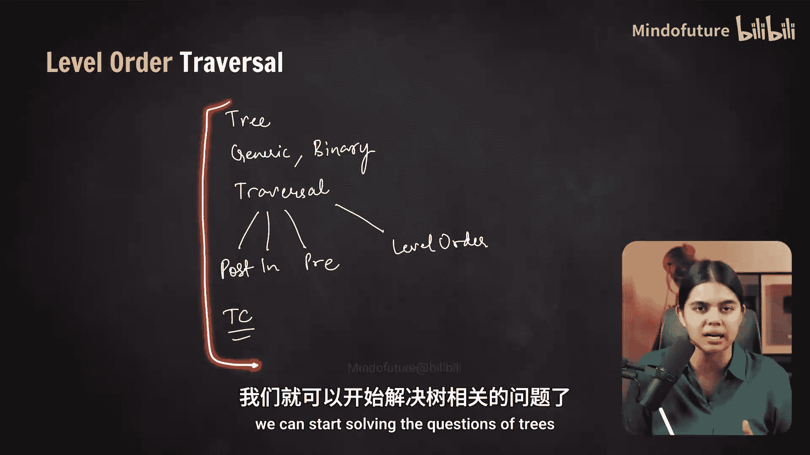

# C++-DSA课程-｜-数据结构-｜-leetcode-｜-Apna-College-｜--Complete-C++-Dsa-Course-p83-P85_数据结构中的二叉树-树遍历-DSA就业系列--BV18oUGBkEmV_p83-

Hi everyone welcome series and today we are going to start with a new data structure。

 which is called binary tree is to start with our own examples。😊，mean by。

folder have a guest user user multiple。erarch of form of of which are called binary majority questions based us try to understand what exactly are。

we imagine it in the form of nodes。 Jesseari can different different nodes imagine node and main node This is called the head of the see similar format made node or mainse root of their opposite of a real life real root starts with the root at top level root multiple branch branch or which is connected。

😊，And in multiple nodes can de co， for example， Yaham data 1 cotrocardia upper2 cocardia。

3 cocard4 cocardia， and is theque say her egg nodes in niari multiple R nodes K under or data store。

 So this is how a generic tree looks like justander。 different different data co three。

 Yes Arjo data Ja， These are all the nodes of the tree a node those three nodes sayp connect connectari tree key branches like a real life tree This the structureic Gene tree isander。

 though are important terms asin。 The first term is apparent。 And the second term。😊。

Is children or child jab B a levels in nodes level perja to next level value nodes children node U For example。

 Yaha1 is the parent node and2，3 and 4ki children nodedes Similarlyly。

2 is the parent node and 56 and 7ki Chdes node next level per jaki children nodedes So this is a normal structure of a gene per binary exactly binary special type of node k at max though children Iari1 valley11。

2，3 children that is not allowed in a binary binaryki single capas at max children binary tree convert node k。

😊，So this will now called and Similarlyly example， this is is also of。😊。

is a binary or nodeham children it has two children。

3 node node end of example2 is leaf node right6 is also node is node similarly node。😊。

relationship example if one is parent also talk about。

araja is the E Hamari 3 k from different different levels given form maybe imagine k term also Hamari 3 k。

😊，ki height specify binary tree levels once to the height of the tree becomes equal to total levels of the binary tree cha binary tree height can also be defined as the total depth of the binary tree rootest binary tree sub sub is basically a small part。

😊，Of a tree。For example。ari of main and right and right example right So this right in context of with。

😊，The root node and right right majority of the basically let us suppose problem solve for。😊。

Okebausam solve knegi k Kai for the right sri。b recur Ame root in o left sri and right srika solution。

ia， or a solution backipas vpaa。 So in dono Chote solution，ni left sri and right srika solution。

 say ahamne roote solution co calculate Karingi the final step Johogar recurion can。

 that will be to calculate。😊，This solution。For the。Root note。

his general recur for most of our binary tree problems basicallys for with let us start with basic😊。

for example， able to right。😊，St kang in the form of pointers Tomkect node star type khi though pointers who create Car ahamra left pointerga and a node starra right pointerga to y variableari left node card de y variable right node card de case we can construct a class called node。

 which will help us create our binary can we create of vector preor node up can class banana。

 let us call this node node canar。😊，H properties a public def Gal public sub integer star and node star right and right child k point。

😊，right nu and right point to nu in the form of which is called sequence What does this exactly mean example。

😊，node root sequence calculate is nu sequence two more node equal nu and is also nu。

Fhamari Purrike Pue writes ariika Di by following this rule。

ham is order sequence construct we can start with the first value first value we are going to start with should which is also equal to right equal。

😊，Left sub next data which is equal to node scan equal4 and right sub sequence sub and right complete completing the right sub of parent and right4 that is represented by right that is by k as So we have a new node equal have null node here right sub information is1 have another null node here。

😊，Sequence is structurec For example， nu which will be which will nu identical which means form given which basicallycur logic let us。

😊，Mimise this and I recurs logicka root left and right sequence basically starting that is going to be the root noteer。

😊，Let us create a pointer which we call index ham index pointer link bar update and her value say node index per or index node createneari index pointer to traverse this preor sequenceari pre sequence availableri binary node we are going to create a recur function called di pre sequence co pre sequences the or vector and index variableing Jocurm index update nodem index variabletatic variable call per will create a static in teacherger variable called index and I initialize with。

😊，The index valid value and rules index for example。

 if index is pointing to this node will create a new node let us call。😊。

And the Yahapper Hammni new Nord go create Karinggi。Pre order sequence can there。

Index value both important step perform that is using recursion is same function and right basically11cur delegate what we are going to do function with。

😊，and or is basically and that。😊，V by passing the pre order sequence here。

And second rightbeliev or right。😊，sub important index initial to index value say update index plus to be able to update the values which is missing let us try and minimize and remove with logic is equal index function index value node with index value。

😊，one to Yapperli I9 node。😊，1 function part is basically This part is the right。😊。

root node22 will be created here in the left part important node root node root is basically nu't want to create node with value of condition。

😊，existing code and that condition is index me or right。😊，Yanni Yahaa I important base case。

 Igaki khibi Agarhamari p order kander index per value here that becomes equal to -1。

 Those case made directly。 Yahase Hammni nu noded go return justkala he Yahapa2 k left s kander will have a null node and a null node jobb return。

 Hoie to2 k left child ma root k left me Matla 2 k left me Hamari pass return Horagi I null value。😊。

JC null value return hookkuragi。The which is similarly as its right。this is。right right right。

To we have a five node 5 right51 and right plus at the end of sequence complete connections connections node or return this connection is return3 is to attached with this node valley node root node with the help of this code and this logic。

 So this is called building a binary tree with the help of。😊。

sequence order sequence importance logic problem root let us convert this pseudo into vector of inte。

😊，Pre order， sequence him。Jo Mariippa is Pri sequence killes subse ecstatic in teacherger variable create curling a index disc to initialize carrying a 1 k herbar function can the subse index who plus as curlinggi howme subse up Ne root node equal create Kai。

😊，With the help of the pre order value to index by Jobi value as a root node code create Carringgi。

 Oque Ba up build the tree co call Kringgi。😊，For the same preder sequence。

 As Kai of B de triera Sri Bnaka dedega to left Sri jse Byaham play rootka left child Bdega。

 same assumptiontionmi Ai Ruka， right child Uke Baga to Briko call Caringi with the same preder sequence。

😊，index is logic。😊，I a Jome Fu really here top JCaripa rootgaham verify curec name root K data co print kvaer if we have the correct tree or not。

😊，In fact， the Huper end of Lang Najaga， let us run our code。And Amerpa print hook Rajaga 1。

 Joki Hamari root car data，ch root car left childca data and right childca data B printer as。

 the root K left childca data。😊，And write Chika data， which is the Rkiem Hypaajaga。

 let us clear this and run。😊，The root is the same with the help of this sequence is function complexity function logical function function key value basically What exactly we doing are basically traversing this sequence sequence equal complexity function key is going to complexity So this is binary Now next we are going to cover。

😊，Concept of three tra tra count total number of maximum required to visit to travel all of given。😊。

major and the last one is post。manner。function called。😊。

Left and j same function next time right So these are So。😊，root equal are function。

and right let us are write function。sub base case root value becomes equal to null Those case may simply return sub root traverse with some space values and then pre call for root sub。

😊，And root right Yahamra writesri preaual perform and Ya for root and me end of line。

 So let us save it and run our。 preal print If we talk about the time complexity of thisrigar binary tree given him。

 And let's supposeari binary tree na pre traveral a iteration a andki。 In fact。

 Agar binary tree on average n operations perform n calls So that is why the time complexity for pre traveral is going to be bigpa pre we have one more traveral。

 which is called in audit traveral in audit。😊，then writes and then we are right。😊，say for example。

 if we start with the route， which is are So this is the sequence that we。😊。

Base case is basically kbhi B aga root he value becomes equal to null。

 Those case may hum simply Kaja return。 So this is how in audit traveral is going to work detail may be the exact inal basically k root the root note1 k equal we are going to start this function with root as one1 is not equal to null sub ino call kgi root kph rootju2ja2ari root22 kja。

 it is not equal to null。 Those case may root kph per root kph per2 k per we are now on this null。

 In fact， Sain nug。😊，the right of visited entire and。😊，But we are going to move to4 Kaaichi。

 which is Nll Backt Kaivappa 3 Perrangi Aham 3 co visit Karangi and finally last mejaar5 co visit Karanni。

 So this is the sequence that we are going to get after following these rules。

 So let us convert this code into C plus code。😊，Though next traversal jkyhamba Kne Val。

 that is going to be in order traversal。😊，To in order traveral k hum similar sub functional colium for in order Ja per hum root couldpa kinggi。

Same base casebihi value nu equal。 we are not exactly saying that this is the one prime root of the tree Yaari Nor basicallyariarija we are going to return in order call forni。

😊，Left heli。Then we are going to print root car data with some space。

And Ferham in order could call Kinggi for rootka。Right。

Main function can the hum in order co call laga pan， let us save this。And run。pa output21，4，3，5。

 This is the same output andki in orderal at least So the time complexity of this algorithm is also big of note even though in order sequence that sequence in both of the traver is going to be different。

 That is why y different algorithmski a different different algorithms onlyne seeal which is called post last me visit the rule basically saysham let's supposeari andri。

😊，example equal So this is the sequence that we are going to in post。😊，Roveral can there root k。

Write Kni and Uke Baham print K data。 So this is the sequence that we are going to follow and N condition Samgibigam Nvaana ask simply return let us write the code for post order traveral post order function。

 let us call this post orderarival。😊，A subopna base case liing a a root he value is equal to null。

 Those case mayam return Kajagi simply nahi though humpost ordeco call Kaneval for root car left。

And for post article call Kinga for rootka， right。And at the end。

 root data with some space the upper main functions I calledal we are going to get a sequence this time。

 which is2，4，5，3，12，4，5，3，1 is the sequence basically sequence right in in between and right So these are the three most important traal or。

😊，case there is one more important reversal justham。

 which is called level order reversal hum level audit reversal could cover Kanivallehe with iterative approach。

😊，Iteration loopki level complete level order tra binary travel level nodes print level second level third level generally tra categories graph These categories are basically。

😊，And B F S， Abiham Unasza D F S BF S Co covering encouraging a members basic tro as our overview of the Negi Gu Cur。

 D F S stands for depth first search。And BFS stands for B first search。😊，D and is called are two。😊。

hamari DS based approaches level audital breadth search in concept full detail cover the level audit reval can basically level wisep node level wise node travel we are going to make use of a Q data structure。

😊，Yea a Qcom C Karing orki helps ham notes for travelring。 Basically。

 the logic that we are going to use isring subses de k equal to onehamb is going to be greater than 0。

😊，and right。And is the same process from repeat Ka。

 And next time Hamari Q K front pit2jaham2 vjo note he， I he as pop Kingi。

right and and this is the order that which is basically。

The steps that we are going to followri Jo and and can simply print that value and right given that those are the upper first condition is not equal to those case may。

And similarly， a current car right is not equal to null。Those case may cu candleander humbu Kingage。

Current key。Rightite Nor is and on average complexity。

 that will be bigverse So this is the same sequence that we are to convert we are going to now write the for star In。

😊，Apnelia ofnicugo。Anjaemnias andnikotaaria size is greater than 0 Yatati subseovnikonasese andusky vluko printva with some space。

😊，Fair Oska left child and right child kill values quocheing him。

 heuged Jobi current a current call left。 if that value is not equal to null。

 Those case make you can push curing ofm。😊，gar歌。Lift。Similarly， if current car。Right is not equal to。

Nan。Those case may cu can the humush king k car。Right。

 and this is how we are going to print all of the values in level order。

 and at the end hummick end of line， B print curane。

 So this is the entire code for level order reversal I main functions a call cur for level order。😊。

And is Bahammy upper end of lying the aru him。So let us save the code and run it。 Now。

 this is the output that we are going to get for level audit reversal。

 A level audit reversal can thepa output I I Maari Nor level maygahamme8 level nodes different lying the print those is the。

😊，For example， if this is the tree that we have toham Iki node 1 agar first level per first line2 and three second line and 4 and 5 next line Iri outputri produce is output could produce same use to different nodes for different line metroverse。

 that is basically by finding a way to mark this end of lineri2 or threeja next line insert tohamja we are going to use a special node。

 which is the nu to next linene。😊，Haak Nll Noko in K， for example。

 Yahaa Le orderveral me Hamnes Se Katharko I barru k Hamush Knehem。😊，is equal to null node。😊。

我すケど没了作て。P is basicallyaura traveral complete Ya andasari second level next。😊。

First and second case simply and and present in。😊，Pping a null element and Hamari Q K under or do say elements presented Kkaa B0hi Ukalami simply obtain next line character Gova。

 The first case basically says Yapa Jese Hamripa Nal Atai and Hamari Q is not empty。

 Q of K Nehi Ikalahehammi simply see out Knahe end of line。 This is the next line case。

 dis my Q is not。😊，Emp and means basically。😊，Tob non empty v simply continue G。

Next line printque Nko continue or else。 So this is the change that we are going to make to our existing level audital to print all of the level wise values in different lines in the output and。

😊，K is non empty。😊，elements is empty non empty v whose case simply end of line and Q reinsert current value and next iteration continue because if we don't continue those case and then we are going to come to this statement definitely So this is the most important change that we are going to make to our function and output So this is a big change in the output level level depending upon the use cases largest element。

😊，nu character and that is why conceptually this is a very important concept also what tra looks like also discuss the So these are all the fundamental concepts which are related to。

😊。

This is the lecture and lecture a very understanding trees as well as graphs in the future if you have successfully completed today's lecture you can market in his now in the can share your progress with me on Twitter description and keep exploring。

😊。