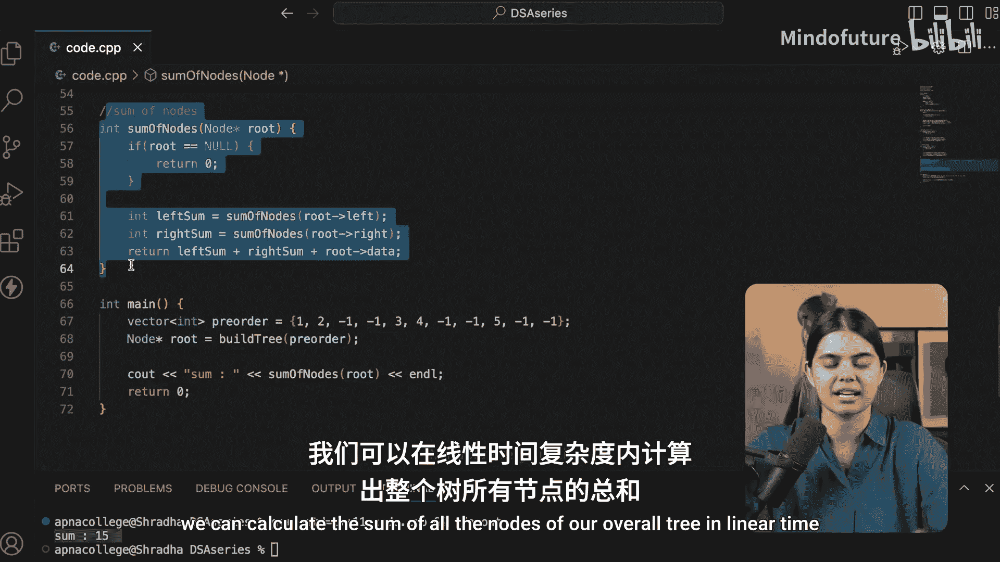

# C++-DSA课程-｜-数据结构-｜-leetcode-｜-Apna-College-｜--Complete-C++-Dsa-Course-p84-P86_L.84_二叉树的高度-二叉树节点计数--BV18oUGBkEmV_p84-

Hi， everyone and welcome to the complete DS series。

 And today we' are going to solve some important conceptual questions based on binary trees。

 I concept。 Also there is a link for a company in the description box。

 the first question that we are going to solve is called height of a So basically binary tree which is given to us binary tree given is key root which is given So this is the function that is given to us function is key root given orme key height who calculate orse is function So how are we exactly going to solve this question。

 basically height of a concept lecture height the maximum depth of a binary tree。

 our example is levels exist So is key height equal calculate。😊。

The riikaio exist cur then just where have basically height code define Carha as the maximum distance。

😊，From the root of the tree。To any leaf node， for example。

 is leaf nodes node node and right for example， root is going to be2 is distance measure in the terms of the nodes1ga is to be31 is going to be3 the maximum distance equal So the height of the is going to be equal to3 binary calculate generally basic that was calculate。

😊，The simplest way sometimes to do that is and right or we only look at in this。😊。

and right subrigi aga2 k equal right subriham individual Iipas maximum deta2 k equal to I functionrias left subriki and right subrija to formula logic overall calculate for this root note definitely there is an answer that exists。

 exampleari root node left subriip equal right subrigiip2 equal height key definition K height is the maximum distance。

😊，From root。To leave。To basically maximum distance exists that is one。

 and right maximum distance exists that is2 overall right root height is going to be the maximum of both of these values or or calculate right calculate or rightm plus which is equal to basically recur。

😊，Why is this going to work Because obviously and on this assumption and right root level is going to be the maximum of left height。

😊，And right height， Jobi maximum value H Ivo lift Sa， Chevo right Saar。Plus1， Yhujai Hamari Leper。

 Hamari。Overall three key height， and this is the value that we want to return from the function。

 So this is the overall logic just k basis per hammnet3 key heightco calculate carrying it Ebar said dry and kemp processco。

 How is this going to look like， So basically， we are going to start with one。😊。

ari root directly nu is empty empty tree nodes a single node is or root is equal to0 is base the root is equal to null is no height So we are going to return value So it is always important to have a base case in the not going to the base2 to base。

😊，2 leftri left subas nu value right， maybe nu value the two se left subang the left subari root value nuge0 equal the Yahai backam2as left value I 0。

And same call root right sub the2 k right subpa same valuegi which is going to be 0 to2 per we are going to calculate the height of this v with the left height 0 and the right s height is 0 formula height right height maximum So the answer is going to be1 is sub equal which is also true2 valley level per return1 as the height of the and v backt k maximum height logical height as1 So that is the answer that weve calculated for this calculate calculate right。

😊，To logical3 calculate3 calculateja to3 right right4 overall height that will be the maximum of0 and 0 which is going to be0 plus1 height to3 return Similarlyly3 right right value return equal3 value return write value return what is going to be the height of say maximum of1 and 1 plus1 is going to equal to right return equal to2 So now if we try to。

Summarize this to basically Hua khib， abiham 1 per cadihe root per left subna height，1 return keyhi。

 right subrina height 2 return keyhi， abiham per 1 kilogram overall height calculate carrying it。

 This will be the maximum of one and 2。😊，Plus1 max2 plus1。

 which is equal to3 to one which is equal to3 overall binary calculate with the help ofcur logic exactly one time because what is this logic logic is basically Now let us convert this logic into。

😊，Sa P will try to calculate the left height just kleham of the height function go call carrying it for root call left。

Then well try to calculate the right height， which will be returned to us through this function root car right and Uke bottom of current heightco calculate current。

 which will be maximum of left height。And right height plus 1。

And Yahai returned Kane me overall heightco。 I hope you plus1 k logicicmi cuki left and right child upni knee heights there the hammnic current root node Q be a Knaar。

 So that is why we have to add a plus1 at each level。 cuki herbajam level of Kari maximum height。

 at least by one increase K to Yahaer。 This is the function that we have。😊。

am already call main function。 y already construct using a function。

 we are going to print the height and the height of the tree is equal to 3。

 So this is solve the problem of finding the height of a binary tree next is to count the nodes of a binary tree basically binary tree givenri count1。

2，3，4，5 count that should be equal to which basically meansrija rightri。😊。

And right subre key nodes count Yni 3 Ajate to cam k Hamipas overall sari T node count Aga。

 because overall tri and the kidney nodes here left sub3 plus right subre key nodes plus this one node。

 which is our root node to one plus 3 plus1 jam kt Hamipas overall 5 sari Ca sari nodes return Orajagi to ecalate the function will basically look something like this。

😊，ander teacher count Namka function rootringgise left count calculate left count is sariari left sub notes count count function callgi for root Ka left same logic useki Sa count functionari overall3 keyri notes count definitely function left spri right sub notes to calculate kri key notes count kringgi。

😊，Similarly， Im right， he notes who count Kane I see count function Co call kque Jcaander I barmne right child Coas Cardigi and the overall count that we are going to return。

😊，Is going to be。Left count。Plus。Right count plus1 to left count kla left subre counts。

 right count commit right subre counts， and plus one basically hamm me root calls a count K and y B base caseipas Cjagaki kbi Bipas S R3 exist k just can the co node vper count of nodes is going to be equal to 0。

 Ja single node have vper count of node is going to be equal to1。

 The base case can0 va case count k generally majority binary3 schedules v base case me the root is going to be null because generally base case myper exist k Ja root can J3 he exists Neta。

😊，To root jahaa Nha Mahaa， we are going to return 0 Azar count。

 Tuskohi to Hammed Dran kam We'll start with the route。

 routeam kringgi route up subriki Norko count Karega22 kpa left me right men Na as 0 return Kagabinal 0 return Kaga to2 key total nodeja 0 plus 0 plus 1。

So2 is going to return one as the final answer to1， Similarlyly， one writerico callga 3，3。

4 co callga 4 return k1 35 co callga 5 we return3 pass and right the three key nodegi1 plus1 plus1。

 which is equal to33 node33 return1 k and right So the total count is going to be1 plus3 plus1。

 which is equal to 5 So this is the overall logic andki is logic node traverse。

 This is also logicri writeri operation perform on the root I complexitygi that will be function them function is we1 to count nodes in the three。

😊，The Raja， let us create a function。Call count。Janiparinggi。Root key value， if becomes null。

 those case may。 the count is going to be 0。 Neto sub Pham of may left count co calculate Kingate by calling this count function for root car left。

 Then we are going to call the same function to figure out the right count to count function co call Kinggi for root car。

Right， and finally， we are going to return the left count。Less right count。

 less one as the final count of notes。So Ya Haja is barham。Count of notes who calculate Kane Valley。

 Let us save this and run。To Maripa total notes equal。

 and this is also a linear function just commonly inta， which is to calculate the sum of node。

 This is going to be very easy for all of us。 In fact。

 you can pause the lecture here and you try to solve this question on your minute sum of notes calculate almost overall99 same logic Recur key root given sum of notes key notes canbi calculate So that is going to be1 plus2 plus3 plus。

😊，4 plus 5， which is basically going to be equal to 15 to 15。 Kistoris I Maripaagga。

O re Agaham Ki cheek Ru。Tokiiri Agarhamippa left Sri and right Sriki Norka saja。

 Tum over triki Noka Matab Agarhamas function has some in recur function。

ru oris functionirise Agarhamippa left saja Joque Aga is the same functionruga and right saja。

Juquese Aga is the same function code of him called carrying a root K right killer。To inno function。

 say right， it is going to be equal to2ki right3 plus 4 plus 5 this is going to be equal to 12 right should be equal to 12gar and definitely there is a very simple or and recur that is going to be。

😊，Plus， write customm。Plus， root this is the value function return value is to be 2 plus 12 plus root which is equal to15 from our function is equal to15 sub smallest problem such smallest problem case Then what is the sum of node to be0 because there are no nodes there is no the sum of nodes be node but we dont know that value sum is going to be0 if the root equal to null。

Those case may we can return the sum of all of the nodes as 0。

 So this is the overall logic per sum of calculate will start with this which is going to be equal to which is which is。

 which is going to be 4 plus 5 plus 3 plus 5 plus3122 right22 plus 12 root is going to be11 equal and is sum node calculate this is also post logic。

😊，s and then we are calculating something for the root complexity that is The last chapter all of these are easy fundamental will function to calculate sum of。

If the root of the tree becomes equal to null， those case may3 can the coia。

 the sum is going to be 0。 Ne those subse Pahammna left sum calculate kringi using the same function。

 just can the root leftham pass carneval。Oskeba Hna writes some calculate cutting game。

With the same function， just can the root right pass carrying it andus bath。

 we are going to calculate the overall sum overall sum is going to be left sum。Let's write some。Plus。

ari Ruka Jubi deu。So yaba， let's print the sum。Of note。And executed。

 So the sum is going to be equal to 15。 So overall three sum calculate in linear time complexity difference cover height of a count of notes and sum of notes Eino although easy level questions But these are important questions。

 especially first time binary three scale logic。 So if you have successfully completed today's lecture then you can market in is down in the can also share your progress with me on Twitter box next lecture learning and keep exploring。

😊。

