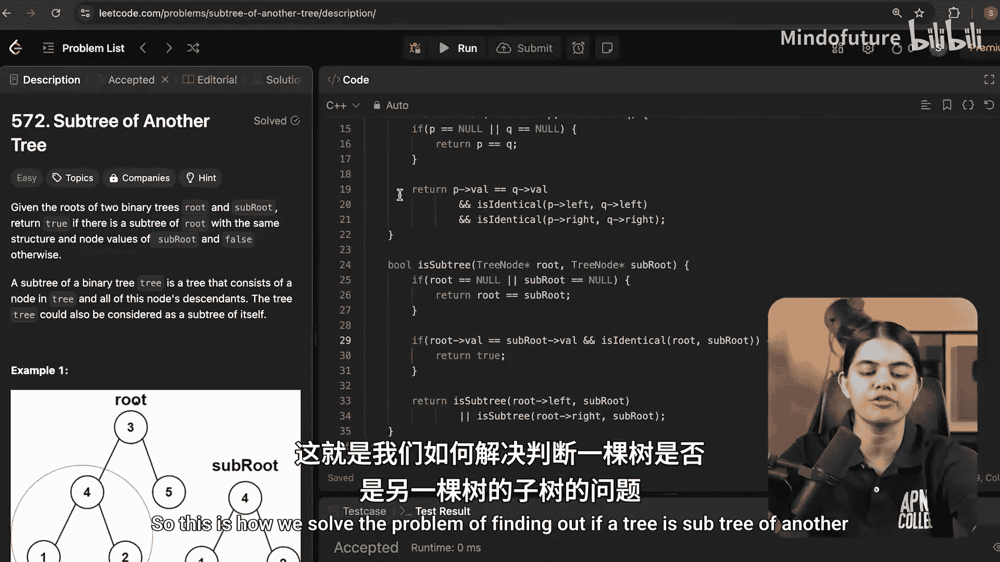

# C++-DSA课程-｜-数据结构-｜-leetcode-｜-Apna-College-｜--Complete-C++-Dsa-Course-p85-P87_L.85_相同的树-另一棵树的子树--BV18oUGBkEmV_p85-

Hi， everyone and welcome to complete D series。 And today we are going to solve two important binary tree problems。

 identical tree and subre of another tree。 Abbicalvagavalnemikda available mijaga。

 Also there is a link for a company by sheet in the description box to start Ka with our first question。

 This problem is called identical tree Ya Iham's same3 Volak。

 And this is problem number 00 on Le code Abbi Saval Karipas， though3 in Jinky roots given。😊。

Let's assume this is the first tree root given。 This is the second tree。

 This is the first example that we are considering identical answer boan what exactly do we mean by an identical tree identical in terms of identical root right because are identical but。

😊，value is1 value is1 left child exists value is2， but child exists is a difference in terms of structure identical or false because there is no child here and there is no right child identical for example identical right are not identical basically logically we can check for all of the nodes in both the in of。

😊，And in terms of values， identicalham first basically identical identical identical identical is identical and root equal to root。

😊，qu Q or identical identical identical function identical or not and function is identical and for identical is this function right。

😊，And upne cuarite。To check if the right subrees are same or identical or not。

 So the say subsehamm subre kingari subrees identical yaning。

Jesse isvi identical right identical which is to check for this current note simply is root value is root value identical right identical or root values identical Je is root identical identical false identical root matchgi identical and right identical basicallyino valuesgi。

😊，Is left same Mula left sub identical Honache and right sub be identical Honache。

And Hamraju P key root key value here that should be equal to Qk root key value。

Theo values equallaino conditions match carryingino a false false exampleru valuesla but left values false or false return what can be the base case for this recur function base p for example aham example If this is the p and this is the Q。

😊，Agarari P and those case false return identical opposite case may beme false return or identical8 cases cases in cases simply write a very simple statement。

 which is let us minimize this first and the simple statement is。😊。

simply return p equal equal false is identical。Check for the third condition。

 which is is the value of p root and Q root equal equal are going to be identical。

 So let us convert the pseudo code into code function given here。

 which is of boolean return is function is case p equal equal Q sub。😊。

Kiahamari left sub same h just we are going to call this function for Pca left。😊，And。Cuga lift。

Similarly， hum write sub three same hairosscalecheing it。

 we call the function for picharite and cuarite。 The last may we want to return is left same and and is。

Right， same。An， an。Jobiari value Hamme mildre Ya peaky value。 is this equal to Qki value。

 So this is how we going to write our recursive function and Qki is function Ma ham k Har single node perja。

 basically check single load per left right subre analyze K Ph noki values score compare k donoki single node egg bar w in case of identical agarari size n K equal。

 those case may complexity we go of N equal the let run our quote。😊，And submit it。

 So this is how we solve the problem of identical subre。 I he his add multijuic problem O here。

 which is to find out if a tree is a subre of another tree or not。 Let us try to solve this problem。

 Is Savagnder Hamipas， though tree is given him。Aari mainkyipas root given he and aas sub givenipas subroot given。

 So this is the subro that we are given yaura， as it isari main underhi for example。

 isahas me Ib is the exact same subla I return true value this sub is a valid sub of this main binaryri Butriska opposite exampleas。

😊，Those case may hamap search khi Hammeta ye ato exist kthai left sri v same， which is equal to 4。

 per right sri k yha to butha Just case me hum true kge falses return curhi because yea3 as it is isander exists inta In fact。

 I core example， O Je say for example，5 kbi upme left child Hota， Let's suppose 7。

 Those case may it thinner to y exist k but5 k left me yea a left child exists curth main k exists inta just come at head。

 this tree is not a valid sri those case mayam falses returnri y。😊，Main7 as。

 though this tree is also not matching with this tree main identical identical part is what do logical。

😊，Example second is going to be true。 logical in the main。😊，example。

 and identical identical question identical identical identical identical identical。😊，Haari Saruot。

And main identical do we exactly find one or example。😊，e and is identical identical。😊。

ki this value could also be 3， and this could be 4， and this could be 5。

 and ande is identicalki we talk about in terms of the function。😊。

So Hamari pass areikaze function Noga， let us call this function Boolean。😊。

Is subri is sub function K E topaari Ru Agi and aasari subriki subru subsehamhiki nodejoari1 v。

 If this node is identical with this node1 is3re subseo conditiongi Agarham in3 V identicalla Agarari root key value。

😊，Becomes equal toari sub value。 And identical is identical is same value functions call it is identical is identical root and for case may or for example。

 which basically means。The Abdjo Spri Don Kahe Mohammara left Spriri Gagaya left Ch Gariga。

 Toham is a Sriko calledlai。For root car left。😮，And the same subroot。To answer。

 agar right return isri those case may return true arigo and second call similar rightrigomam right。

With the use this or and So these are the basic is of another or right in the base to。

G 값 희비 아げra미 바 time。He root a subruot may say a v value nuoi Malayato root y value becomes equal to null Ya subroot He value becomes equal to null。

 Those case may hum return Gnevallere。Root。Equal to equal to subro because they are the same but false return So this is the same base case is identical function case and this is the logic out if the is sub of another or not So let us convert this logic into the is the function that we want to complete that becomes equal to。

😊，Equal to equal to subroot。Nto ham subip check linkiki Kiaari rootki value。

Is equal toariruot value Don Dono values Agahe bath and and K kham is identical Kegi is identical make the route pass Kingru pass K Agarom thoseham returnmenari Job orhita Sri or right Sse Those Ca maham returngi。

😊，Is sub。For root car left。And。Subroot。Or or is sub。Of rootka， right？And art。Sub。

ner identical write logic identical function identical。😊，Note P。And three note。Ca， disma。

 this is the similar logic between A Aga Ki P Najata， Qjata。

 those case may P equal to Qhamme return Kna nahito。

I me return Knaya basically the combination of three values and the three values are。😊。

K peak key value should be equal to Q key value。And， and。Is identical。For Pa lift and cua lift。😮。

And and is identical。For peak right。And。Qga。Right， though is a different line scanderham structure Curletam。

 that values in Donoki value Alex Man directly Tinoino values true see Caham function rule theranneleam。

 which is going to be。Subroot key value。 Let us now run our code。And submitted it。

So this is how we solve the problem of finding out if a tree is sub3 of another three or not。

 so if you have successfully completed today's lecture then you can mark your ins down in the comments I case Smi can also share your progress with me on Twitter just cu Kakunische description box canander mijaga Askate9 Mil next lecture can tell and keep learning and keep exploring。

😊。

