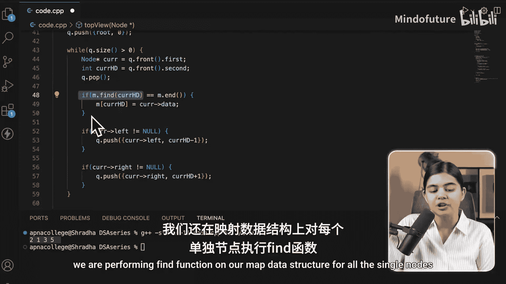

# C++-DSA课程-｜-数据结构-｜-leetcode-｜-Apna-College-｜--Complete-C++-Dsa-Course-p87-P89_二叉树的顶部视图-DSA系列_-L.87--BV18oUGBkEmV_p87-

H everyone， and welcome to the complete series。 and today we are going to solve an important binary tree problem。

 which is called top view of there is a company problem is called top view of imagine that for example。

 this is first this is not a we to print。😊，hi So this is the final answer that we want to print as the top and and for example。

 if we at vertical vertical will visible Similarly include this will visible and how exactly do we calculate the use concept ofalculating。

Distance horizontal distance， exactly hamki clearjaga， but kbibigahampa topka。 in fact。

 Itatava bottom Yuvaham horizontal distance Naki jco calculate basically Jbium topkimea root of the binary trait or top include hoki Agaham top level say they。

 So this is the first node Jori binary exists k the root node Hamisha binary tree include Ho。😊。

And Ugar Hamm me root node get through Lejae Valley a line passs curib。

 and I see Terrike say hurry e level of nodes get through Hammi therikiki vertical lines gopaqueib。😊。

single coin single line per for example， equal and  equal this is the first line the first line This is the second line is the third line is the fourth line1。

3 and and and that is level order tra。😊，am order lecture This is levelal and and fourth or vertically segment or top top top what exactly do we mean by this horizontal distance basically distance that is equal to basicallyse。

😊，Sayni number line origin imagine number number line is theri。

 this is the origin am left k distance negative right distance positive This is basically the x axis in the graphbi axis imagine root of the root kgi horizontal distance calculategi that is going to become1 j right distanceja plus and single node horizontal distance calculate let us first look at the values level horizontal distanceja Similarlyly level right horizontal distance plus8 level the distance becomes1 or right distance becomes plus1 node。

😊，left child and right childca horizontal distance that's going to be very easy。

 node k aham leftta left child ariska distance D So this distance is going to be d1 or right child distanceja D plus1 equal yes information Similarlyly3 k left childca distanceja plus11 that is going to be 0 and is right childca distanceja plus1 plus1 that is going to be plus2 this horizontal distance is equal to 0 this horizontal distance is also equal to 0in B nodes distance R don don nodes same vertical line k U horizontal distance key numerical value Yet the identify nodes same vertical line k U Similarlyly aham calculate0 left distanceja1 right distanceja plus1。

😊，Jkala ye dono nodes jin horizontal distance1 and-1 head same vertical line cube exist and don nodesin distance plus1 n plus1 same vertical lineium a single node specific horizontal distance key value nodes horizontal distance same nodes same vertical line or information 0 and0 horizontal distance node top node level order traal1 and 4 say level order traal sub1 is the node includeringab 2 and 6 k level orderal sub2 is the node include And this is the overall strategy or the concept。

😊，Thisk Uer hum top view of a binary tree valley ofalcoalthe。 So to summarize。

 what exactly are we going to do hum upne。3 per level order implement level wise travel level order sub。

 because this is one of the most basic codes binary exactly Q bar bar different question as it is to my assumption is Q level sub In fact。

 Ya function can level code This is the function complete。

 which is called top view root given is function can sub will have to use or include a Q data structure sub Q generally level order node star。

😊，Hm tree key Norgo include curtheham and Q and hum push cur subse root of the tree。Okeba luimpt。

 in fact，p Kka size is greater than 0。ri Q kbiem k in the form of this current node and Q Kni Noko Ukeba generally outne Nor deko in level audit reversal paris deko print Kagirukeba agarari k k becomes not equal to nu。

😊，Those case can Q maym push K current caliph。And if current car， right。Is also not equal to null。

Those case may we are going to push kka right in the cube。

 So this is the overall entire logic of a level audittros supposeal is Q node level calculatemus horizontal distance calculateum level reval horizontal distance B basically is single node will start with the root node which is equal to1 and root horizontal distance equal to0 equal So this is how we going to store the node as well as its horizontal distance inside level basically node。

😊，Hara Jovi horizontal distancevo node top Jesegar1 k if the horizontal distance is 0 and 4 k the horizontal distance is also 0。

 but level audit reversal makeki k horizontal distance first time or4 kjaba horizontal distance 0 already I1 co as our answer to4 k perus horizontal distance key unique value first time each first I track we are also going to use a map。

😊，hamic map use kringgirum track kari horizontal distance key valueari node first time exist for example。

 horizontal distance and horizontal distance0 k corresponding1 horizontal distance0 horizontal distance top ignore Similarlyly levelal and k which is going to be2 with a horizontal distance of1 and which is going to be3 with a horizontal distance of horizontal distance plus node next time。

😊，21 horizontal distance this is also occurring for the first time is inside the map to3 that is also occurring for the first time and with horizontal distance of with and with horizontal distance of with horizontal of of horizontal distance process。

5 kilo horizontal distance plus2 first time plus2 with the node and at the end of horizontal distances answer and ordered do we needest and this answer is equal to this is the overall。

Lo is a basis per up not top U of a binary tree calculate current game Ab this logic can。

 What are the exact changes that we need to make to our level order traersal code。

 Basically sub L T justcom change kernel。 That is Kep Q can Ahamic pair store kvani volume。😊。

Of the node pointer horizontal distance， which is an in teacherger valueander we are going to store pairs of nodeer and in teacher value pair along with the horizontal distance also need a map in in let us include a map in our code map include basically horizontal distance and nodeer is not going to make any difference and root along with its horizontal distance which is equal to0 similar Q。

😊，In so that will be Q dot front dot first and horizontal distance So that will be Q do dot second value and this is going to be an integer value horizontal distance horizontal distance horizontal distance dot the current horizontal distance。

To yea distance Agahammin Nehielai， if this value is equal to map dot n。

 those case may map canander current horizontal distance ke is equal to current card data And left child k K I A B horizontal distance kar to ya Agarhamari current nodeka horizontal distance is current horizontal distance。

 Then this is going to be current horizontal distance，-1。 Similarlyly。

 this will be plus1 Ya pair kkana with current horizontal distance，-1。😊，And Yahaper。

 it is going to be current horizontal distance。 plus one。

 So this is how we are going to push the pairs。 And is therique Hamara Pura kura level audit traversal He Jam complete carrying。

 along with the calculation of the current horizontal distance for all of the notes。 And at the end。

 Hamraju map Hoga I Ken Hampariari horizontal distancesky valuegijori top view K to the end up map Kham loopasakam。

😊，Though let's create a4 each loop。 Just kander will have an iterator on the map。

 or humm simply see out Kinggi， Hamari iterator Kder Jobi second value Hoge。

 along with a space tosari Kisari Machijo values him， Mohamas Pertokarajagi and Yahai。

 let us call this function。 top view of the binary tree。😊，And the answer is equal to 2，1，3 and 5。

 Similarlyly， to 21，3 and 5 was the answer calculate。

 So this is the overall approach binary top calculate complexity to basically question binary U level perform node N K equal level complexity equal is function level map data structure U function B perform for all the single nodes function for the map data structure in plus plus is function k time complexity log n k equal time complexity will be n log。

😊。

Apkuap the kga is fine functionty from Le。 that is assumed to be bigov one， which is incorrect。

 kky C plus a scanner， unordered map。😊，Hami bigov1 time complexity data practical case scenario ksi per normal Jo C plus mapham login time complexity data。

 And that is why the overall time complexity of the solution is going to be bigov N login。

 So I hope kashi lecture say Hamra top of a binary tree ca logic here form me crystal clear Hoga I case me I see a Milta Juta Savalhe。

 which is called bottom view of a binary tree。😊，Bottom view of a binary tree aham is particular 3 k calculatec carrying it those scannerme bottom say Ani node the kgi 2 second node the kki 4。

 third node the k 3 and fourth node the k5 k。 So you can also try and write the code for bottom view of a binary treeea question completely clear。

 The bottom view is other difficulty inche this should also be a very easy question for us。

 So I hope that you complete this question as a part of your homework problems。

 If you have successfully completed today's lecture， then you can market in is now in the comments。

 If his me can also share your progress with me on Twitter justkuni description box can Ask with the next lecture can key learning and keep exploring。

😊。