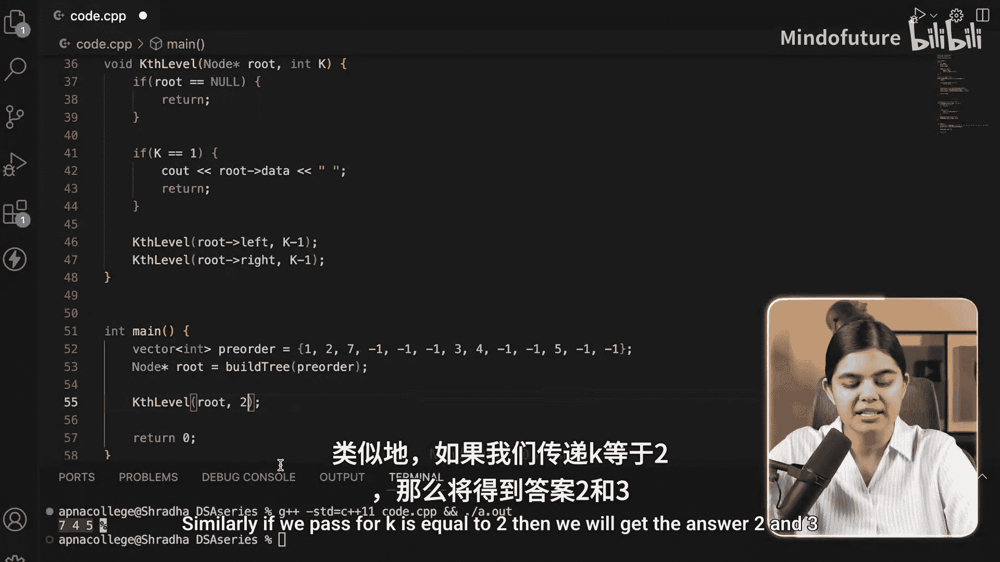

# C++-DSA课程-｜-数据结构-｜-leetcode-｜-Apna-College-｜--Complete-C++-Dsa-Course-p88-P90_二叉树的第K层-DSA系列_-L.88--BV18oUGBkEmV_p88-

H and welcome to complete series。 and today we are going to solve one more binary tree problem。

 which is called k level in a binary tree concept per。

 Also there is a link for a company in the description box this problem is called k level of3 I are given this binary are given the root of the3 andari k we basically have to print all of the nodesari binary tree K K level perander it is already implicitari K is going to be a very valid value and measure binary treeanderju root that is going to be level k is equal to1 This will be k is equal to 2。

 and this will be k is equal to 3 the third level perri nodes says 7，4 and 5。

 So our answer is going to be 7，4 and 5。😊，to solve this problem。

 we can also use level audittrorosal Yahammii iteratively be solved kecttin recursively solved kecttam。

 but because the recursion logic in binary trees is generally simpler to write tohammi Savalco solvele recursion logicco use carnivale and how exactly are we going to solve it。

😊，ham function level or root given root levels So this is the first level。

 this is the second level and this is the third levelcurche per instead of increasing the or distance。

😊，J root k childter k value decrease by1 valueja equal same g right k value decrease by equal2 k byja equal level1 that is the first level levelari k value reduce is equal to k equal to give a demo of this。

😊，What exactly are we going to do， which is the root level value equal Jeche is equal1 is equal1 equal So this is answer I same problem value equal basically root is equal right value or or Q or。

😊，value02 reduce specifically notes value1 peripas available So the logic that we are going to use for thisanderip function。

 which is called K level return typeas root and value。😊。

A me simply check Knaigar k perari kki value1 Hoka base case we consider K。

 which is the root node case given he agar is equal to1 first leki values to Ya root node k kki value1 given root or vus return to kbi kki value to。

😊，me print Gna， Ya outna A de。And Yahasi Ham simply Kajai returned。

 Neto will go to the left and the right child。 Let's bring this here。

 Nato Hammni Ke Lelki called La Gi。For root car lift。

And left me Jesse Jgi kkoarding a -1 similar call him Lagane for kth level。

For Hamari Ruka right and Yahabbi came -1 right hiter of Jawe to Hamari expectation A recursively Agar Hamme Ana K is equal to1 Mali node in the Himalli。

 the recursively Hamju functionvohamus nodekolega anusga A car base case reect for the null node case。

 Ya Kabibi。😊，A root becomes equal to null case simply return and we won't be printing anything。

 is equal to start from this level is equal to1 and similarly equal to and right and right node and right right node root though k is equal to1 match root root needs to be a base case at the start of thecur function root nu So this is the entire logic level of binary and function。

Com nor go worst case may at least a travel just come but the time complexity of the function is going to be be。

 So let us convert this entire logic into action C plus。 The code。

 This is the function that we have to complete is function sub base case like root value Those case may we are simply going to return。

😊，Next case for Maav Vohoga jmikiki value 1 Hoja Muhamaban desired levelge， the Yahaham out K rootka。

😊，抵的。With some space and Yahaarjagi return。Nhito K at level cab。

 I am simply called aange for root car left by passing k -1。😊。

And for root car right bypassing same came minus this one。 So this is the function logic。

 Let us save it。And run our code for k is equal to3。 The a k is equal to 3pa answer7，4 and 5 k equal。

 So this is the answer for 7，4 and 5 is equal to3 Similarlyly，m is equal to2pa answer2 and3。

 So this is how we solve the problem of the k level of binary So if you have successfully completed today's lecture you can mark in is now in the can also share your progress with me on Twitter calling description lecture and keep exploringing。

😊。

