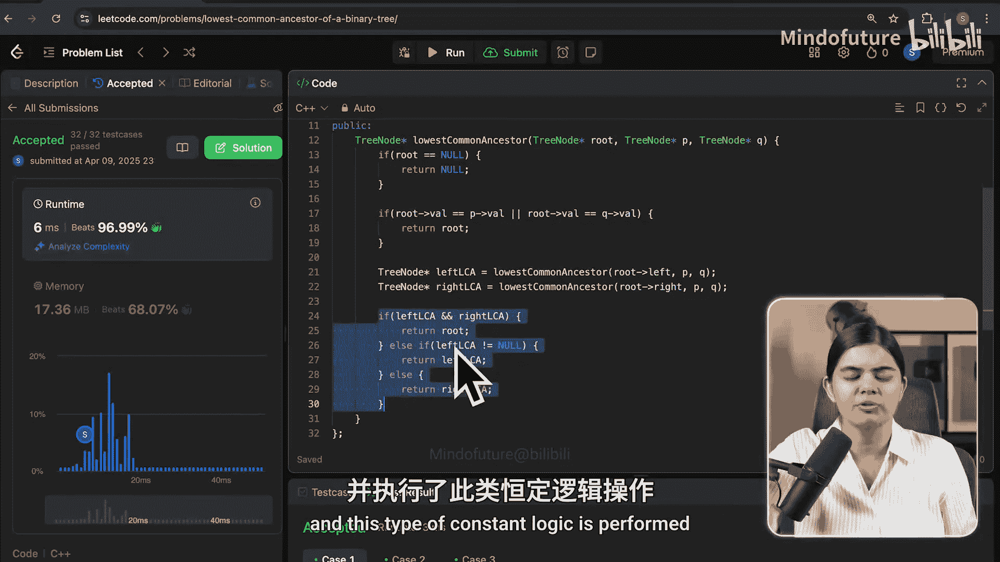

# C++-DSA课程-｜-数据结构-｜-leetcode-｜-Apna-College-｜--Complete-C++-Dsa-Course-p89-P91_二叉树的最低公共祖先-DSA系列_-L.89--BV18oUGBkEmV_p89-

Hi， everyone reckon to complete series。 and today we are going to solve an important binary tree problem。

 which is called lowest common ancestor。 concept Also there is a link for company in the description box this problem is called lowest commoncestor binary given and given Q P Q for example P be equal to and Q can be equal to7cestor is going to be equal to this is also problem number36 us try to understand what exactly is commontor iscestorcestordi。

😊，Noode is equal to2 to ancestors， parent， parent cap parent and is theri U Valley Lekini Nor Zem is particular node root can exist Kaia in subkoham ancestors Catem Jese 5 k ancestors Zja 2 and 1。

 Similarlyly， Agarham 9 k ancestors theyja 5，2 and1。

 the root Z Pame Jobi Nordes exist Karivo incestor Zja Saalri Pa ye be given here Ki a Nord can also be。

😊，Its own ancestor， Yai Jaam ancestors who consider Karinggiki 9 kdka ancestor y specific conditionalipus already given orbja Jabam lowest common incestor Kiba Uskaki Kobi though Norscapepers Segam de。

 for example， Agam5 Koi and7 Koi。😊，Toino，2 and1 and3 and1 incestor in ancestors in lowest commontorki P and a commoncestor He which is equal to 1。

 So one is going to become the lowest common incestor。 Similarly。

 Agarhamara P is equal to 6 and Q is equal to 7 in common inscestor and onecestor butki the lowest common incestor is3。

 So the answer is going to be equal to 33eljaga for this particular example。 example。

 consider kri p is equal to 6 and Q is equal to3 I case mecessge3 and13cestorsge and1 case 3 is also going to be the lowest common incestor to Ya。

 it becomes important to noteki a node can also be an ancestor to itself to I。😊，8 node parent Bjata。

 whose case me parent node Ya ancestor node is going to become the answer to Jo P and Qip given Also Sa given P value Qki they are both going to be different nodes or Hamish commoncestor exampless examples may basically El comes out to be the first node。

😊，Jahoar， Hamari， P and Cu。Usndke subpriganander。Exist， in fact。

 sub three can existtheme is examplegam to P and Q K L3。

 So3 is the first node sub the P and Q don existthe A Q to Q to node co and P is K left subme exist。

 So this is the first node sub P and Q don nodes existtheme Yes。

1 node right subprea P Q don existthe。 But Agam U k of this is not the lowest node。

 this is not the first node。3 is the first node， and that is why this is L A core example。

 let us suppose Im calculate kneki for4， which is P and for 9。

 which is Q to4 and 9 conci node first node sub can existstheme that first node is equal to2 So2 is going to be the L Yes。

1 K left subpre P Q don exist1 first node first node head2。😊。

Left sub P right sub Q And that is y2 is going to become the L So basicallyme node find outne for the first time given p and Q nodes exist recurs travel and recur travel and Q value right p and Q node right value that means is going to become the lowest common ancestor or lowest commoncestor value So basically if we have a function which is called L。

😊，Just canander Hamipas P value H。 in fact， just canander Hamipas root value H。

 We have the value of P。 We have the value of Q and is function say Hamap meelieko return Gnaim Tom Koius Kagi K recursively is function K hurryri level say Hammels returnels could return Gne。

😊，example equal equal root and to start from the root and right we are choosing to return let us and。

😊，branchch or or and a of and but our isces or。😊，second answer irrespec assuming。😊，To basically。

 what we mean to say is T C B level per Agar Hamrijo root he value him。That becomes equal to P。

 or the root key value becomes equal to Q。 Those case may assumedring。Tohi return。

 assuming that this is going to become the L return asel and2 v level4 as theel basically function call for root。

😊，P and Q left sayham Lake Ar Ane left LC C K Vallugo。

 and similarly right sayham Lake Ae upne right LC C K Vallugo to ya Bham， right Kiccale。and right。

is equal to Q equalga or return is9 we are choosing to return9 asar to5 to writes to5 level per Q first node p and Q Q level returnga which is going to be 92 write p and Q2 and this becomes the first node2 is going to be the and2 level value returnga as the and1 level2 return which。

Going to be the final value of LC to ham case the case I figure out carrying it basically Jy ham recurs say left LC and right LC value calculate knegie cur。

 the char possible cases and you exist curtheam。 Let us analyze those four possible cases say res curum。

😊，To our first case you select take left LCK of value here that becomes equal to null and right LCK of value here that also becomes equal to null。

😊，Jham8 right those case return name case return second and third case right case answer return name right99 return as value and fourthb and right。

😊，Left LC C is also not null and right LC is also not null。

 Just case me case example dictate this is the case of node2 valid value I is equal to4 right valid value I which is equal to 9 node right value Rhi common case this is basically our jackpot case me root node return because we have found our final valid topro conditions let us paste our code here。

😊，Is therikehamasu de already li Iander Jese Hamipas A Elsie and rightelsieki Aja Ukyem Agarelsie B a valid value him and Johamara right Elsie him。

 That is also a valid value。 Ukemimiham Kruhu。😊，This is the fourth case， just call me upper handle G。

😊，I L who。Kaggar left Elsie is not equal to none。 Those case may Pattaya Kiham Ane left Elie could return Kinggi。

那 he do。Else， F kiss me。Hya return right Val。basicallyically cases in in statements can combine values value root right is equal to nu or is equal and right So these are the LC values based on and right common values let us convert this entire pseudo into actual is function co complete。

😊，Function canander Hamari pass root given here P node given here and Q node given sub polytopma base K C Licle think kbi V Agahamari root E value nao V。

 those case me we cannot find the LC value and those case me Ham return in nu value。😊。

Second caseki agar root key of value He that becomes equal to P key value Ya root key of value He that becomes equal to Q key value。

 whose case Jobi as theel toari cases mayri and write sumin to subseo。G no star。H up knee。

 up knee left LC key value go calculate knegie gocious cur game。😊，Within the left sub。

 just my P and Q Qham pass caneval and I C coham copyle。

And right L C E co du Nikki kius Kringgi within the right sremam P and cucopa Kinggi are based upon left and right spri Hamipas char cases exist curectam。

 first K C A Ogaki Ugarhamipas left LC C K B valid value and Hamipas's right L C K B valid value。

 whose casemere root is the answer discom return guinggi。😊。

Else Agar left LC C A is not equal to null This come rightel N Hamisha Hoga neither the first case is such each other。

 this case mayam returned gu a left L C K Val co and else Valjodoo cases Ukeham return Guinggi right L C A value score。

 So this is how we complete the function of finding the lowest common in sister for two notes。

 Let us now run it。😊，And submit our solution。 So this is how we successfully complete our solution to the problem。

 Agarhams time complexity analyze Kane k to basically ise function Meham recurively single node per recursively leftel right and is theke constant logic performed K to basically Aander。

😊。

ham or n nodes exist so that case time complexity is and this is how we solve the problem in linear time complexity complexity complexity in the case is also going to is the most optimal approach to solving this problem and in complexity if you have successfully completed today's lecture you in share progress with me on。

😊，クり。