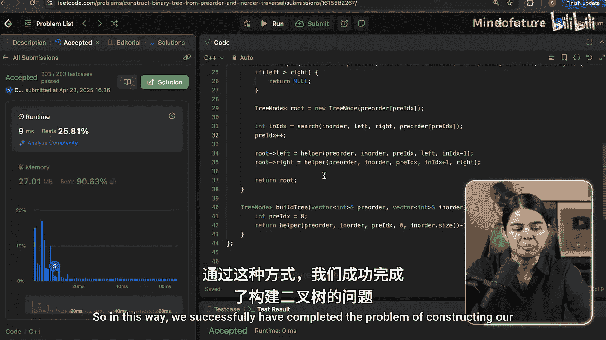

# C++-DSA课程-｜-数据结构-｜-leetcode-｜-Apna-College-｜--Complete-C++-Dsa-Course-p90-P92_根据前序和中序遍历构建树-DSA系列_-L.90--BV18oUGBkEmV_p90-

Hi everyone， welcome to the complete series。 and today we' are going to solve the problem of constructing a tree from preorder and in order sequence co。

 there is a link for company in the description box。

 This problem is called building a or constructing a tree from preor sequence and in order sequence。

 binary sequence given here or isconstruct This problem is also105 on This is the function that we have to complete preorder and in order sequence to what exactly is a preorder sequence preorder sequence root Then well travel the entire or traverse the entire sub and then well traverse the entire right sub seega in order sequence in order sequence root or right。

😊，o rules and sequences3 K pre order sequence key Cam pre orderder sequence guarantee3 key root exist pre sequence to root key value will always be the first value in the sequence pre order each of first value。

 which is3。 that is going to be the root of。😊，To sequence construct but the problem with sequence example。

 and 2015 and 7 right sequence basically order sequence。rightari write for example。

 weve already found out that3 is going to be the root of the In fact。

 I is the root ofm in order sequence in order sequence and right and right sequence by we are going to construct a new node with value 9。

😊，now problem arises which was 152 and。which means if we 15 to15 is part of and similarly7 is the part of along with sequence or in order sequence and this is the that we basically values or。

😊，Not hee su right su U， let us try to create a function。 Lets call this function build it tree。😊。

Bilt3ander a toham pass knena pre order sequence， which will be a vector a pass in order sequence。

 which will also be a vector Ime index value Pa kam。

 which will be an integer value zone by reference Paek function level per shouldme index value0kiba1kiba2 hogi and so on。

 to Sa pre orderder index namm value pass k justham initialize k0 kat So let's suppose Bpa he values exist Ktium subs functionme3 key root co K root is going to be the current value Japer preorder index point K to pre order kander。

😊，ari pre index value that is going to be the root of the next iteration index plus And this is something by are already given in the sequence and to the right s function orcur function simply So this is the beauty ofcur when we are dealing with single function order sequence and pre。

😊，pacard it， similarly， thebarin。Pre order。In order and pre order index forpacal。 Now。

 we are going to assume khamri of first function call herricursov call Bohami Rok left Sri Bel Kqueri and second recurzov call Hame Ru Ka Hamme right Sri Bquequeri。

 But Yaer， there is a slight issue that occurs。Rootka left subprime right subrimi Sokiari Ricur callsdoja。

 But how do we track He root a left subme con con node Zval。

 How do we track root a right subrime con con node Zval。

 the Yaam use carrying a uplay in order sequence Basically，mipaakki root a left subprimi。

Jaha in order root exists。 Let's suppose yaha root is index per exist kt to left sub valley node index1 right value node index plus one index in orderriki or rightri nodes exist for example。

 let us try to imagine this entire in order sequence as in visualm in order sequence values and right forcese index values root is the root inki values isse root I inside the in order sequence next time jam leftrime in left。

😊，Spri in order or left sprika in order k exists kt left sprika in order is basically this part。

 which means key left spriicajo in order here W index L lire if this is my index E isco in order index sum。

😊，If this is the in order index of the root， in order index minus1 exists k。

 Similarlyly Agaham right sririari in order in node in order sequence。

 which meanski in order index plus1reari right value boundary in order sequence parts divide based on the rangebiari valid values k depending upon I suppose is that is going to be 520 and 7 this is going to be the in order index the leftri exists cur left sub is left index are index minus1 right index plus1re right boundary tag exist cur。

😊，WeAl have a range of valid in order values exist valid in order values root order sequence order sequence root function and right order right root order sequence root basically if this is the root value or order sequence from to right which will be the search function order index return function。

😊，gi Icha Boha It is going to be a basic for loop Yara in order sequence Saari Pri value Igisdigi andas in orderki boundaryniche。

 which is basically the left and right boundary Jagi Ya function return Kariga index。😊。

Y in order index Jahabihamari value Hammiil to Yahamm' search function go calli Just kdanderhammna in order sequence pass Kringgi left value pass Kringi right value pass kringi and will pass pre order canander Johabihamari current root here。

 which is pre order。😊，Index Yesriari values Ajagi or yehammehama in order index return Gingi。

 So jabami left subriko B Knai， Hammuskyanderrupmi boundaries gopa Kif from left to。😊。

In order index1 similarly right will pass in order index plus1 and right and and finally is So this is the overall logic on basis of which we are going to construct with help basically valid node in boundary values。

Basically value in nu node which means key value becomes greater than right value is the overall logic to solve problem is function to or parameters a similar functions call it function function sequence index will be an integer and inte right function with pre。

Sequence in order sequence pre order index co harm0 rock a percu is a by reference pass array to subelhammeic variable banana boga。

😊，And is variable kyaper，paval。Uskebar left boundary 0 Neval right boundary is going to be in order。

 dot size -1。So this is the right boundary。 The helper function Jovi Val me return Kaal that will be our3 and Ukoya returnne helper function kanderhamna logicbe subse hamab3 key rootco constructuring it。

 So this is going to be new tree nodecanander， we are going to pass pre orderka。😊。

Pre index jse Co V nodeham create calera root node。

 v say hammni pre order index co plus Sching it Takeki future level K hum updated index keyboardvaquaium Oskeba is root value Come search Kna。

😊，Inside in order， thosecale will call a search function。

 Just scan thehammna in order pass Kinggi left and right boundary pass Kingi。

 And this is the value that we want to search for。 ask I search Kgihamari in order index Kpa value Ajagi Okiba helper function Goham call Karinggi。

😊，To build the tree recursively sub a left subrecoal carryinggi will pass preorder index left s lakere。

In order， index minus1 tu。Phase， we are going to get root car left。

We ask if we are going to get rootka left and I similarly Mariippas rootka right tiga。

 just may we are going to pass。😊，Index plus1， seilre right tu。And finally。

ya return upper base case apa Egaki kbi B left key value becomes greater than right key value。

 Those case maybe we are going to return a null value。

 So this is the overall entire logic diskk basis per tree construct search function coium complete cur。

 search function card return type will basically be an integer value。

 So this is the function that we are trying to complete。😊，To integer search。Jisky under Hamipas。

 Hamara in order。Ajaga Sa me we are going to have left。 In fact， you are left come start care with。

Yeah， let's keep it left and right left。Right。And the value that we want to search for toomic loop jalaine simply I is equal to left silire I less than equal to right T Herberardingi I plus less Agarhamari in order。

Of I valuebiari value return that the that we are trying to build sequences sequences index valid value1 return。

 even though。 So this is the search function。 and this is the helper function index plus statement because we are using the older value of pre index in this search call let us now run our code and try and submit it we successfully have completed the problem of constructing ourfi brief basically。

😊。

K let's see how the problem is going to execute index right function index 00 and right value 4 k this is going to be the left value This is going to be the right value and index index which is going to be to right index plus which is index0 and right key limit is also equal to 0 function called index1。

😊，which is equal to 9。 So we have built the 9 node and order order sequence it will lead to similarly right and is as20。

ari right key callgi to build the right sri preorder index at2 rightja。

 So we are going to construct a new node， which is going to be equal to 2020 order can the search in order may left boundary have 15 per right boundary720 search this is in order index in order index in order index plus20 right we get a new node here。

 which is going to be 15 Similarlyly 15 and 15 15 plus7 and 7 per right index is going to be building。

7 value j7 value build Ho2020ariri function calls and will eventually get this binary tree as a result。

 So this is how the brief dry run of the entire solution looks like if you have successfully completed today's problem you can market in now in the comments can also share your progress with me on Twitter description lecture can Keep learning and keep exploring。

😊。