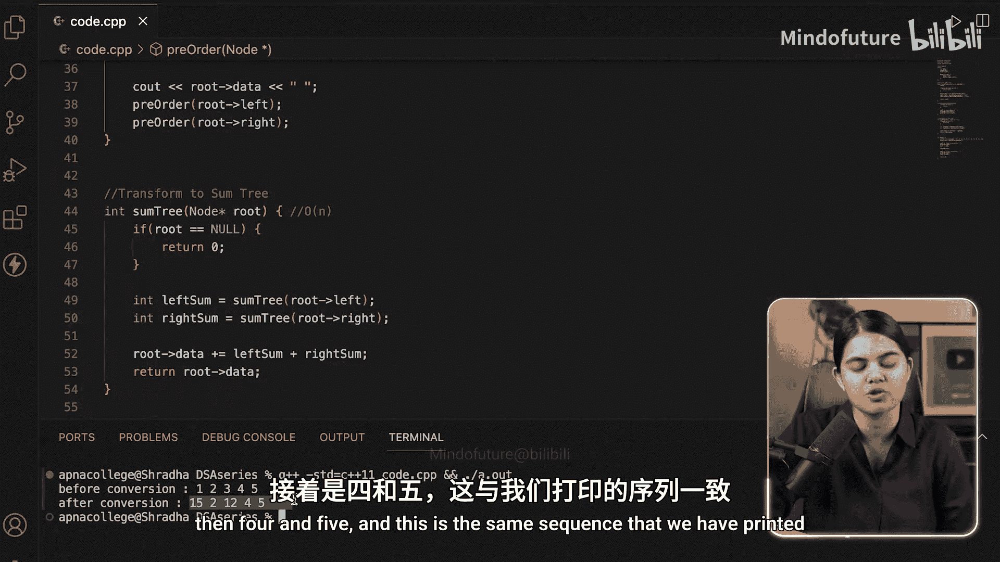

# C++-DSA课程-｜-数据结构-｜-leetcode-｜-Apna-College-｜--Complete-C++-Dsa-Course-p91-P93_转换为和树-DSA系列_-L.91--BV18oUGBkEmV_p91-

Hi everyone， and welcome to the complete D series。 And today。

 we' are going to solve the problem of transforming a normal binary tree to a sum tree。

 A biscalabcoor concept Knath form is playless canander available mizaga。 Also。

 there is a link for a company by D sheet in the description box。 startvalad。

 This problem is called transforming the tree to a sum tree。 Basically。

 this is a binary tree that we have。 And I say Hamake sum tree if formmic convert Kna。

 What do we mean by a sum tree。 Basically heric node canander。

 Hammuski value could replace Kna Chaium with the value of that node plus。😊。

Haari Prigie left Sriikam， plus Purrikei， right Sriikasm。Jiska Malab。

 if we want to transform this node， the Yahaper 1 kssat Sa Hamme add Knapadiga pue left sricikam。

 which is 2 plus Pure right sricikam， which is going to be 9 plus 3，12。

 So this value is going to get replaced by 15。😊，Similarly。

 left nodeki left and right which is going to be equal to2 rightriki There are two nodes3 plus4 plus 5。

 which is equal to 12 right childs value is going to become 12 eventually is this have to complete this function root and also we have to return the sum of is sum of try to solve basically is a majority question。

😊，I also a very easy level question。 Basically Jiva Yahammed transformriaria a transformne。

 or assume Kki recursively left sri and right Srito transform Hu。😊。

Nor transformki left transform andgarriura transform return eventually to left side， sayippa leftka。

 which is equal to Similarlylyura rightja right right， sayip right which is going to be equal to 12。

 saym is ruderi transformjaja rightri transformjaja is rootko transform And the answer to that is yes。

 basicallyimri right simply。😊，Uppenne nodegi value could replace Knai with the current value。

 left subream， right subresome， or Jobiusski new value。

 Hamipus niel Karagi Useham Ane function say Kingriton， which basically means。😊。

If we have a function。Let us call this function sum tree。 Just scan the Hamaripa tree key root here。

 and Ya I may impeach your value return Gai to Ma Kainggiki recursly Hami hama function of any problem cause solve Kdega for the left sub and for the right subre。

 Toham I see some tree co call Lagani。😊，Upne root k。Left， K。Jhani Hamipas Aval Abna left some。

Similarly， Ihio called La Ge Huford write sum， well call the sum tree function。By passing root car。

 right child。 And is the Riquese Hamra left subri， right subri Pri the rese transformjaga。

 It transform hookerhamhamra sumr town Kingi and Uskeba Hamariju current root key value here current root car data Oseham replace Caringi with root car datata。

 In fact， we can do plus equal to left sum。😊，Plus。Write sum。

 and upne is function a finally hum return Guingy upne root K new data key value。😊，Which is the。

 Any upper basically scenarioki kbi B a root key value becomes equal to nut。

the sum of the entire tree is going to be equal to0。

 So this is how arecur plane into process basically which equal。

right k So we are going to go to33 left sum co call from 4 to4 U v level co4 return Similarlyly3 writes5 co to5 level value return which is equal to5 j say write sayhi3 can4 plus5 co So3 will be transform to 2 and U value level value return which is equal to2 level per2 y So the answer is going to be1 plus2 plus12 which is going to be15 recur transform So let us convert this pseudo into actual sub if the root is equal to nu those case return equal sub co to transform the sub。

😊，Jhansi Hammadias。Left some return， Fukuaya。Similarly。

 Hamris subreula called Laganhi to Hamipas writes some return Hokuraga after passing Ruutka。Right。

And Hayahaper Hamni root Ca datahi。U say transform cannival by adding the left sum and the right sum。

And hassem return Garingne root cap de。 So this is the entire logic。

 and Qneri is are a three key root perme single time traverse k。

 So the overall time complexity of this function is going to be linear， which is beovin。

 Al A main function can themne tree co K and gakering it before converting the tree Hammne tree Galeoska preorder print Kvai。

 And after the transformation preor print Kvaange to see the difference。 So let us save it。😊。

And ran our code。 So before the conversion， this was the preor sequence for3 is pre deam Abbi pre sequence Aga 1。

2，3，4 and 5。 And after transformation yode 15jagi 12jagi preorder sequence may subpa 5paga。

 then well get 12 then 4 and 5。 and this is the same sequencepa So transform to a I'm sure this was a very easy problem。

 And in fact， starting lecture of nodes of questions I logically this was a very easy question to solve in binary。

 So if you have successfully completed today's lecture， then you can mark in his now in the comments。

mi can also share your progress with me on Twitter is callingku description box Mil lecture can and。

😊。

