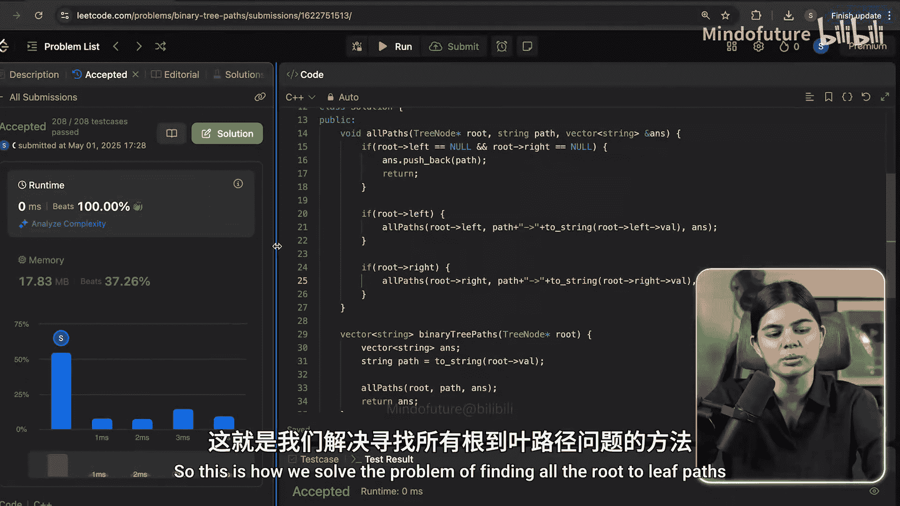

# C++-DSA课程-｜-数据结构-｜-leetcode-｜-Apna-College-｜--Complete-C++-Dsa-Course-p92-P94_二叉树路径-DSA系列_-L.92--BV18oUGBkEmV_p92-

Hi everyone in welcome to the complete。 And today we are going to solve one more binary tree problem。

 which is called binary tree parts。 Also there is a link for company in the description box。

 is an easy level problem called binary tree parts binary tree given andme is root print print the form of strings for example。

 in this given binary tree first is root。 So the first path is going to be a string1。

2 second root is So the second path is going to be13 and 4ang which will be vector of string and in functions This is also problem 257 on。

 and this is a very simple problem。 Basically already。😊。

identify this is a plain and simple binary simply。😊，Noka left。Is also equal to null and Hamari Nodka。

 right。Is also equal to null。1 which is not which is going to be equal to2 order doesn't really matter right are going to add and2 to2 is first and which is going to be。

😊，1 is to do， the Yahaa。are going to this two from multiple right move on is and and secondly is。😊。

 and we are going to backtrack back to3 Je right and go back to the root children we are going to move back to the main function andariari end same basically we have to complete this function。

 Let's call this all parts all going to pass this string。Johaari， Lehaari Paco told Karagi。

 Andosss asked me， we are also going to pass a vector of string。Dis canander。

 Ham me sari Gaari answer values goes to workang you Ab me function canander。Japbi Kivi Nor parium。

 sub Nor Gely。 We have to check if that node is a leaf node or not Kikihamra recurs。

mi leaf nodes perhi Rukega。 So that is going to be the base case。 base case cannymki root call left。

😊，A girlnal him。And rootka， right。Is also equal to null。Those case may to answert and return。

 So this is going to be base is baseja according to the question that we are trying to solve minimum simply need to check we call all and。

Is calm proper syntax codelect Kaingi and Ukiatmi， we are going to pass the answer。

 same condition humru kitekie Raingi Ugar root Kaite exists Kt。

 Those case may harm all partski call the Ggi Yahaber。Rotque right go past Caneval。

 We are going to pass path， plusarrowu。Plus， Smi Hamari， write key value。 and the answer。

 So this is what the entire overall logic of the pseudocode is going to look like。

 I his Sami Jebbi Hamari's all path functions。 Goham called La Gip to Yaha per Hammi Shiat me upni stringing Pa Kander。

Root key value say initialize kna2 logic follow k nodeja node2ja already2 value I the logic implement cur because we want to add arrows arrows only to a arrow root per I in our logic we are going to be only adding arrows to the non root nodes of the。

 So this is the logic that we are going to implement convert to actual。

 This is the function that we have to complete I vector of string vector of string。

 Let's call it answer stringize root key value。😊，U we are going to create a helper function。

 Joe Hamli， as such could be written the Kariga is function Gammhoga all parts just Etohammni root kpa Kaneval。

😊，Ouske ame， Hammani string path passcaringgi and vector of string。Joriri answer Cosga Hams。

 all paths function go call Guringgi with the root the path and the answer and is functions at return to actually helper function helper function can the base root。

😊，Becomes equal to null and root car right。Becomes equal to null。

W case me Hammanander Se push back Karingi up knee path value Co and Yahase we are going to return。

Otherwise， humchk Karinggi Kikihaari Ru kleski left value exist Katier Agar left value exist Katier from all partsco call Laangi with the root car left for the next level。

Hmpa carrying a path， canander。Upni value co add curgi the y we can use a function called two string jca under hamm knee root key。

Left key value go string and convert carrying。 you can also do the same thing here。😊。

Is your string value here is a convert con。And well also pass the answer。

Same cheese on knival root K， right， kill。And Yaper， we are going to replace it with Ruka， right？

 So this is the oral logic diskky basis per Hamippasri Kaari route to leave Pat's return。 Hokazgi。

 Let us fix this before running the court。And let us run the code。And submit it。

 So this is how we solve the problem of finding all the route to leaf parts。

 Gr upper time complexity key carrying to basically up a recursive function can simply up three key her a node by a bar travel K or mass Backer carry。

 Just come at ahead that time complexity of the entire solution is going to be big off。

 it is a linear time complexity solution。 if you have successfully completed today's lecture。

 Then you can mark in is down the comments If case me can also share your progress with me on Twitter just calling upkuche description box can mi Ja Ask youulate my Mil the next lecture can till keep learning and keep exploring。

😊。

