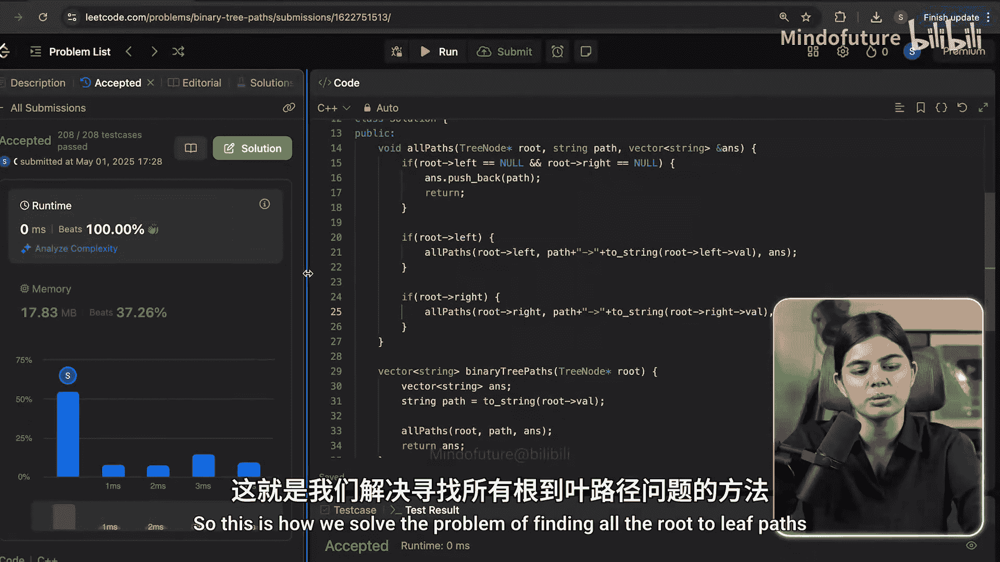

# C++ 数据结构与算法课程：P92：二叉树路径问题


在本节课中，我们将学习如何解决一个关于二叉树的简单问题：找出从根节点到所有叶子节点的路径。这是一个来自 LeetCode 的简单级别问题（第 257 题），我们将用 C++ 实现解决方案。

## 问题概述

给定一个二叉树的根节点 `root`，我们需要返回所有从根节点到叶子节点的路径。每条路径需要以字符串的形式表示，节点值之间用 `"->"` 连接。

例如，对于以下二叉树：
```
    1
   / \
  2   3
   \
    4
```
应返回的路径字符串为：
```
["1->2->4", "1->3"]
```
结果将以字符串向量的形式返回。

## 核心思路

解决这个问题的核心是使用**深度优先搜索（DFS）** 进行递归遍历。当我们到达一个叶子节点时，就将当前累积的路径字符串保存下来。

上一节我们介绍了问题的基本要求，本节中我们来看看具体的解决步骤。

以下是解决问题的关键步骤：

1.  从根节点开始递归遍历。
2.  在递归过程中，记录从根节点到当前节点的路径字符串。
3.  当遇到一个叶子节点（即左右子节点都为空）时，将当前路径字符串添加到答案列表中。
4.  如果当前节点不是叶子节点，则分别递归遍历其左子树和右子树，并在进入子树前更新路径字符串。

## 代码实现

现在，让我们将上述思路转化为具体的 C++ 代码。我们将实现一个辅助函数来完成递归遍历。

```cpp
/**
 * Definition for a binary tree node.
 * struct TreeNode {
 *     int val;
 *     TreeNode *left;
 *     TreeNode *right;
 *     TreeNode() : val(0), left(nullptr), right(nullptr) {}
 *     TreeNode(int x) : val(x), left(nullptr), right(nullptr) {}
 *     TreeNode(int x, TreeNode *left, TreeNode *right) : val(x), left(left), right(right) {}
 * };
 */
class Solution {
public:
    vector<string> binaryTreePaths(TreeNode* root) {
        vector<string> answer; // 存储所有路径的容器
        if (root == nullptr) return answer; // 如果树为空，直接返回空容器
        
        string initialPath = to_string(root->val); // 初始化路径，从根节点值开始
        helper(root, initialPath, answer); // 调用辅助递归函数
        return answer;
    }
    
private:
    void helper(TreeNode* node, string currentPath, vector<string>& result) {
        // 递归终止条件：到达叶子节点
        if (node->left == nullptr && node->right == nullptr) {
            result.push_back(currentPath); // 将当前路径加入结果
            return;
        }
        
        // 如果存在左子节点，递归遍历左子树
        if (node->left != nullptr) {
            string newPath = currentPath + "->" + to_string(node->left->val);
            helper(node->left, newPath, result);
        }
        
        // 如果存在右子节点，递归遍历右子树
        if (node->right != nullptr) {
            string newPath = currentPath + "->" + to_string(node->right->val);
            helper(node->right, newPath, result);
        }
    }
};
```

## 算法分析

让我们分析一下上面解决方案的时间和空间复杂度。

*   **时间复杂度**：**O(N)**，其中 N 是树中的节点数。每个节点我们只访问一次。
*   **空间复杂度**：**O(H)**，其中 H 是树的高度。这主要是递归调用栈所占用的空间。在最坏情况下（树退化为链表），空间复杂度为 O(N)。

## 总结

本节课中我们一起学习了如何解决“二叉树的所有路径”问题。我们使用了深度优先搜索（DFS）的递归方法，从根节点遍历到每个叶子节点，并在过程中构建路径字符串。关键在于正确处理递归的终止条件（到达叶子节点）和路径的拼接。这是一个理解树遍历和递归思想的经典入门问题。



