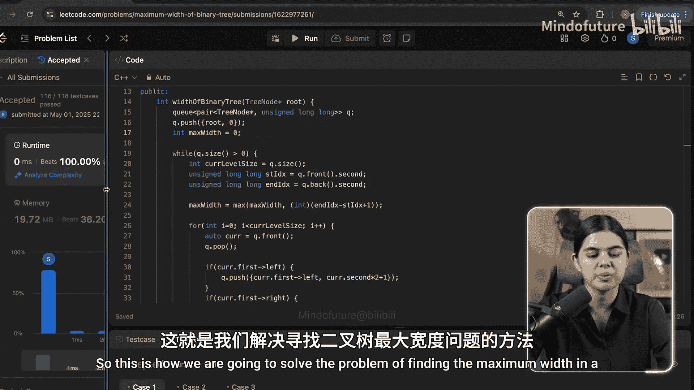

# C++-DSA课程-｜-数据结构-｜-leetcode-｜-Apna-College-｜--Complete-C++-Dsa-Course-p93-P95_二叉树的最大宽度-DSA系列_-L.93--BV18oUGBkEmV_p93-

Hi， everyone and welcome to the complete D series。 And today we're going to solve an important binary tree problem。

 which is called maximum width of a binary tree。 Abkmi Dika coor concept Knath warm is playless Kennerra available nojaga。

 Also， there is a link for accompany company by Z sheet in the description box。

 The start caepnivalatvalderra Mariipasic binary tree given her Gkeleuki maximum width code return Gnaai。

 This is also problem 6，621 lead code。 what exactly is this maximum width。

 maximum width in the question is the longest length between the end node of any level。😊。

Basically3 k level node starting node including both the node assuming binary complete binary complete is basically last and complete binary complete second level calculate。

😊，The starting node this is the ending node B or additional nodes the width is going to be equal to2 Third level calculate cur starting node ending node given binary as node include So the total width is going to be equal to which is the maximum width that is going to be3 let us take an example of this binary binary node will have a right we are going to have aaginary node absent node and right and this node will also have a left and right try to calculate the maximum。

😊，The first level per nodede the maximum width is going to be one second level peras though node Z startingja endingjapa with2 equal Third level p this is the starting node。

 This is the ending note total4 nodes width is equal to 4 last ya4 level per This is the starting node。

 this is the ending node。 but escape B5 or node So the width is going to be equal to 7。

 So the longest width for us is 7 to answerja maximum width7 binary complete binaryri completely filled maximum width calculate maximum widthco calculate logical binary level y travel or her level per levelki width calculatene and her levelki width maximum valuese answerhi same approach use。

😊，Any level travel travel tra and that is one of the most simple ways to traverse simply and tra traverse andne is a very simple process going to use something called indexing complete binary。

😊，node indexingam basicallyb complete binary complete binary last level completelyium node nodeium nodeium second level per nodes and similarly k level complete binary nodeium given that k is less than n complete binary。

 If I try to represent this in the form of this special index root rule indexing complete binary root equal0 index follow parent node。

😊，Note are IAT index Para thosecal left child。😊，2 into i plus1 index per Hoga and o nodeka write child hamishsha2 into i plus2 index per sroga。

 Just come athe。 If this is the parent node jaar Iq value 0 the2 in20 plus1 Hamra3 first index per store Hoga2vo second index perroga。

 and it the Ri a hamap me eri k up 3 key different different nodes who store k thepa3jagapa2jaga Similarlyly。

 if I mention the index， this is index 0， this is index 1。

 this is index 2 targetgg 3 kpa index value 1。 So5 is going to get stored at 2 into1 plus1 This is going to be 3。

 This is going to be 4， This is going to be 5， this is going to be 6。😊。

3 index4 per9 noteki given binary complete binary value but even though based index basically is calculate So the width is basically the total number of according logic in simply starting index or ending index which is3 and6 So this value is to be which is the total width for this particular level width is going to be。

😊，Ending index minus the starting index。Plus1 to basically calculate level orderal and level orderki index values simplyteger which is going to be index and and end and ending node index widths try to summarize this logic in the form of and this function is going to give maximum width which is already available for us and。

😊，lets store a pair of node star node and we are going to store for now we are calling it an integer value。

 but with the implementation we are to convert it into uns explain Q pair of values and node are root with a fixed index value root root index based depending upon right but it doesn't really matter Q complexity and。

Same Oskeba， we are going to implement a loop loop quo uptakran Kainggita kari cua size greater than 0。

This is a very standard implementation of level order reval entries。

 Ham Kinggi subse hamm starting index who calculate Kringgi Ukeba will calculate the ending index starting index sumki Q k front pay Jobiippa value Hogi Uscajo second value Hoah。

 which is basically the integer index value that will be the starting index similarly Q K back me Jobiippa value he Upa key second value is going to be the ending index Sa case that we can create a variable called maximum width gam initialize k name with0 and Yahamper maximum width co compare Kinggi。

😊，With maximum of maximum width and the current width current width is going to be ending index minus starting index plus1 at each level。

 we are going to get the index of that current level implementation level starting index and ending index X to apply the formula3 a level processna first level node X second level node X process third leveltoriris x process we are going to use a loop inside a loop to process all of the nodes of one single level store let's call this value current level current level size this is going to be Qca current size andra loop。

😊，From I is equal to 0。To current level size。And current level candle， Jojo Sarikiari knows him。

Jo say for example， current level meari3 and2 to sub3 co pop and three index already left child and right childco along with their index values k same cheese k to pop and right childco along with its index kran the the process is going to be very simple。

 For example， Joari current node he。😊，Jseham Qay pop Kvaium。

Is current nodedke index coham assume Carnevalge as I D X index value to other current nodedka left exist curt。

 Those case make you and theam store Carge up noded key left value， along with2 in2 index plus 1。

Similarly， a current noded car right childil exists kt。

 Those case may have stored carryingang in noded car right childil， along with two into index plus2。

 So this is the pseudo code for our level audit reversal。

 I'm giant to I say Egbar dryyran Kkiby the exact on the given example。

 So let us resize this a little bit。And yaha， basically hamra loopra main function completeura theham example。

 let us create a Q This is the front end is the root1 along with its index toward index equal level starting index index maximum width00 plus1 So the answer is to be which is the maximum width with equal and right is loop1 remove Q。

😊，Processcur with index 1ippa 3 sjaga with index1 and two co right telco process carrying with index2 to2 s rojaga with index 2hamippas second level k sa xa Q and available loop and the starting index ending index calculate carryingpa ending indexigga2 k equalpa starting indexigga1 k equal maximum width will be 21 plus 1。

 So this is going to be equal to2 to maximum widthco update to2 Similarlyly， aham next level k。😊。

3 and 2 K children nodes go process cutting it The subel。 we are going to evict or pop 3 from here。

 The three k hamyai pop Ker 3 K children notes go add Kringi Q and there。

3 K children notes score at K Kalabeki 5 K index Ojaga 3。Similarly，3 Ga index ojaga 4。

And next and we add the children or the child of two the two index value ideally which is9 with an index value of equal starting index equal plus1 is going to be equal to4 maximum width we are going to e is we are able to calculate the maximum width after comparing the current width at possible level using sub important concept that is of indexing。

Lead binary tree can just that case indexing Ho E cananderney actually indexing a here。

 butney was indexing a concept who use k to calculate this current width。

 So let us convert the pseudocode into actual c plus code。

 and then we are going to analyze its time complexity。

 Now this is the function that we have to complete I can the sub we are going to create a Q Just can pair toward store the three node anusme for now we are writing it as in teacherger value。

 which is going to store the index of each node in a CBT E。

 which is the CBT index the upper Q Q the subse pair of root and the value 0 Anusme will create。😊。

An in teacher called maximum width， scan their answers to caring a0 equal。

The japt Hamari cua size is greater than0ptme subseliectopy cua y current levelca size calculate kai。

 which is equal to cuca size Usme Hamrajo starting index Sojaga that will be equal to Kke front by Jobi value here Uska's second parameter and ending index will be equal to Q k back per Jobi value here U second parameter。

😊，Maximum width is going to be maximum of max width。And the ending index， minus starting index。

less one。ham loopriari notesco process from I equals0 I less than Jobiri current level ksi and Q nodedes subcom X process level traalhi a go x single iterationari traversese let us store the current node let's call it current which is at Q front and Q subki current Jobi first value。

 which is the node itself is left pointer。😊，Exist curtai， similarly， hamchkainggi， we are， in fact。

 subsequently。Agar exist Kt， to Q and humush Khene the pair。

 The pair is current K first car left andusque Ame current car second in2 plus 1。

 So this is the index value multiplied by 2 plus 1。 Take pair hasscomni pushush Kier。 Similarlyly。

 we are going to check for current car。😊，Right， exists current index into2 plus2 and at the end we want to return maximum width this is the overall logic basis and let us now run our which is the data of indexes let us look at complete binary indexing complete binary n level second level。

😊，1 nodes， this is the approximate value of nodes that we are going to get at that particular level toari index valuet max limit cross andki nodes is a very big limit。

 which is given constraints constraints nodes 3000 nodes scenario binary completely sked binary binary total3000 level S31 nodes 31 index logic 32 3 index value index starting index ending index calculate values calculate These values cannot be in teacherki scenario are going。

😊，Exceed the intes limit， just come lab here ink data type code change curqueme in a banana pad unsigned。

😊，Long long。IntSo this is the data type that we are going to change。 Similarly Yahaba。

 he unsign long long in Toga jsehammed typecast Knaarriga to integer。

 So this is the entire value that we want to typecast。 And Ame， we want to change the size here。

ang node and index index because we are followingings So this is how we are to solve the problem of finding the maximum width in a binary and will be equal to binary the of is to is we solve the problem of finding width completed' lecture now in the share progress on。

😊。

They're helping them keep learning and keep exploring。😊。

