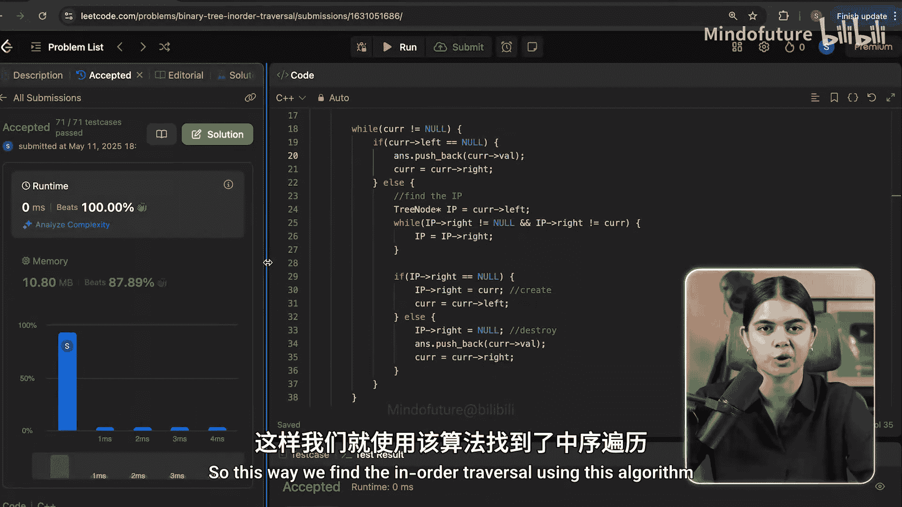

# C++-DSA课程-｜-数据结构-｜-leetcode-｜-Apna-College-｜--Complete-C++-Dsa-Course-p94-P96_莫里斯中序遍历-DSA系列_-L.94--BV18oUGBkEmV_p94-

Hi everyone， and welcome to the complete series。 And today we are going to cover the concept of Morris in concept there is a link for company and this is basically conceptual question is is one of the simplest and right4 and So this is to。

😊，Can it the iteration co use in order rev co use Kgi And this approach。

 can S Eki iteration may convert komic stack co use K。

 we are not going to use any stack a completely new algorithm use K just may we are going to create temporary threads inside this binary tree of algorithmham core logic the core logic important concept of Zru which is the concept of in order。

😊，Prettycessor。In order predecessor in order sequence For example。

decessor that is going to beki in order sequence4 is going to Similarly predecesor that is going to bekidecessor automatically are using the return root。

😊，Ro as such direct to mor in order is he problem goes basicallygam in orderko traverse mor in orderhamri in order predecessor for the root connection before traersing the entireriri tra for example。

 I have this2。😊，Then we have a tree。And we have a for。

A bihaer Am is root north artka is Purrike Purririka in audit revveral ojaga 3，2，4， and1 k equal。😊。

Toha it itly leftas， for example， consider traverse pereration is root per or between the root and in order predecessor of the root node。

 in fact， root different different node in order predecessor outne for example。

 if this is the root and in order predecessor order predecessor we are going to create a。😊。

T23 and4 directly right child order sequence out are going to delete this connection connectionsdecessor basically isdecessor and right。

😊，vo， let me also write this down。In order， predecessor。Basically， Hotaai， the right？😮，Most nod。

In left sub。Am root node in order predecessor root nodeme in order predecessor。

 I am repeating it left sub right node1 k the right node this is equal to4。

 That is y 4 is the in order predecessor Similarlyly1 k aga right node that is2 So2 is once in order predecessor to root node in order predecessor to simplyme search or node bo simplygam root node per let's call this current node in order predecessor initialize with current left。

😊，m kja simply right， right， right， rightbi last right v。

 This would become the I P that we are trying to find basically right is not equal to null。😊。

predecesor and predecessor it looks something like for example。right first， if conditiondecesde。😊。

And we check for two conditions is equaldecessor case and then we traverse answers is。😊。

Starting with current current is not equal to equaldecessordecessordecessordecessor equal is equal right anddecessor is。

😊，root So we are going to print the current value， which is going to be2 is equal to is not equal to nu are to repeat need predecessor predecessor predecessor equal equal predecesor which is。

😊，and then right to track the order of node。 Then we'll do the same thing with is equal equal equaldecesordecessor equal Then well try to find I is equal to nu equal to nu co repeat is equal to is equal print equal。

😊，in order and we are going to update to backward go back to find in order predecessor in order predecessor out to be equal nu is not equal to nu and print and current So we are going to go the new current node is going to be if it is null not equal is equal null equal going to print we are going to print the value of and we are going to go to null。

is equal complete and this is the answer we have in so we basically have to convert this entire pseudo into predecesor in order predecesor are going to add one more condition。

😊，And that condition is Kihamrajo in order predeserica right here that should also be not equal to current。

decessorki，s suppose4 exist order predecessordecesor will be equal to nu backward connection casedecesorju that is pointing to the note that is also a stopping condition for us in case the thread has already been is a Let us convert this entire logic into is the function that we have to vector in and answer last me。

😊，Ousque A me， let us create a current note disam initialize King with the root Anaic loopalingi Je the kra current is not equal to nu a I me check her now Iki current left。

Is equal to null。 Those case may directly answer kander is where Prince Karanki Jugeham pushed back Kinggi Ane Ruki Valluko。

 And then we are going to move to current Ka。Right。

And Iika L K So Jagaki sub we find the in order predecessor。 in order predecessor could find out can。

I variable banasticastic name。3 node， I P。 Let's initialize it with current car left。

And hamic loop Chiing it Jept I P cur right。Yto is not equal to N null and JepT I curve。

Right is also not equal to current the tuham I Pco update card it to in order predecessor car。

Right value， Jesse Hamme in order predecessor Milga Uskebaching agar in order predecessor right is equal to nullna connection create in order predecessor write co pointvaing to the current value。

😊，Andos current to current and I key connection exists I right nu So this is statement to create connection and this is the statement to destroy or delete the connection delete answer push node And next time right So this is the entire logic in order let us make this little chain root and now run our code and submit we find the inal using this we talk about the time complexity of this solution basically tra are forming this and we are going to repeatedly go to theri。

😊。

Mortize time complexity Hoie that is going to be linear Ynigo and K equal the recursion can there be we get the same time complexity and Yahabi iterative approach can there we also get the same time complexity I hope that we have successfully completed today's lecture if youve done it you can mark and is down the comments excusecusmi can also share your progress with me on Twitter is calling Kakuni description box can Ask9 Mil lecture can and keep learning and keep exploring。

😊。