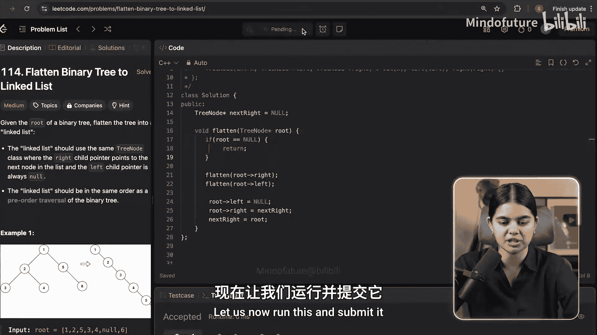

# C++-DSA课程-｜-数据结构-｜-leetcode-｜-Apna-College-｜--Complete-C++-Dsa-Course-p95-P97_将二叉树展开为链表-DSA系列_-L.95--BV18oUGBkEmV_p95-

Hi everyone， and welcome to the complete series。 And today we are to solve one more important problem。

 which is called flatten binary tree to there is box binary given is problem 11 given given basically have as a new data basically。

😊，Value is going to be1。 left following the preal Also convert node right this is to be and4 and right the next and similar is and  is going toutil basically。

and nodes will be represented by the right pointer。

 So this is what we want as the final result are going to use a very and is one of the most unique to solve this problem basically follow and are going to look into that。

root per to subse right sreander convert kgi left subrecholessander convertgi。

 and then finally rootless basically approach followander reverse order is going to be subsera rightrihamra leftander convertga or root and how are we going to do that。

 we are going to do it recur function complete and E function recur basically we have this function called flatin。

😊，This can return type of avoidvoder or just scan theripa Samari route available。😊。

prigo Jaam flatrigi， Tohamme Pattayaipas。I leftri to assume2，3 and4 In fact。

 approach right and right will be connected with the and right andize with nu and basically function function right because we are going to follow the tra sequence and and a core important additional value which is called the next right。

有。Next， right value is basically。The last visited node in the sequence last visited node basically basically and is last in sequence and So there is this next right。

😊，rightri andripa 2，3，4，5 and 6 lit andjo next right here。

 that should be ideally recurs That should be ideally pointing to this two value。

me simply root k right may say or root k left may null jse and right Sri the root left will be equal to null。

And right next to right pointer。 This next right is basically a global pointer。 will So is logicten。

😊，Returnjaim， so this is the logic that we are going to follow。

 let us try to dry on this or our entire treebar is say resize curriculumliium and let us write it down here。

😊，variables a next to right variable right So this is the root value。

 This isder right and right is right right is equal right is also equal to or next next right root root equal next right。

😊，lujagi6 k equal and Yaha is v remove kque。 We can place a6 here to back cur vas a root say hum last level per root Pale5 K Uka writesriura left andki exists Ni to ye calljagi Ob 5 root he the 5 k left is going to be equal to null the5 vagjori5 k left is going to be equal to null5 k right is going to be next right next right khe last visited node last visited node is equal to6 the 5 k Uka right is going to point to the last visited node。

 which is 6。😊，Lets say Yahapa Leath。 This value is going to be6。

 Anduskeba next right update Hojaga to route。 But the backt Knese Pale Hamape last visited Norko update Ki 25。

 basically， this next right is now going to point to this5 and ye Val Yahapa B update Hoevalier。😊。

The root say right visitnekiri rootri similarly and right values is going to be null This is the most important step。

 is going to bell but4 right is going to be the next right。

 which is the last visited node and this is the most important connection last visited node is5。

 the4 right direct connection for with thisjo right head that is going to point to the last visited node which is equal to connection form and right is bad next。

😊，ja and v root right Now， if we look at what we have done till basically is abnormal directly preor is simply single connection is root is is equal to So if this is the is equal to is the last which is right next right is4 right or。

right root next right update3 and is equal to nu is the is equal to nu right will be equal to which is the last and next right or last is and is main visit is equal nu equal to null and point to the which right and next right。

Will become equal to root。 The next right， as I last visited will be equal to root and root k assign hum return kine game。

The value is going to be one。 and this is the linkless that we are going to build。

 So this is how the diran of this entire approach is going to look like is approach directly but which is right left and then route directly and visited right or the next pointer in the visited and in this way。

 since we are going to visit every node once so the of this solution is going to be and this is a very interesting approach this approach is not very intuitive。

😊，clean solution as a beginner is going to be very is a very complex solution time imagine is。

 butki let us convert function we complete becomes equal nu simply。😊。

Skiat subse Bellham flatin go call Kinggi for root car。Right。

Then we are going to call flatten for root car left。

And we are also going to create a global variable3 node star。 Let's call it Next right。

 We can also call it last visit it。 Gisehamm initialized Karingapni， Nval Ksat。😊，Ahar。

 subseu Ru Caul left him， Saish Knahii， this is going to be。Nll root Ca right here。

 it will now point to the last visited node， which is next to right。

And backtrack can next right will be updated to root。 So this is the entire solution。

 Let us now run this and submit it。 So this is how we solve the problem of flattening our binary sheet to a simple plain link list。

 If you have successfully completed today's li。 Then you can mark it and is now in the comments。

 I this a me can also share your progress with me on Twitter is calling Kakunija description box and mi Zga。

 Askkyate 9 Miltonix lecture can the key learning and keep exploring。😊。

