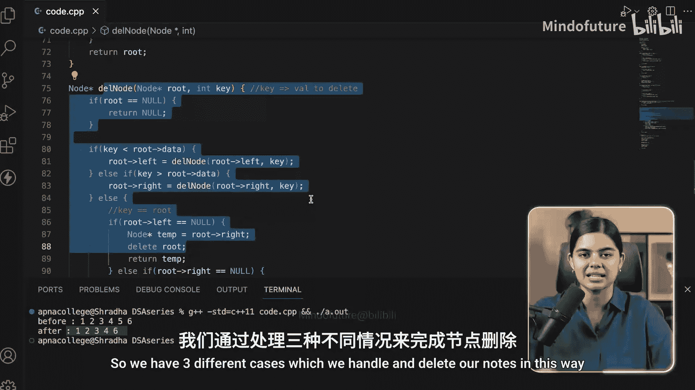

# C++-DSA课程-｜-数据结构-｜-leetcode-｜-Apna-College-｜--Complete-C++-Dsa-Course-p96-P98_二叉搜索树_(BST)-DSA系列_-L.96--BV18oUGBkEmV_p96-

Hi everyone and welcome to the complete series。 and today we're going to start with a new data structure。

 which is called a binary search tree conceptless there is a link for compromise in the description box to data structure this is called a binary search tree special type of binary tree binary properties is why it called binary normal binary but this is actually special properties and what is that basically parent node parent node node Any sub is always going to be less than the parent nodes value and right sub are going to be greater than the parent nodes binary that all the nodes are going to be unique and。

😊，S given duplicate node question generally is explicitly mentioned generally assumerival properties follow let us look at all of the nodes。

 For example， if 3 is parent。 The3 K left me to win， which are less in values write me 4，5，6。

 which are greater in value。😊，Similarly， values available example， scenario be。😊。

En search for node binary in value in value example equal be。😊。

Spco Pura de orm simply right mejaar compare k Yahaer mijaga just come club here her a level per arerico ignore kjagi or8 K direction may travel Kja to B S T K。

 B S T。😊，Search K， amiic interesting time complexity data， which is big of height of the tree。😊。

the Jobi maximum height that is going to be the time complexity of searching a node in a binary search tree or generally hum balanced binary search ja value login k equal to generally B time complexity that is big of login which is very much optimized as compared to a linear time complexity you see a binary search tree search operation bar perform a core special property which is binary search tree in order traver。

😊，That is in sorted orderki in order exactly in order sequence me say example in are to3 in order Then we are going to get this value root is then we go to the right which is going to be  and to return sequence which is a sorted sequence in order sequence now。

 then that is going to be a sorted sequence。😊，Now， we are going to learn about how to build a B S if we are given some nodes。

 say for example，ari given node given in node binary basically single node insert will create an insert function single node So the root node is basically pointing to null value。

😊，We'll start with the first value3 kat kringgi up generally， B T andb node for insert kringgi。

 However he same B property follow commonly already par which isgar parent say roots smaller value left heater ofgi or larger value here to right sub and the jaar attach Hobi root mode those case nu node create k with the new value and U say attach K to the3 as the new root say for example。

 Ya3 k we are going to create a new node， which will store3 andri rootgi a function to insert all of the node let's create an insert function。

 root Ho and will get a single value insert K kbi B root key value is going to be equal to null。😊。

Wlu as root insert is return tight Bangham node star， very similar to a binary tree。 In fact。

 Agaraham Bne Ba structurea dega。😊，Which is same as a binary tree Jani binary tree equal create katta those scanander B C that is a node class by I T。

 This is the same node class that we are going to create for a B S T I scananderapas data He Hamipas left value He Hamapas right value M。

😊，If root is going to be equal to null， those case may Ham functions say return。

 Geringy upon any new node go。With the value as the new root。

 and this is going to be case next node and basically3 and case are node which is equal value than。

write in rules， which basically means subseja and compare Kari value is less than rootta。😊。

Those case mayhammed left Sri the insert Kna to insert function Cohim call Kinggi for rootka left and the value。

 And Im Kainggiki left Srian the value insert Hojai or Yahaippa Samara left Chka pointer return Hokua jseham store Kainggi in Roka left。

 Similarlyly， Ikael vakki Soni v that root k。😊，Right pointer go。

Hm Kaanggi by calling insert in rootka right sub with the value。 And finally。

 Jesearipa rootka left here rightari togi function return K Ro value。 So this is the entire function。

 Joe aari insert Karaa。😊，To similarly j to6 co compare6 is greater than is greater than insert to insert here and to is greater than is less than and this is how is printing the in order sequence which will be a sorted sequence for all of these values function function single value let us convert。

😊，Project into C code， the code canander Hamipas， which boiler plate code given here Just node class already create Kaier Hamas vector given here Justcanas notes。

 We are going to create a function。 Just return typegan note star。

 and we'll call it build B S T build B S T Kerasaura vector v。😊。

Anyurauraariga ki is function Ganderne node insertgi will create another function node star。

 and we'll call it insert or is insert function Gander Hamne tricky rootpa kringgi along with the value insert can this insert function called logic de logical I kgi。

 We are going to start with a root， which is a null value。😊，Fham ak kque， lets create a4 each loop。

 just my vector key herriic value kium loop bgane v。😊。

Hmbarbar insert Karingi inside the B S T each of the vector's value。 The upper。

 we are going to pass the B ST's root， along with the value and expect Karinggi Yajo insert functionjo routeriki return dega And at the end of this function。

bi name B S root return Yaseham B S go callgi scanpa andari up B S Jo return。😊。

So let's complete this insert function。 insert function k subse base casei Ajagaki roothi value Kabibi。

 Those case may we are going to return a new node。 just cananderham pass K value Naom compare King Ariju value。

 That is less than root Kadita。 Since we are assuming unique values to kbibi equal to value Hoginito less than Hogi a greater than Hogi。

 Those case may insert co call kinggi for root K left。😊，And we'll pass the value。

 And we are going to expect root car left pointer from here。Evaa케hoga。

Jaam insert co call Kainggi for root Karight。 and well expect the right child or Yaha sayam return Geringgine root go。

 So this is the overall logic to insert one single node。

 and this is the entire tri barbar insert function co call Kariga to insert all of the values inside the BS D A Cassium verify Karinggi will create an in order function。

😊，Just scananderham root copa caring or me in order co car in order function hum subcopath type。

 If the root is equal to null to simply Kja return na though subip hum call Laangi to in order for root car left。

😊，Then we are going to see out。Route car data with some space and scba will call in order for root car。

Right to。Yaper， after building the tree， we are going to call in order and exc out cale end of line。

 Let's save this code and run it。To run Kipas sorted sequence for all of these values。

 justkahama BST successfully create Hoga B could create Kneba。

 the next most important thing that we should know key K that is to search for a value inside a binary search tree and this is one of the most important operations in a B value Co search Khi simple logic follow values insert Kte time follow binary search k follow which is the B propertyari left values are greater than the parent value。

 and this is less than all the right child values。 say for example，mi search K。😊。

For is equal to Since is greater than is equal returnole which is equal Similarly to search for is equal is greater than is greater than。

😊，The8 is greater than 6 writes false。 So what is the pseudo going to look like。

 I'm simply function's call this search root of the get this。😊，Subseileto Agar Kabibi。

 Hamarijo Ru him。 It becomes equal to null。Wse case mayham Yahii return Guinggi false value。

Is he a parallel case Hogaki Agar kbiwi root Ca data He， It becomes equal to key The Yahaur。

 we are going to get our answer。 Mala Yahase will return to。Now。

 he taught mekiko Yaom left upri and the search King here。 He writes upt and the search King。

 the subseella said Hogaki Agarhamriju rootki value him。 any rootka data。

 if that becomes greater than the key。😊，Kiki Val Choti。

 orru Kata B Malakime left Sri de megi toham search， he called La Ghi。

For Ruka left along with the key。 Andi Jobi answer Iga whose answer Kom returned Gneval。

And Iika El Cahoga Kiyahi same search called him Laganni Valhe for Rukaright。And Jo functions return。

 So this is the entire logic for searching for a node inside complexity function either going to go towards the left side or the right side node scenario complexity for this is going to be and for sub like is going to be which is rarely Now let us convert this into。

😊，Let us clear this and well create another function justing a Boolean search。

A search function canander Hamari plus8 to Hamari cheeky rootan Eval Uske asked me we are going to get a key value。

Ssebass Ajagaki Kabigaru，hi Val N， Mahaur toki Milli Sati to vapuram return Kingi falls。

And Kabi B Ugar root car data becomes equal to the key。 whose case may we have found the key。

 So we are going to return a true value。 Nato Yatoham left key choice Ler right key choice Ly Agar Hamari Joqui。

 that is less than root carada。Toham left key choicelinging anym search function go call Kinggi for root call left。

And the key and Yase Jobi Iga Useham returned Kingi as the answer。

And I car L K soga Cam search function go call Kringgi for root car right。😊。

And Yai Jobi answerraa Uim returned Kingip。 So this is the entire search function。

 which has a time complexity of bigov height， we call it。😊，Let's save it。 and Yahaur。😊。

In order could print Carvani each again。Is Barraham simply sea out Caravval。For search route。

 subsequently we try to search for 5。야プルハ마リパス。One print owner here because5 exists in the BSD。

So we will get a one which is equivalent of true。And we can also search for 8 jkipas0 printon because 8 does not exist in the BS D。

 So we are going to addta 0。 So this is how we search in a binary search So a the K。

 though important operations Co in a BS T cover Kier sub important operation Takiki theriki a B Tk and the values comm insert Kaem。

 Second important operation was searching in a BS D。 Now， next。

 we are going to cover one of the most important operations in a BS D。

 which is to delete a node in a binary search tree， and this is going to be very interesting。

 Jpium Bt and the node who delete Kneki Bathe Hamipas the ariki inzoium。

 first category of node Hamipas Vo Jinka Koi Ch Neta。😊，J for example。

 Agar Sme6 co delete those case simple value no let's suppose delete second case single for example。

 if we want to delete delete deleteju properties what we to do andi even after dele satisfy and a third case be。

😊，The node that we want to delete has two children。 Jes， for example。

 Agam 5 v node could delete Kna B S Aki5 A married three structure Casji logically decide。

 So when we talk about deleting node in a B S inino cases could tackle。 So basically。

We have to complete a function which is called delete node in k conditions going earlier there。

So we have a function which is called delete node are given the root of the tree And are also given the node delete let's call this node key function delete have to return the node pointer。

 which is basically the final root of the node after deleting this key from the delete delete delete And which is very similar to performing a binary search basically is equal to6 delete is greater than is greater than。

😊，Yha6 value mijagi jse nodeki value mijagi Jaars node code delete Kna to delete Knese。

 The first step is basically to search for the node。

 And then the second step is to actually go and delete the node or rearrange the three connections to maintain the BSD properties to subse node code un checkers。

😊，Base case will always be if the root is equal to Nll U case Mahammariki Hammibi miiggini to Yahaam return Khengipni Nal Valluo。

9 toriara first case， Honeval。 if the key value is less than root Kadita。

Those case Muhammed me Srijaham delete node go call Karingi。😊，For root car left。

And the key and Ya I ma Karinggiari Jokib who left Norkar mizagi to Ya value Dzagi De Honeab。

 We are going to get the left Sri。 the Yasemeari Roka left Sri Miljaga， Similarlyly。

 Sika else F vlaquehoga Kef the key is greater than Hamari Ru Kata。😊，Those case。

 may we have to go to the right Sri， right Sri Kmeddubars said delete Noko call Knaga for Roka right and the key and Yaha said delete Honikebaaripa Ajaga。

ri Ruka。Right pointer。And in third case Ho else case justma the root is equal to the key。

 and this is the actual case。 delete operation co perform logicalse or right right right or third case delete which basically means key root Jo is equal to the key delete root delete there are three cases first case first case for example。

 if we want to delete6 delete is root delete and level。😊，5 k child。

 So let us try and minimize all of this。 And Yaha， basically first case dismiss me there are0 children。

0 children simply delete。 and we are going to return to the previous level。

 So this is how we are going to delete a no Ika second case Ya1 that is equal to。

The key is equal to2 km case that7 node could delete carrying here。😊。

se start with33 is in the root is to be equal to root root single is quite possible and right and1。

5 Similarly 1。51。 and root simple for maintaining the properties even after deletion of。

Mala kgi Yase2ko remove Kanegi kringgi or1 co3 kat attach kinggi as three k left child tohoga Nietzscheri to B S properties anyway follow tobgi bejagikeri and B S T properties followran Yes same cheese left subri same cheese right subri。

 for example， A， we had a right child， which was 9 and9 left child， which was 7。😊。

A deleteche single as child， which is the root level。😊，Yeah。

 let's call this the nonll child returnbu definitely left child right to the parent node。

 which is3 single remove from Now let us talk about the third case。

 which is the two children case third I Third case let us consider5 as an example。

 let us suppose is equal to delete andab this is the node that we want to delete5 kki right is node there is not a single。

😊，This note could delete Car specialial processor just come' follow at them。

 Just scan there are three steps involved。 Sub step here to find the。In order， successor。

Of5ka in order successor What is an in order successor in order successor in order sequence I basically in that is going to be 1。

2，3，4，5 and 6 successor that is6 in the in order sequence is oror order de order successor order successoror lets call this I S。

😊，To replace K with in order successor in order successor6 to5 and。

 we are going to make a function call。To delete the in order successor instead。

 basically sequence in orderor or in order successor but and by doing that are preserving properties properties preserve in order sequence properties preserve in order sequence in order sequence deleteb sequence and。

😊，in order successor larger number of original and in order successor childrenoror by definition when we talk aboutor is the leftmost。

😊，In right sub。In order， successor Hammeah right subri the leftmost Noe。 And why is that logical。

 Qki right subrimi Hamishah sarigisriinos Parhamme subse Hamun Buddy Nodes Mes subse Choinona。

 for example， Agarris Chi。5。W whichch was 5。5。 Ham5 co replaced with this 5。

5 And the right subri is 5。5 co delete5。5 delete andju mean now we have replaced this 5 with 5。

5 and is 5。5 de in order sequence preserve。 So this is how we delete a node which has two children in B S basically。

😊，Hme subi elioic function Manana perga， which gets us the in order successor is function comb directly calledlecteangi。

 but in order successor key definitionney already re in order successor K Hamm right subpreme。😊。

Basically， Ane left the most nodeko Niky cautiouscious Karingi and those Norko return Karinggi。

The third point。Upne Suander Hamraju third stephoga with two children。

 Oskander Hamipas upe original team steps dismiss me the first step is to get the in order successor。

 Hamipic node day node pointer， which will be the in order successor from this function。

kander Hamru k write me Ane in order successor quo hoing him Oskabar second Stephoga kham Ane root k de co。

😊，Overrite Kingi with in order successor Kdita to Yahaba， this is the route that we want to delete。

 This is our in order successor。 Toham 5 co replace Karingi with 6 anduskeba。

 we are going to call the same function， which is delete note Ani see same function。

 Koham call Kingi Gikander is by root kbujagi Kkihamara in order successor Hamishah writes uprikander exists Kt Toham root kpa Kringgi as root K right。

😊，Maam is in order successor Com delete Kana or just not delete Kna that is in order successor to in order successor K detapa for deletion and Ya delete kneke Jobi valuepa return Kaalingi as R roots right child Yai Jobi value returnragijaay Ro khama。

😊，Right child。Toham6 co delete kneki callede deletejaga to Yaias N value returngi to6 co attach K N Valar。

 So this is our overall logic for deleting our nodes in a BSD。

 A big bar convert contains is Purri logic into C plus code。😊。

Code can BST Common already built Kawe hum I function Mani v， let's call this function delete note。

As function can， we are going to get the root of the tree Anusque army will get the value Yesco key cain just sayhammed delete Ki。

 basically key is the value。😊，That we have to delete。Usse Kabigaruhi Val Naloium， those case may。

 we cannot really delete anything to Yaam returnal Valluku Obaamringgi， Agarhamra Jobi Kihe。

 if that is less than root Kadita。😊，Tmi subse knaga。In root car left。

 tom delete Nor go call Kinggi for root car。Left and the key。And Yahase Hamari Ruka。

 Naya left Hamri return Hokuraa， Jeriki， Dhi Tuuchoki。Second case Hp for searching itself。

 the Ukiki value is greater than root car right， a root car data。This case me on the right side。

 my same operation could perform Gu Any root K。Upne right subpremic Eco delete kringgi or naigh right childco return Kgi。

 And third case El vac case Vohoga Jahaper Hamari key becomes equal to root or Yaha actual deletion co perform actual deletion co perform Caneulapa the cases a onino cases combgos thename key Agar Hamari root Ka left is equal to null。

😊，W case mem Gaaringgi left Nha。 Tommy guaranteed， but I ate child toalhe。

 Tom Gaaringgi temporary candander。Upne route k right Chco thoughy casestoll value Yaku valid value though no he cases mayhammed de K A route Nor go。

And Yaim returned girl Gna temporary。Same cheese from Yaur knivalle。

 if rootka right is equal to null。Those case may are to left Nllho。Yeahander기。Doohi cases K。

 we have to delete the route， and we are going to return the temporary value。 Basically。

 what Ive done is I've combined these two cases in those cases。

 I say combined k delete Knae or returnja can store， or in any case。

 we are going to return that return returno cases we have covered in these twoel statements。😊。

Third 헤as a키 소jaga。😊，This is the direct case for two children。 though。

 children Valley K Kleazum kic function already exist Kai Jome subse in order successor Lar dega。

 Let's suppose we have this function called get in order successor to root car right Lega in order successor dega hum root K data co replace Kingge with in order successor car data Anduskeba。

 we are going to call delete node。😊，For rootka， right Jahaur in order successor go delete Kana the Ruka writes a delete Kaangippa Nayaruka rightga。

Is function genderander。And finally， from here， we are going to return， though。Roop。😔，In fact。

 root coham directly Yahaibi at the end of the function will return the root note。 Now。

 the only thing left is to complete this function， which is get in order successor。

 is function Ko bar create Kam node star。 let's call this get in order successor A Mars Kobi root value Igi just K。

 we have to find the in order successor up all each of in order successor K call la is node K in order successor right side may exist Kgamni root K right Ch Koibija Matla yjo right Ch he y order successor Ro。

 which is the root value here。😊，Toic Luchaading him。Jbt， Yatohamari root key value。

Is not equal to null and root car left is also not equal to null。T Ru Koish Kka left。 And finally。

 Jobiariki returnedham Sija Cha and Japer Jaarruka Nalo Jese 5 k perspective Sagar de Tokyites subreist 6 S he Noska left is equal to null Mulaab this 6 is the inor successor。

In order successor once again， is the leftmost node。In。Right subre。

 you see that y is say in order predecessor copy be concept ohi。

 which is the rightmost node in left sub。Though this is how we return the in order successor。😊。

And y upper aer hop notes code delete Calingger root code return King here。都。Upne B S T go。

 subse to Ika in order Huprint Kvaian。Let us print the in order for the BSD。Along with end of line。

 Oskybam Karringgi uppni8 node go delete Karinggi example Ks subsele。

 let us delete 6 and Oskyba dubarrase Hamuske in oorko print Kbangi。数。😔，This is。The before。

And this is。The after。Let us save this and run。 We also have to pass the route from here。

Let's clear this and read our code。Toari in order sequence me subel we had all of the notes。

 Hamme 6 co delete Karaanaa， which was a single child note。

ari in order sequence A Hamli 6 delete oga， Similarlyly， Agarhammet 2 could delete Karaa。

 which is a one child note。 The upper two delete oga。 and after me Hampa sequence me I2 he。

 y print hookerra， Similarlyly， Agam 5 could delete Karaana。 we can also do that。😊，If we delete5。

 is barhamari in order sequence a 5 de。 So this is how we perform deletion in a B ST from the different cases as Ginko handle Kthe Chte and as therini notesku delete K。

 So if I try and summarize today's lecture。 So it was one of the most important conceptual lectures to understanding binary searchries。

 Ajane cover kki B S T exactly Jo khi plusme B Sti Giju properties him。😊。

Second also analyze the time complexity dele are if you have successfully completed's lecture share progress with me on and。

😊。