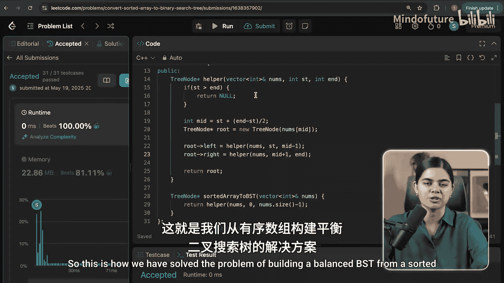

# C++-DSA课程-｜-数据结构-｜-leetcode-｜-Apna-College-｜--Complete-C++-Dsa-Course-p97-P99_有序数组转为平衡二叉搜索树-DSA系列_-L.97--BV18oUGBkEmV_p97-

Hi everyone， and welcome to the complete D series。 And today we' are going to solve one more D A problem。

 which is called sorted array A to balance B S concept K playless scanner available。 Also。

 there is a link for a company by in the description box。

 So start This problem is called sorted A A to balance B S。

 and this is an easy level problem available on lead code as problem number 10。

8ari vector given here， which has a sorted sequence of numbersid numbers convert K to a balance B andkeju return will be given in justham balance B can convert K B properties Ko Al last lecture can cover k B S is a binary search tree。

😊，And binary search treat a particular property follow。

 which basically is if that is the parent node Sa lesser values greater right is very similar to how binary search happens called propertyki in that is always sorted sequence and sequence sort in tra given So this is a very easy problem to solve basically and right hide side be equal number of nodes or right side equal number of nodes what。

😊，To doni B S properties co follow equal number of nodes for me equal number of nodes forgi or a node as the parent nodejo sequence ofbied to is sequenceanderju middleju midham as the root note and mid and left half they will become the left s right half will become the right s orbiarimetai。

 If I try and visualize my like this。😊，Though we have-10，-3，0。

5 and 9hamish start k ex starting node equal to 0 and ending node k for this case。

 this is going to be equal to4 and N mid find out mid root of the3 and left sub call and So basically sub midko calculate it is going to be equal to0 root we are going to make a call to build the left sub3 leftham starts mid1star mid1 is mid is going to be this value midja is root root we are going to add a value of-10 and。

😊，Rightri leftri values right we are going to create a new node which will have value3 similar right is the next mid is going to be equal to calculate is always equal to n divided by optimized version use which is start plus。

😊，N minus start divided by2 to Ine portion k。 If my start is equal to 3 and my n is equal to 4 to a Mari made Hojaga 3 plus4-31 divided by2 3。

 So this is going to be the mid value 5 madejaga to sub write subre and create Kgi 5 k node Okeba 5 k write subco create Kane call。

 which will be the call for 9， the Yahani 9 value node create Kangi attach Kgi。

 And this is how we are going to create a balance B S D out of a sorted array page ofuraura processor Ibar is a summarize k in the form of a simple pseudo code。

😊，Aney， basically， Khakiia。Hamock start and ending value coac children just have normal binary search can correctly。

 So hammock helper functioning it just can we are going to get the vector numbers。😊，Wuski at me。

 we have the start and the ending value or Yahasam return Knajate Ame note。Rot go aer subse。

 we are going to calculate our mid value。 Jesse Ham made calculate Ka ham upne 9 nodeko create Karinggi rootjaga。

 basically。A new note。Which is available at Hamju numbers E Uski made indexer Ukiba the rootki left Cobel de Carnegili。

Hdubars， a helper function go called Laanghi jsmhamapnaamspaqueecte and his bar starts a lakere mid1 Tamjaanggi to build root caliph。

 Similarly， Hamrijuru Kaura Kaura ride Srihoga。😊，Use B de Carnii second half gopa Caringgi。

Just come helper function called Lamku passringgi。And is bar will start from mid plus1 silica enter Jgi and is the re A hum root cobal kringi root k F cobal Ki root k right cobal kringgi。

😊，And is function safe， we are finally going to return， though。

Route value base case k upper base caseippa in range I key image of valid values and3 kbigar in value valuebi greater than agarhama andja。

 Those case may co valid node existing in to we are going to return null value。

 So this is the helper function。 helps and Qki we are going to traverse on all of the nodes 1 by one or a k cur nodes。

😊，Haarrijo time complexity Lagie's function Gander。 that will be big of。

 So let us convert the pseudo code into C plus code code Kelly。

 this is the function that we have to complete A Ckimeni code Gander extracting an ending index H to E function copy Vanange。

 which will be the helper function。😊，Helper function Gander Hammna vector nus to pass Kinggi Uskeme。

 we are going to pass a starting index。And in。Ending index or Hama Yjo function H is simply a maari helper function go call Gga with nus star to Jaga 0。

😊，And ending index ogon nu start size  -1。And Yahase Jobiappa value。

 Igiari Rui O return Khen Ane Hepha function Gander Kabi B Agaari starki value is greater than the ending value。

 The Yahase we are going to return the null value。😊，Now though， up name mid go calculate ke。

 which will be start plus n minus start。😊，Divided by two。And Oskeba。

 we are going to create a root value。 Let's call this tree node。New3 node value。

 Just scan and pass curl in nus of mid。F root k left ofricobel cannela callla W。

Left sprico built Kane you call la use my helper function could pass carrying you with nus starting and mid1。

😊，Similarly， root k writes subrigo。Built Kani you call La Ghi to the helper function nus。

Mid plus1 silire int and its functions Sam return K G me root。

 So this is the overall logic disk key helps him up balance B S Dco be carrying it。

 Let us run this code and submit it。😊，So this is how we have solved the problem of building a balance BST from asorted area。

 So if you have successfully completed today's lecture。

 then you could mark it and is now in the comments。

 I case me can also share your progress with me on Twitter just calling up each description box and the mill Ja。

 Askate9 Milic lecture can the and keep learning and keep exploring。😊。

