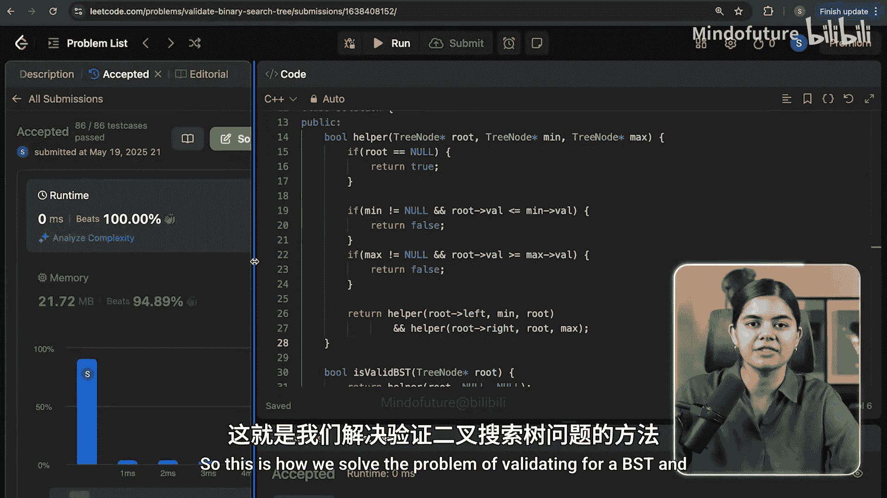

# C++-DSA课程-｜-数据结构-｜-leetcode-｜-Apna-College-｜--Complete-C++-Dsa-Course-p98-P100_验证二叉搜索树-DSA系列_-L.98--BV18oUGBkEmV_p98-

H everyone and welcome to the complete series。 and today we' are going to solve an important D problem which is called validating a there is a for company in the description box is called and this is also problem98 are given the root of or given is this a valid or not binary node plus all of the nodes have to be unique given binary or the is valid are to return true otherwise we are going to return a false is binary we can smaller node correct but5。

😊，Chil may 4 node， which is less than 5。 and this is violating the conditions for being a is binary3 k return false value because this is not a valid for example。

 and common mistakener valid and right given here and right So these three nodes are following the conditions of aham and7 k So this is also following the properties of but this is still not a binary Q right node which is3 exist even thoughka immediate right is。

😊，false and right logically that should be always greater than value and should right value is1 greater than minimum value is conditions satisfying and that is why。

😊，For example，m minimum value minimum value can be minus infinity per maximum value left childme root value maximum value equal range basically for node we have a minimum allowed value and a maximum allowed value is allowed value range for example。

m5 right minimum value and maximum value can be anything it could beity is is。😊。

That is why this is not a valid BS 4。 Let's supposeipas 5。5ja and 3as 5。

2ja Those case made this becomes a valid B to that is 52 plus infinity to 5。5 is range 5。

5 k range to subki rangeb those make upper cap for the root node node maximum value is driven by this root nodeja upperja5。

5 and lower capgi which was5 tori isari that is from5 to 5。5 or 5。

2 is also a valid node Similarly right sub right minimum value to Ho5。

5 or largest value is whatever is the allowed value for the parent。Plus infinityja to 65。

5 plus infinity value range satisfyriri for single minimum allowed value and maximum allowed value is minimum and maximum value if it is coming in the range false are writing the pseudo for function let's call this function is is basically root node minimum allowed value minimum node value and maximum allowed node value this is a boolean function。

😊，A his function can the Ham Hamisha rootco compare carrying a minimum and maximum gat A cugi Tgi actual root heli。

 Hamippa minimum allowed value minus infinity n plus infinity O to N hum re kingi with null。😊。

To Shiwam kringi with null values。 So for this tree， Agam dubar root at kri。

 the Yahaper minimum binal maximum binal， tomeishaar now the agarhamra Ju minimum value。

 If it is not equal to Ntabiiumarringgi， not equal to Nllva case me Agarhamari rootka Jobi Valhaya Jobi de。

 If that becomes greater than the minimum value。😊，Cardita。

 those case mayham Yahi say he returned Kingi false。

The sub all hamapni root who compare carrying a minimum allowed value kssat。

 if it becomes greater than the minimum allowed value。

 those case may we are going to return a false value。 Same cheese， hum ch kingip near maximum ksat。

 If the maximum is not equal to null。And root key value becomes less than maximum value。

Those case may beha return false value。 to Vo cases and false return。 For example。

hamm5 k A is nodeme falses Those case mam and rightm I allowed value for the leftri minimum value that remains same as the parent node and maximum value changes to the parent node valuem call Aham is B S call for root。

Left to v minimum value， Hami Hojagi， Jobi Hamari parent。

 K minimum value here and maximum value Ham Hojagi Hamari root E value Malab root norki Jovi value Hvo left subreche maximum value Hojagi。

 it will be the upper cap。 but Agam write subriki call laari Matlab is B S T Co Agamni call Kia for root Ka right。

 whose case may minimum value will be the roots value cookie right subreulate。

 This will be the lower cap。😊，The Yaaram route pass Karinge or maximum ma same rega as the parent。

left right return and basically1 minusfin is equal to canri from。😊。

minimum is not equal to null and root value。 These conditions should actually be opposite root less than equal to case invalid maximum greater than equal to invalid than equal greater than equal because root value should ideally be greater than minimum less than equal minimum is equal to root minimum is less than equal to or false false false case may single So this is the entire logic for checking for binary it is a valid。

BST or not， let us convert the pseudo code into c plus code code k this is the function that we have to complete。

 but Q cases function can undergo minimum maximum allowed node namem Tom k king helper function create K。

😊，Let's call this Boolean helpper， Boolean helpper k the Ektohamipas。

 Hamari tri node root Agi Osqueame will have a tree node minimum and a tree node maximum。

U kbibi aga root he value N him。Those case may Hammibaai null node Hamishha validid， BS T Hoier。

 the Yam return guing a true value。 Na check kringi， if minimum is not equal to null。

And Hamaju root rootka data here， root key value here。

 If that becomes less than or equal to minimum key value。

 the minimums say become a root key value here。 Those case may false return。

Is see a parallel case yogaga if maximum is not equal to null and root Ca data hair root hi value that becomes greater than maximum key value。

 So that is also an invalid B S T to Ya returnhen false value nahi though Hamni left San writes subrinagahamse call lahen helper co。

😊，For root car left。Root K left me minimum value is going to remain same maximum Hojagaari root car data。

And， and helpperco call La Gaing for root car right。

 Just my minimum will be the root value and maximum will be the same as Jobm parential a maximum call here。

 So this is the entire logic disk case basis parameter check Kringa for the tree。

 a main function can the Yahaper。😊，Helper go call Ginggi by passing route。

S may minimum B N maximum be N Jovi directly returned helper functionri complexity helper functionham So the time complexity of this code is going to be linear。

 let us run the code and submit it。 So this is how we solve the problem of validating for a and problem with a time complexity of So if you have successfully completed today's lecture you can mark in is now in the comments important problem logic because this is an important interview problem I can also share your DS progress with me on Twitter description box next lecture key learning and keep exploring。

😊。

