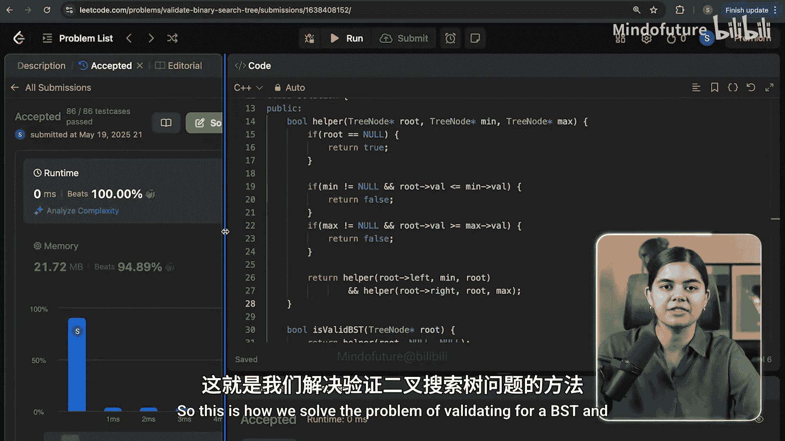

# C++ DSA课程：P98-P100：验证二叉搜索树


## 概述
在本节课中，我们将学习如何解决一个重要的数据结构问题：验证二叉搜索树。我们将理解二叉搜索树的定义，分析常见的错误判断，并学习一个使用递归和值范围检查的有效算法。

---

## 二叉搜索树定义
二叉搜索树是一种特殊的二叉树，其中每个节点都满足以下条件：
*   该节点**左子树**中的所有节点值都**小于**该节点的值。
*   该节点**右子树**中的所有节点值都**大于**该节点的值。
*   左右子树也必须是二叉搜索树。

**核心公式**：对于树中的任意节点 `node`，需满足 `左子树所有值 < node.val < 右子树所有值`。

## 常见误区与正确思路
一个常见的错误是只检查每个节点与其直接子节点的关系。然而，正确的验证需要确保整个子树都满足条件。

例如，考虑以下结构：
```
    5
   / \
  4   6
     / \
    3   7
```
节点5的直接子节点（4和6）满足条件，但节点6的左子节点3小于根节点5，违反了BST的定义。因此，这棵树不是有效的BST。

上一节我们介绍了BST的基本定义和常见误区，本节中我们来看看如何系统地解决这个问题。

## 基于值范围的验证算法
解决此问题的关键在于为树中的每个节点定义一个**允许的值范围**（最小值和最大值）。在遍历树时，我们检查每个节点的值是否在其允许的范围内。

**算法思路**：
1.  从根节点开始，其允许范围是 `(-∞, +∞)`。
2.  检查当前节点值是否在 `(min, max)` 范围内。如果不在，则树无效。
3.  递归检查左子树：其允许范围更新为 `(min, 当前节点值)`。
4.  递归检查右子树：其允许范围更新为 `(当前节点值, max)`。
5.  如果所有节点都满足其范围，则树是有效的BST。

以下是该算法的伪代码描述：
```
函数 isValidBST(root):
    返回 helper(root, null, null) // 初始范围无限制

函数 helper(node, min, max):
    如果 node 为空:
        返回 true // 空树是有效的BST
    如果 (min 不为空 且 node.val <= min) 或 (max 不为空 且 node.val >= max):
        返回 false // 节点值超出允许范围
    返回 helper(node.left, min, node.val) 与 helper(node.right, node.val, max)
```

## C++代码实现
现在，让我们将伪代码转换为实际的C++代码。

**核心代码**：
```cpp
class Solution {
public:
    bool isValidBST(TreeNode* root) {
        return helper(root, nullptr, nullptr);
    }

    bool helper(TreeNode* root, TreeNode* minNode, TreeNode* maxNode) {
        if (root == nullptr) {
            return true;
        }
        // 检查当前节点值是否在(min, max)范围内
        if ((minNode != nullptr && root->val <= minNode->val) ||
            (maxNode != nullptr && root->val >= maxNode->val)) {
            return false;
        }
        // 递归检查左右子树，并更新范围
        return helper(root->left, minNode, root) &&
               helper(root->right, root, maxNode);
    }
};
```
**代码说明**：
*   我们使用 `TreeNode*` 类型的 `minNode` 和 `maxNode` 来传递范围边界。使用 `nullptr` 表示无穷大或无穷小。
*   递归基例：如果节点为空，返回 `true`。
*   范围检查：如果节点值小于等于最小值或大于等于最大值，则无效。
*   递归调用：检查左子树时，最大值更新为当前节点；检查右子树时，最小值更新为当前节点。

## 复杂度分析
*   **时间复杂度**：O(N)，其中 N 是树中的节点数。我们恰好访问每个节点一次。
*   **空间复杂度**：O(H)，其中 H 是树的高度。这是递归调用栈的空间消耗。在最坏情况（树退化为链表）下，复杂度为 O(N)。



## 总结
本节课中我们一起学习了如何验证一棵二叉树是否为二叉搜索树。我们首先明确了BST的定义，然后指出了仅检查直接父子节点的常见错误。接着，我们引入了基于值范围检查的递归算法，该算法通过为每个节点维护一个 `(min, max)` 区间来确保全局有序性。最后，我们实现了该算法的C++代码，并分析了其时间和空间复杂度。这是一个重要的面试问题，掌握其核心逻辑对理解树形数据结构至关重要。