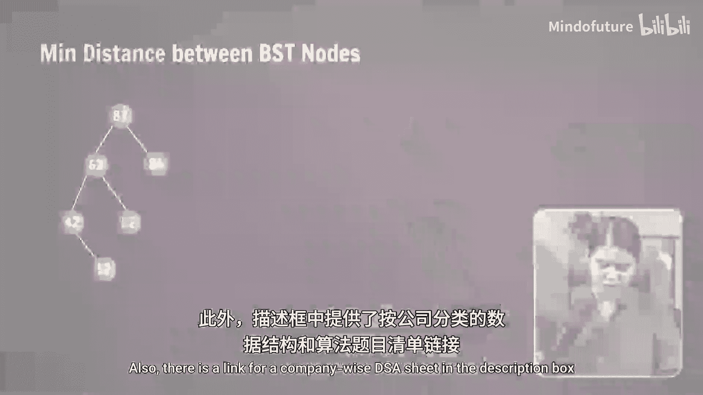
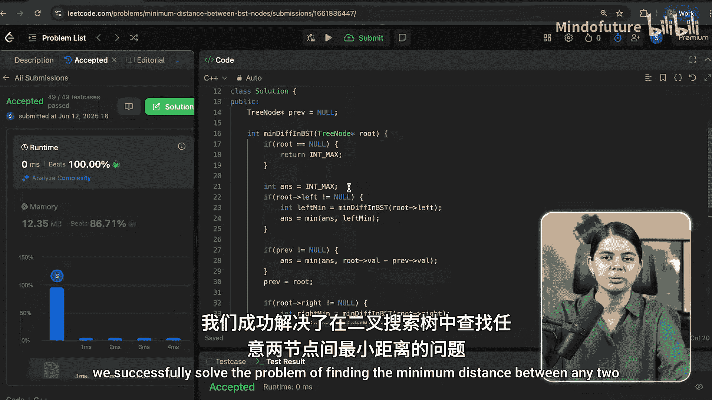

# C++-DSA课程-｜-数据结构-｜-leetcode-｜-Apna-College-｜--Complete-C++-Dsa-Course-p99-P101_二叉搜索树节点间的最小距离-DSA系列_-L.99--BV18oUGBkEmV_p99-

Hi everyone， and welcome to the complete D series。 and today we are going to solve an important B problem。

 which is called minimum distance between any two nodes of the B playless available there is a link for a company sheet in the description box start this problem is called minimum distance between nodes and this is also problem 783 binary given binary minimum distance which is basically the minimum difference between any two binary nodes example nodes difference minimum 82 and 83 difference that is going to be equal to1 and one is the answer output So this is the function that we have to complete are node。

😊。

Alyze distance difference in sequence sort sequence for example， sequence can42 then 526282。😊。

83 and 88 values minimum in fact that is a linear complexity problem numbers62528225262 as compared to 42 minimum numbers and basically what we can do is logically52 and 42625226288288。

😊，just may say minimum difference is going to be equal to one。

 and this is the exact approach basis per minimum distance calculate order1 we can get the minimum difference in linear but how exactly do we get the sorted order in in have that in orderverse root and then we traverse the entire right we see in2 right28 to8388。

😊，And in orderme sorted sequence return problem simply in order fashion traverse sorted sequence important is previous value for example。

 52che to 52 previous value was 4262 62 order value was 52 83 83 the previous value was 82 in order travel also have to track a previous value to track the previous node which was visited in in order sequence。

😊，Let us try and do the dry and of the approach that we are talking about global pointer create previous nu to previous or in order sequence83 per 83 to to 62624242424242 previous root next42522 previous42 as 42。

 and then we are going to move on to 522。😊，5252 current difference previous values compare to 52 and 42 will be equal to 10 to 52 node is not the final answer。

 but this is the current difference of this particular node 52 this value is going to be equal to10 root value42 will be 52 and right62 62s suppose423 case may answer which would have been one62curs what we also have answer。

return case equal to62 difference which is 10 up 62 difference 62 and 52 which is also equal to 10 and nexteration is62 right82 and 62 difference is equal to 20eration is82 to 62 difference is 10 right difference is 20 and1062 because we have to return the minimum distance which is equal to 10 root8383 difference calculate and that is going to be1。

😊，Oskeba， we are going to update the previous value to 83， and we are going to move on to 88。

88 per a K difference calculate ki， which is going to be equal to 5 previous update K to 88 and backtriari nodes message of minimum difference I that is equal to1 finally returnring and root go up in our distance to calculate Knata using previous left kga with recursion and right car difference Bga with recursion。

 Now， how do we write the pseudo code for this entire logic pseudo subse global pointer create K3 node star previous and I initializene with value Usque me we have a function。

😊，Let's call it minimum distance function。anderipas root node available functionander in order traveralari root is not equal to nu In fact。

 I am just going to write if root node left exist K Those case may minimum distance function call with root and minimum value returnverse answer return for example。

83 and right return we can create an answer variablefin initialize minimum value to initialization maximum valuefin initialize in max initialize and answer answer is equal to minimum of answer and left say Jobi minimum differenceipas。

😊，Return Uaya。 So this is the first step in in audit revversal。

 which is to traverse the left sub Oky root level casear root level perme Apeny root kiaka minimum distance calculate。

 the root minimum distance is previous value simga。😊，To next time check her Se。

 if the previous value is not equal to null， whose case may answer is going to be minimum of answer and Jobi Hamari Rokey value Hog minus the previous value。

The upperim root kta a previous Kta co minus Kge， And this overall value is always going to be a positive value because y B S T just scan the previous Hamishah left sub3 say Yes value He throw Kraa。

 Those case may root key value Hamishah previous key value said。

 Hence we are always going to get a positive value。 say minimize Kle， Let us re this。😊。

So this is the first step in in order， Okeba for the right side。

sab left sri reverseverse cur left minimumia root code traverse cur current minimumia and aham right of right of previous update Kana top previous updateque to root and see cheese for the right sri。

😊，Malaab Agarhammarlia Ruka right exist Ktai。 those case me。

H up knee right minimum key value co calculate currentringgi by calling minimum distance and passing route car。

Right there。 Andkiba answer say compare Kingi。Minimum is equal to answer。

And Jobiay right minimum key value。 This one is the root part。

 and this is the part Ja in orderki third step perform。

 which is traversing the right sub Jobiari answer Valse return Yaham simply last May I return answer statement andrumeky root is equal to Nll。

😊，Those case may what will be the minimum distance。 There is no minimum distance that can exist。

 Toma Kingi infinity Yni in teacherger Max value Cohiium return Kaneval。

Though we have to return the int max value in that case。

 So this is how we solve the problem of finding out the minimum distance between two nodes in obesity。

 and upper notice cur hummni extra Nani simply in order traveral could perform here to Mariio time complexity Hogi。

 that will be the time complexity of in audit traversal。

 But the p tricky her node a bar traverse cur。 So if we have n notess to marry time complexity of Jgi B of N K equal。

 Now， let us convert the pseudo code into C plus code。

 the C plus code K this is the function that we have to complete say Nele。😊，Iq。Node pointer Bium。

 which will store the previous value and saym initialized King in algiat。

To subseli base case likeium， if the root is equal to null。

 those case may pattaya in teacherger max value co return case me。

 we can create an answer variable just in max initialize K to subseli a root call left exist k。

 we are going to reverseverse the left sub。 we can also write the condition as not equal to null to ya left minimumippa Iga and this left minimum will be an integer value y aa jab minimum difference in BS T function co call a for root car left。

😊，And Uskiba answers compare Kingi。Up knee， left minimum go。Similarly。

 hamni current minimum who calculate carrying it to a previous is not equal to null。

Those case may harm current minimum co calculate currentringgi as。Minimum answer。

Current minimum could calculate currenta as root key value minus previous key。

Value and Ja previous root Yahi sameme toha rootjaga and same cheeseasgi。

 this will be now right minimum。And rightman， finally， Hamya return Kingne answer。

 So this is the overall logic justk basis by Savalco Sal value。 Let us now run the code。😊。

And submit it。 So this is how we successfully solve the problem of finding the minimum distance between any two nodes of the BSD。

 So if you have successfully completed the lecture， then you can mark in us down in the comments。

 I says how me can also share your DSA progress with me on Twitter just calling Kakuni description box and Mil Ja Askate9 Milton next lecture can the keep learning and keep exploring。

😊。

