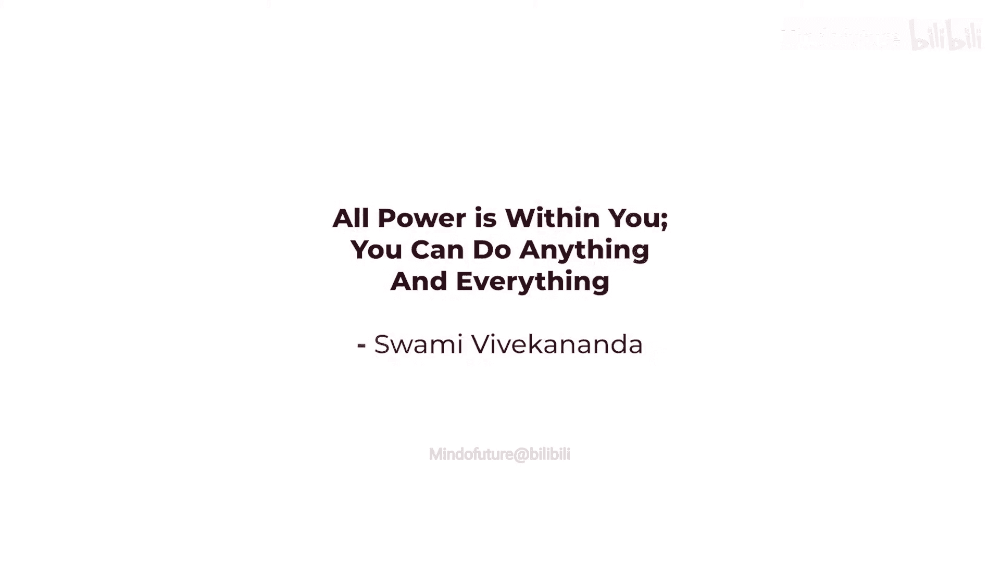
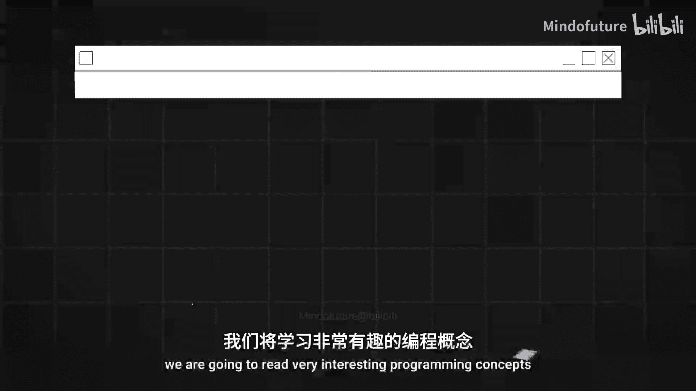
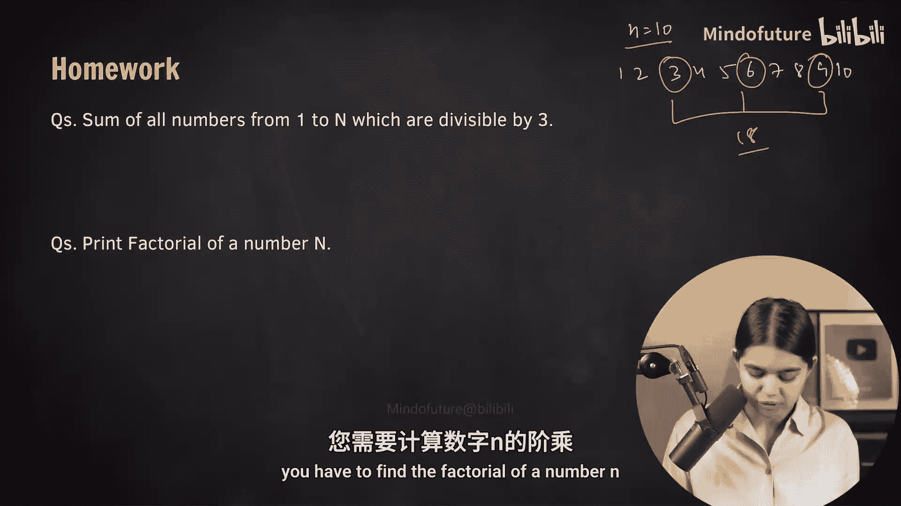

# 003：条件语句与循环 🚀





在本节课中，我们将学习C++编程中两个核心概念：**条件语句**和**循环**。它们是控制程序流程的基础，能让我们编写出根据不同情况执行不同操作，以及重复执行特定任务的程序。

---

## 条件语句 🔀

条件语句允许程序根据特定条件的真假来决定执行哪一段代码。其核心是 `if` 语句。

### `if` 语句

`if` 语句的基本结构是：如果条件为真，则执行大括号 `{}` 内的代码块。

```cpp
if (条件) {
    // 条件为真时执行的代码
}
```

例如，判断一个数是否为正数：

```cpp
int n = 45;
if (n >= 0) {
    cout << n << " 是正数" << endl;
}
```

### `if-else` 语句

`if-else` 语句在条件为假时，提供了另一个执行路径。

```cpp
if (条件) {
    // 条件为真时执行的代码
} else {
    // 条件为假时执行的代码
}
```

例如，判断一个人是否有投票权：

```cpp
int age;
cout << "请输入年龄：";
cin >> age;
if (age >= 18) {
    cout << "你可以投票。" << endl;
} else {
    cout << "你不能投票。" << endl;
}
```

### `else-if` 语句

当需要检查多个条件时，可以使用 `else if`。

```cpp
if (条件1) {
    // 条件1为真时执行
} else if (条件2) {
    // 条件2为真时执行
} else {
    // 以上条件都不为真时执行
}
```

例如，实现一个简单的评分系统：

```cpp
int marks;
cout << "请输入分数：";
cin >> marks;
if (marks >= 90) {
    cout << "等级：A" << endl;
} else if (marks >= 80) {
    cout << "等级：B" << endl;
} else if (marks >= 70) {
    cout << "等级：C" << endl;
} else {
    cout << "等级：D" << endl;
}
```

### 嵌套 `if` 语句

`if` 语句可以嵌套在另一个 `if` 或 `else` 语句内部，用于处理更复杂的逻辑。

---

## 字符判断示例 🔤

我们可以使用条件语句来判断一个字符是大写还是小写字母。

以下是判断逻辑：
*   如果字符在 `‘a’` 到 `‘z’` 之间，则为小写。
*   如果字符在 `‘A’` 到 `‘Z’` 之间，则为大写。

```cpp
char c;
cout << "请输入一个字符：";
cin >> c;
if (c >= ‘a‘ && c <= ‘z‘) {
    cout << "这是一个小写字母。" << endl;
} else if (c >= ‘A‘ && c <= ‘Z‘) {
    cout << "这是一个大写字母。" << endl;
}
```

**注意**：在比较时，字符会隐式转换为其对应的ASCII码值（例如，`‘A’` 对应65，`‘a’` 对应97）。

---

## 三元运算符 ⚖️

三元运算符 `? :` 是 `if-else` 语句的简洁写法，适合简单的条件赋值。

**语法**：`条件 ? 表达式1 : 表达式2`
如果条件为真，整个表达式的结果为 `表达式1`，否则为 `表达式2`。

```cpp
int n = 45;
cout << (n >= 0 ? “正数” : “负数”) << endl;
```

---

上一节我们介绍了如何根据条件做出一次性的决策，但在编程中，我们经常需要重复执行某些操作。本节中我们来看看如何利用循环来实现重复执行。

## 循环 🔁

循环用于重复执行一段代码块，直到满足特定条件。

### `while` 循环

`while` 循环在条件为真时，会反复执行循环体内的代码。

```cpp
while (条件) {
    // 条件为真时重复执行的代码
}
```

例如，打印数字1到3：

```cpp
int count = 1;
while (count <= 3) {
    cout << count << “ ”;
    count++; // count = count + 1
}
cout << endl;
// 输出：1 2 3
```

**注意**：务必确保循环条件最终会变为假，否则会陷入**无限循环**。在终端中，通常可以按 `Ctrl+C` 来终止无限循环的程序。

### `for` 循环

`for` 循环将循环变量的初始化、条件检查和更新集中在一行，结构更清晰，特别适合已知循环次数的情况。

**语法**：
```cpp
for (初始化; 条件; 更新) {
    // 循环体
}
```

例如，计算1到n所有整数的和：

```cpp
int n = 5;
int sum = 0;
for (int i = 1; i <= n; i++) {
    sum = sum + i; // 或 sum += i
}
cout << “1到” << n << “的和是：” << sum << endl;
// 输出：1到5的和是：15
```

### `do-while` 循环

`do-while` 循环先执行一次循环体，然后再检查条件。这意味着循环体至少会执行一次。

```cpp
do {
    // 循环体（至少执行一次）
} while (条件);
```

例如，即使用户输入不满足条件，也至少会打印一次：

```cpp
int i = 10;
do {
    cout << “Hello” << endl;
} while (i < 5); // 条件为假，但“Hello”已被打印一次
```

---

## 循环应用示例 🧮

让我们结合条件语句和循环来解决一些实际问题。

### 示例1：求1到n之间所有奇数的和

思路：遍历1到n，用 `%`（取模）运算符判断每个数是否为奇数（`i % 2 != 0`），如果是则累加。

```cpp
int n = 10;
int oddSum = 0;
for (int i = 1; i <= n; i++) {
    if (i % 2 != 0) { // 判断是否为奇数
        oddSum += i;
    }
}
cout << “1到” << n << “之间所有奇数的和是：” << oddSum << endl;
// 输出：1到10之间所有奇数的和是：25
```

### 示例2：判断一个数是否为质数

质数是大于1的自然数，且除了1和它自身外，不能被其他自然数整除。

**基础思路**：检查从2到n-1之间，是否有数能整除n。
```cpp
int n = 7;
bool isPrime = true; // 先假设是质数
for (int i = 2; i <= n-1; i++) {
    if (n % i == 0) {
        isPrime = false; // 如果能被整除，则不是质数
        break; // 发现一个因子即可确定不是质数，跳出循环
    }
}
if (isPrime) {
    cout << n << “ 是质数。” << endl;
} else {
    cout << n << “ 不是质数。” << endl;
}
```

**优化思路**：实际上，检查到 `√n` 即可。因为如果n有一个大于 `√n` 的因子，那么它必然对应一个小于 `√n` 的因子。

```cpp
int n = 7;
bool isPrime = true;
for (int i = 2; i * i <= n; i++) { // i <= sqrt(n) 的等价写法
    if (n % i == 0) {
        isPrime = false;
        break;
    }
}
// ... 后续判断逻辑相同
```

---

## 嵌套循环 🎯

一个循环放在另一个循环内部，称为嵌套循环。外层循环每执行一次，内层循环会完整地执行其所有迭代。

例如，打印一个5行5列的星号矩形：

```cpp
int rows = 5;
int cols = 5;
for (int i = 1; i <= rows; i++) { // 外层循环控制行
    for (int j = 1; j <= cols; j++) { // 内层循环控制列
        cout << “* ”;
    }
    cout << endl; // 每打印完一行后换行
}
```
**输出**：
```
* * * * *
* * * * *
* * * * *
* * * * *
* * * * *
```

通过修改内层循环的条件，可以打印出三角形等多种图案，这将在后续关于“模式打印”的课程中详细探讨。

---

## 总结 📚

本节课中我们一起学习了控制程序流程的核心结构：
1.  **条件语句** (`if`, `if-else`, `else-if`，三元运算符)：让程序能够根据不同条件做出决策。
2.  **循环** (`while`, `for`, `do-while`)：让程序能够高效地重复执行任务。
3.  **嵌套循环**：用于处理更复杂的重复模式，例如打印多维图形。



掌握这些概念是学习数据结构和算法（DSA）以及解决LeetCode等平台问题的基石。请务必通过练习题（如计算1到n中能被3整除的数之和、计算数字n的阶乘等）来巩固理解。下一讲，我们将深入研究循环的进阶应用——模式打印。