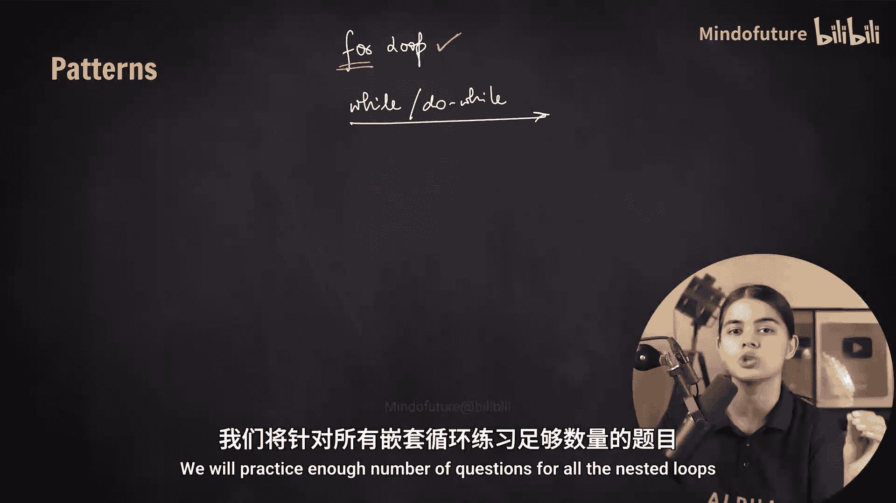
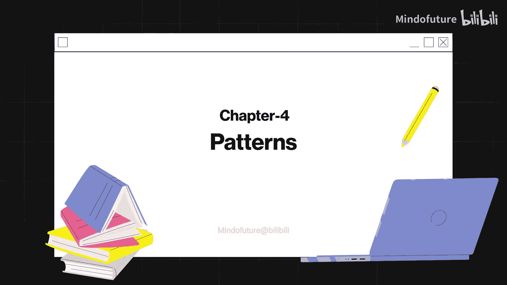
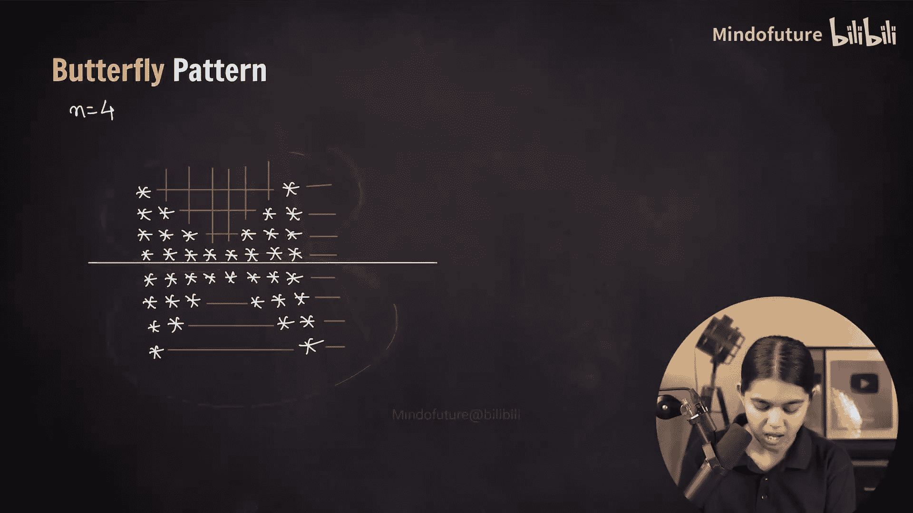

# 004：模式打印教程 🧩






在本节课中，我们将学习如何使用C++中的嵌套循环来打印各种图形模式。这是理解循环控制流和问题分解的绝佳练习。我们将从简单的方形模式开始，逐步过渡到更复杂的三角形和菱形模式。

---

## 方形模式 🔲

上一节我们介绍了嵌套循环的基本概念，本节中我们来看看如何打印一个简单的方形数字模式。

**核心逻辑**：使用两层循环。外层循环控制行数，内层循环控制每行打印的数字个数。

以下是打印一个 `n x n` 方形数字模式的步骤：
1.  外层循环 `i` 从 1 运行到 `n`，代表每一行。
2.  内层循环 `j` 也从 1 运行到 `n`，代表每一列。
3.  在内层循环中，打印数字 `j` 或一个固定字符。
4.  每完成一行内层循环后，输出一个换行符以开始新的一行。

```cpp
int n = 4;
for(int i=1; i<=n; i++) {
    for(int j=1; j<=n; j++) {
        cout << j << " ";
    }
    cout << endl;
}
```
**输出**：
```
1 2 3 4
1 2 3 4
1 2 3 4
1 2 3 4
```

---

## 递增三角形模式 📈

理解了方形模式后，我们来看看三角形模式。首先学习递增三角形，其特点是每行的元素数量逐行增加。

**核心逻辑**：内层循环的终止条件与当前行号 `i` 相关联。

以下是打印递增三角形模式的步骤：
1.  外层循环 `i` 从 0 运行到 `n-1`。
2.  内层循环 `j` 从 0 运行到 `i`。这意味着第 `i` 行将打印 `i+1` 个元素。
3.  在内层循环中，打印星号 `*` 或数字。
4.  每行结束后换行。

```cpp
int n = 4;
for(int i=0; i<n; i++) {
    for(int j=0; j<=i; j++) {
        cout << "* ";
    }
    cout << endl;
}
```
**输出**：
```
*
* *
* * *
* * * *
```

---

## 反向三角形模式 📉

现在，我们尝试打印一个反向的三角形，即第一行元素最多，最后一行元素最少。

**核心逻辑**：内层循环从较大值开始，递减至较小值。

以下是打印反向三角形模式的步骤：
1.  外层循环 `i` 从 0 运行到 `n-1`。
2.  内层循环 `j` 从 `n` 开始，递减运行直到 `j > i`。这样第一行（i=0）将打印 n 个元素。
3.  打印元素并换行。

```cpp
int n = 4;
for(int i=0; i<n; i++) {
    for(int j=n; j>i; j--) {
        cout << "* ";
    }
    cout << endl;
}
```
**输出**：
```
* * * *
* * *
* *
*
```

---

## 倒置三角形模式 ⏬

倒置三角形在每行开头包含空格，形成右对齐的视觉效果。

**核心逻辑**：每行由“空格”和“数字/星号”两部分组成。空格数递增，星号数递减。

以下是打印倒置三角形模式的步骤：
1.  外层循环 `i` 从 0 运行到 `n-1`。
2.  第一个内层循环用于打印空格，循环 `j` 从 0 到 `i`，打印 `i` 个空格。
3.  第二个内层循环用于打印星号，循环 `j` 从 0 到 `n-i-1`，打印 `n-i` 个星号。
4.  换行。

```cpp
int n = 4;
for(int i=0; i<n; i++) {
    // 打印空格
    for(int j=0; j<i; j++) {
        cout << "  ";
    }
    // 打印星号
    for(int j=0; j<n-i; j++) {
        cout << "* ";
    }
    cout << endl;
}
```
**输出**：
```
* * * *
  * * *
    * *
      *
```

---

## 金字塔模式 🔺

金字塔模式是倒置三角形的对称组合，是更复杂的模式。

**核心逻辑**：将每行输出分为三部分：左侧空格、递增数字、递减数字。

以下是打印数字金字塔模式的步骤：
1.  外层循环 `i` 从 0 运行到 `n-1`。
2.  打印左侧空格：循环 `j` 从 0 到 `n-i-2`，打印空格。
3.  打印递增数字：循环 `j` 从 1 到 `i+1`，打印数字 `j`。
4.  打印递减数字：循环 `j` 从 `i` 到 1，打印数字 `j`。
5.  换行。

```cpp
int n = 4;
for(int i=0; i<n; i++) {
    // 左侧空格
    for(int j=0; j<n-i-1; j++) {
        cout << "  ";
    }
    // 递增数字
    for(int j=1; j<=i+1; j++) {
        cout << j << " ";
    }
    // 递减数字
    for(int j=i; j>=1; j--) {
        cout << j << " ";
    }
    cout << endl;
}
```
**输出**：
```
      1
    1 2 1
  1 2 3 2 1
1 2 3 4 3 2 1
```

---

## 菱形模式 💎

菱形模式可以看作是一个正金字塔和一个倒金字塔的组合。

**核心逻辑**：将图形分为上下两部分分别打印。

以下是打印菱形模式的步骤：
**上半部分（正金字塔）**：
1.  外层循环 `i` 从 0 运行到 `n-1`。
2.  打印左侧空格：循环次数为 `n-i-1`。
3.  打印星号：首行打印1个，后续行打印 `2*i+1` 个（奇数序列）。
4.  换行。

**下半部分（倒金字塔）**：
1.  外层循环 `i` 从 0 运行到 `n-2`。
2.  打印左侧空格：循环次数为 `i+1`。
3.  打印星号：循环次数为 `2*(n-i-1)-1`。
4.  换行。

```cpp
int n = 4;
// 上半部分
for(int i=0; i<n; i++) {
    for(int j=0; j<n-i-1; j++) cout << "  ";
    for(int j=0; j<2*i+1; j++) cout << "* ";
    cout << endl;
}
// 下半部分
for(int i=0; i<n-1; i++) {
    for(int j=0; j<=i; j++) cout << "  ";
    for(int j=0; j<2*(n-i-1)-1; j++) cout << "* ";
    cout << endl;
}
```
**输出**：
```
      *
    * * *
  * * * * *
* * * * * * *
  * * * * *
    * * *
      *
```

---



本节课中我们一起学习了从基础到进阶的多种图形模式打印方法，包括方形、三角形、金字塔和菱形。掌握这些模式的关键在于理解**外层循环控制行、内层循环控制列**的基本思想，并学会将复杂模式**分解为空格和图形两部分**，或**拆分成多个简单模式的组合**。请尝试将这些模式改写成打印字母或特定数字的版本，以巩固学习成果。