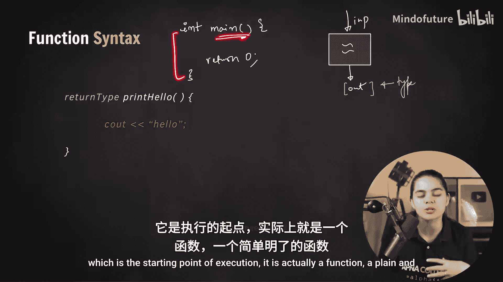
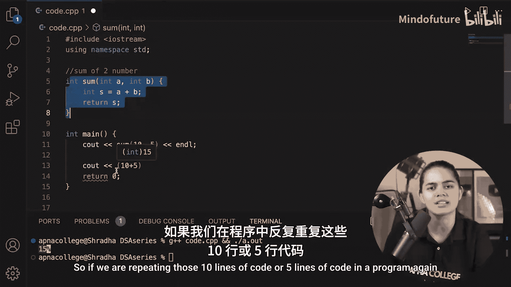
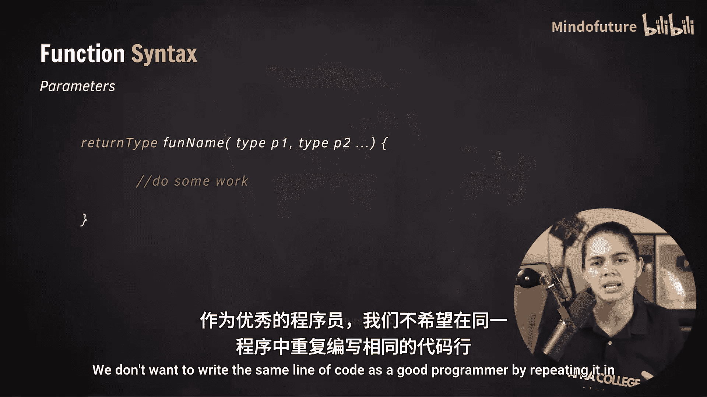
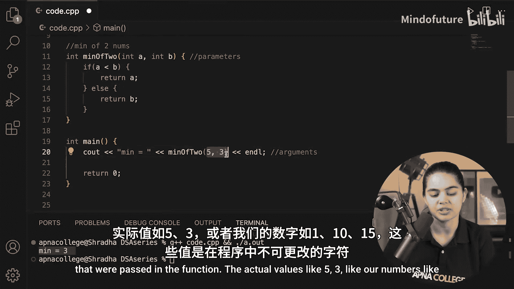
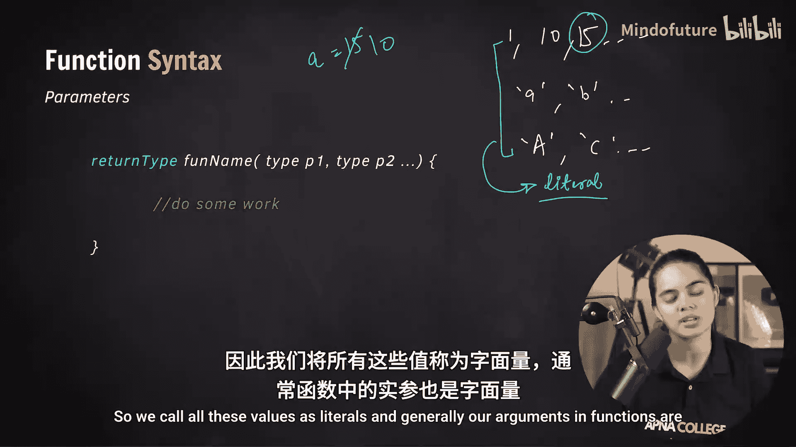
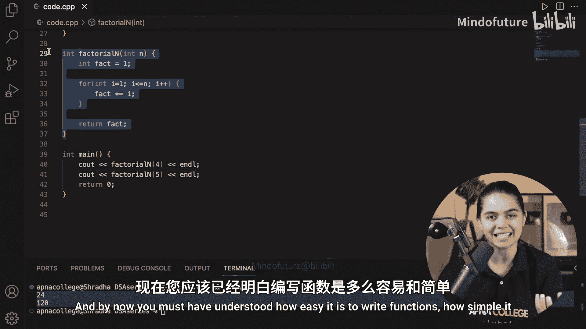

# 005：函数 🧮


在本节课中，我们将学习C++编程中一个核心且强大的概念——函数。函数是编程的基石，它允许我们将代码组织成可重复使用的模块，从而避免冗余，使程序更加清晰和高效。



## 什么是函数？

上一节我们介绍了课程概述，本节中我们来看看函数的基本定义。

函数本质上是一个执行特定任务的代码块。当程序中需要反复执行某项工作时，我们可以将这项工作编写成一个函数。函数就像一个“黑盒”，它可以接收输入（参数），进行处理，并返回一个输出（返回值）。

一个函数的基本结构如下：
```cpp
返回类型 函数名(参数列表) {
    // 函数体：执行任务的代码
    return 返回值; // 如果返回类型不是void
}
```
例如，程序执行的起点 `main` 函数本身就是一个函数。

## 创建第一个函数



理解了函数的概念后，我们来动手创建第一个简单的函数。



以下是一个打印“Hello”的函数示例。这个函数的返回类型是 `void`，意味着它不返回任何值。
```cpp
void printHello() {
    cout << "Hello" << endl;
}
```
要使用这个函数，我们需要在 `main` 函数中“调用”它。
```cpp
int main() {
    printHello(); // 函数调用
    return 0;
}
```
运行程序后，控制台会输出“Hello”。

## 带返回值的函数



并非所有函数都只是执行操作，很多函数需要计算结果并返回。本节我们学习如何创建带返回值的函数。



以下函数计算并返回整数3。注意，其返回类型是 `int`。
```cpp
int returnThree() {
    cout << "Hello" << endl;
    return 3;
}
```
我们可以在 `main` 函数中调用它，并将返回值存储在一个变量中，或直接使用。
```cpp
int main() {
    int value = returnThree(); // 返回值3被存储在value中
    cout << value << endl; // 输出 3
    // 或者直接使用
    cout << returnThree() << endl; // 同样输出 3
    return 0;
}
```

## 带参数的函数

函数真正的威力在于能够处理不同的输入数据。本节我们学习如何向函数传递参数。

让我们创建一个计算两数之和的函数。它接收两个整数参数 `a` 和 `b`。
```cpp
int sum(int a, int b) {
    int s = a + b;
    return s;
}
```
调用时，我们传入具体的数值。
```cpp
int main() {
    int result = sum(10, 5); // 调用函数，传入10和5
    cout << result << endl; // 输出 15
    return 0;
}
```
通过参数，同一个函数可以计算任意两个整数的和，极大地提高了代码的复用性，避免了代码冗余。冗余是糟糕程序员的标志。



## 更多函数示例

掌握了函数的基本结构后，我们通过更多例子来巩固理解。以下是几个常见功能的函数实现。

**1. 计算两数之和（支持小数）**
```cpp
double sumDouble(double a, double b) {
    return a + b;
}
// 调用：sumDouble(10.99, 5.65) 返回 16.64
```

**2. 求两数中的最小值**
```cpp
int minOfTwo(int a, int b) {
    if (a <= b) {
        return a;
    } else {
        return b;
    }
}
// 调用：minOfTwo(5, 3) 返回 3
```
函数调用时传入的具体值（如5和3）称为**实参**。函数定义时指定的变量（如`a`和`b`）称为**形参**。

**3. 计算1到n的累加和**
```cpp
void sumOneToN(int n) {
    int sum = 0;
    for(int i = 1; i <= n; i++) {
        sum += i;
    }
    cout << "Sum is: " << sum << endl;
}
// 调用：sumOneToN(5) 会计算1+2+3+4+5并打印结果
```

**4. 计算n的阶乘**
```cpp
int factorial(int n) {
    int fact = 1;
    for(int i = 1; i <= n; i++) {
        fact *= i;
    }
    return fact;
}
// 调用：factorial(4) 返回 24， factorial(5) 返回 120
```

## 函数调用与内存（栈）

函数在内存中是如何工作的呢？这对于理解程序执行流程至关重要。

在C++中，函数调用使用了一种叫做“调用栈”的内存结构。当 `main` 函数开始执行时，系统会为它创建一个“栈帧”。当 `main` 调用另一个函数（如 `sum`）时，会暂停 `main`，为 `sum` 函数创建新的栈帧放在顶部，并开始执行 `sum` 的代码。`sum` 函数执行完毕后，它的栈帧被销毁，返回值被传递回来，程序控制权交还给 `main` 函数，并从之前暂停的地方继续执行。

每个函数的局部变量都存储在自己的栈帧中，其他函数无法直接访问。例如：
```cpp
void fun() {
    int x = 25;
    cout << x << endl; // 可以访问自己的x
}
int main() {
    fun();
    // cout << x << endl; // 错误！main函数无法访问fun函数中的x
    return 0;
}
```
函数一旦执行到 `return` 语句就会立即结束，其后的代码不会被执行。

## 按值传递

C++中函数参数的默认传递方式是“按值传递”。这是一个非常重要的概念。

按值传递意味着当调用函数时，传入的**实参的值会被复制**一份给函数的**形参**。函数内部对形参的任何修改，都只影响这份副本，而不会改变原始实参变量的值。
```cpp
void changeX(int x) {
    x = 10; // 修改的是副本
    cout << "Inside function, x = " << x << endl; // 输出 10
}
int main() {
    int x = 5;
    changeX(x); // 将x的值5复制一份传给函数
    cout << "In main, x = " << x << endl; // 输出 5，原始值未变
    return 0;
}
```
因此，对于普通变量（如 `int`, `double`），函数内部无法通过形参直接修改实参。

## 实践练习

现在，让我们运用所学知识解决两个具体问题。

**问题1：计算一个数字的各位数之和**
例如，数字 `2356` 的各位数之和是 `2+3+5+6 = 16`。
思路：反复用 `% 10` 取最后一位，用 `/ 10` 去掉最后一位，直到数字变为0。
```cpp
int sumOfDigits(int number) {
    int digitSum = 0;
    while(number > 0) {
        int lastDigit = number % 10; // 获取最后一位
        digitSum += lastDigit;       // 加到总和中
        number /= 10;                // 去掉最后一位
    }
    return digitSum;
}
// 调用：sumOfDigits(2356) 返回 16
```

**问题2：计算二项式系数 (nCr)**
公式：`nCr = n! / (r! * (n-r)!)`
我们可以复用之前写的阶乘函数。
```cpp
int factorial(int n) { /* 如前所述 */ }

int binomialCoeff(int n, int r) {
    int fact_n = factorial(n);
    int fact_r = factorial(r);
    int fact_nmr = factorial(n - r);
    int result = fact_n / (fact_r * fact_nmr);
    return result;
}
// 调用：binomialCoeff(8, 2) 计算 8C2，返回 28
```

## 总结与作业

本节课中我们一起学习了C++函数的核心知识：从定义、调用、参数传递到返回值，并理解了函数在内存栈中的工作原理以及“按值传递”的特性。


以下是巩固知识的作业：
1.  **打印1到n**：编写一个函数，接收一个整数n，打印出从1到n的所有数字。
2.  **判断素数**：编写一个函数，判断给定的数字是否为素数。
3.  **打印斐波那契数列**：编写一个函数，打印斐波那契数列的前n项（如：1, 1, 2, 3, 5, 8...）。

恭喜你成功完成了本讲的学习！请在评论区分享你最喜欢的部分。持续学习，持续探索！