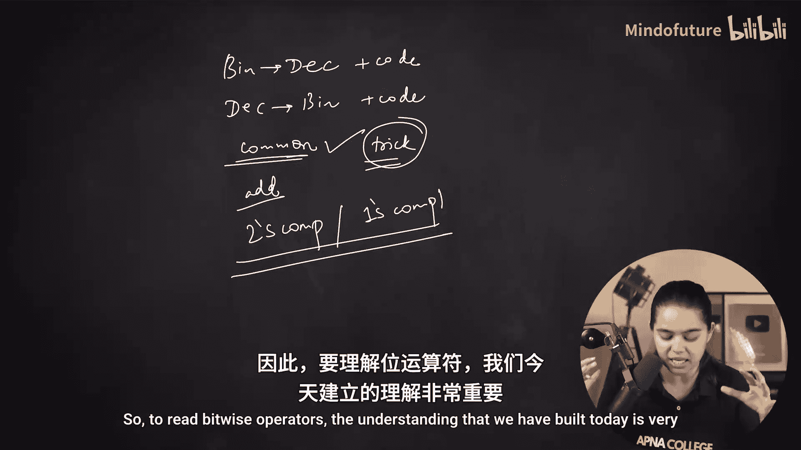

# 006：二进制数系统


在本节课中，我们将学习二进制数系统。这是一个非常重要的章节，因为它将教会我们很多关于数据如何在计算机内存中存储的知识。我们已经知道，数据是以二进制数的形式存储的。

## 数制系统概述

上一节我们提到了二进制数系统的重要性。本节中，我们先来了解不同的数制系统。我们常用的十进制数制系统使用0到9这十个数字进行计算。因此，它的基数是10。

除了十进制，还有其他数制系统，例如：
*   二进制数制系统，基数为2。
*   八进制数制系统，基数为8。
*   十六进制数制系统，基数为16。

本节课我们将重点学习二进制数制系统，以便理解数字在计算机内存中是如何被处理的。

## 十进制数转换为二进制数

现在，我们来看看如何将十进制数转换为二进制数。转换的核心方法是**重复除以2并记录余数**。

以下是转换步骤：
1.  将十进制数除以2。
2.  记录余数（0或1）。
3.  将商作为新的被除数。
4.  重复步骤1-3，直到商为0。
5.  将记录的余数从下往上（即最后一个余数到第一个余数）排列，得到的就是二进制数。

**示例：将十进制数42转换为二进制数**

```
42 ÷ 2 = 21 ... 余数 0
21 ÷ 2 = 10 ... 余数 1
10 ÷ 2 = 5  ... 余数 0
5  ÷ 2 = 2  ... 余数 1
2  ÷ 2 = 1  ... 余数 0
1  ÷ 2 = 0  ... 余数 1
```
从下往上读取余数：`101010`。
因此，十进制数 `42`（基数为10）等于二进制数 `101010`（基数为2）。

**示例：将十进制数50转换为二进制数**

```
50 ÷ 2 = 25 ... 余数 0
25 ÷ 2 = 12 ... 余数 1
12 ÷ 2 = 6  ... 余数 0
6  ÷ 2 = 3  ... 余数 0
3  ÷ 2 = 1  ... 余数 1
1  ÷ 2 = 0  ... 余数 1
```
从下往上读取余数：`110010`。
因此，十进制数 `50` 等于二进制数 `110010`。

## 二进制数转换为十进制数

上一节我们学习了十进制转二进制。本节中，我们来看看反向过程：如何将二进制数转换回十进制数。方法是**将每一位二进制数字乘以2的相应次幂，然后求和**。

**公式**：对于一个n位的二进制数 `b(n-1) b(n-2) ... b1 b0`，其十进制值为：
`十进制值 = b(n-1)*2^(n-1) + b(n-2)*2^(n-2) + ... + b1*2^1 + b0*2^0`

**示例：将二进制数101010转换为十进制数**

从右向左（最低位开始），位置和值如下：
```
位：  1   0   1   0   1   0
幂： 2^5 2^4 2^3 2^2 2^1 2^0
值： 32  0   8   0   2   0
```
计算总和：`32 + 0 + 8 + 0 + 2 + 0 = 42`。
因此，二进制数 `101010` 等于十进制数 `42`。

**示例：将二进制数110010转换为十进制数**

```
位：  1   1   0   0   1   0
幂： 2^5 2^4 2^3 2^2 2^1 2^0
值： 32  16  0   0   2   0
```
计算总和：`32 + 16 + 0 + 0 + 2 + 0 = 50`。
因此，二进制数 `110010` 等于十进制数 `50`。

## 使用C++代码实现转换

理解了手动转换的原理后，我们可以用C++代码来实现这些过程。

### 十进制转二进制的C++代码

以下是实现十进制数转换为二进制数的函数：

```cpp
#include <iostream>
using namespace std;

int decimalToBinary(int decimalNumber) {
    int power = 1; // 代表2的0次幂，在计算中用作位值权重（10^0, 10^1...）
    int answer = 0; // 存储最终的二进制数（以十进制形式表示，如1010）

    while (decimalNumber > 0) {
        int remainder = decimalNumber % 2; // 获取余数（0或1）
        answer += remainder * power;       // 将余数放到正确的位置
        power *= 10;                       // 更新位置权重（个位、十位、百位...）
        decimalNumber /= 2;                // 更新商，用于下一次循环
    }
    return answer; // 返回二进制形式（以整数表示）
}

int main() {
    int num = 50;
    cout << "Decimal " << num << " in binary is: " << decimalToBinary(num) << endl;
    // 输出：Decimal 50 in binary is: 110010
    return 0;
}
```

### 二进制转十进制的C++代码

以下是实现二进制数转换为十进制数的函数：

```cpp
#include <iostream>
using namespace std;

int binaryToDecimal(int binaryNumber) {
    int power = 1; // 代表2的0次幂
    int answer = 0; // 存储最终的十进制数

    while (binaryNumber > 0) {
        int lastDigit = binaryNumber % 10; // 获取最后一位（0或1）
        answer += lastDigit * power;       // 将该位的值加到结果中
        power *= 2;                        // 更新2的幂次（1, 2, 4, 8...）
        binaryNumber /= 10;                // 移除已处理的最低位
    }
    return answer; // 返回十进制数
}

int main() {
    int binNum = 110010;
    cout << "Binary " << binNum << " in decimal is: " << binaryToDecimal(binNum) << endl;
    // 输出：Binary 110010 in decimal is: 50
    return 0;
}
```

## 二进制补码：表示负数

到目前为止，我们处理的是正数。在计算机中，负数使用一种称为**二进制补码**的特殊形式存储。这是理解计算机如何处理有符号整数的关键概念。

**计算一个负数（如-10）的二进制补码表示，步骤如下：**
1.  **取绝对值的二进制形式**：先得到正数10的二进制形式（假设为8位）：`00001010`。
2.  **按位取反（得到反码）**：将所有位0变1，1变0。`00001010` 的反码是 `11110101`。
3.  **加1（得到补码）**：将反码加1。`11110101 + 1 = 11110110`。
4.  因此，十进制数 `-10` 在计算机中的8位二进制补码表示是 `11110110`。

**从二进制补码还原为十进制负数：**
1.  观察补码 `11110110`，最高位（最左边）是1，表明这是一个负数。
2.  **对补码再次取补码**（即步骤2和3的逆操作）：
    *   按位取反：`11110110` -> `00001001`
    *   加1：`00001001 + 1 = 00001010`
3.  得到二进制数 `00001010`，即十进制 `10`。
4.  由于原最高位为1，所以最终值是 `-10`。

**示例：求-8的8位二进制补码**
1.  `8`的二进制：`00001000`
2.  按位取反：`11110111`
3.  加1：`11110111 + 1 = 11111000`
4.  因此，`-8`的8位二进制补码是 `11111000`。

## 总结

本节课中，我们一起学习了二进制数系统。
*   我们回顾了不同的数制系统，并重点学习了二进制。
*   我们掌握了**十进制数转换为二进制数**的方法（重复除以2）。
*   我们也掌握了**二进制数转换为十进制数**的方法（按权展开求和）。
*   我们用C++代码实现了这两种转换。
*   最后，我们介绍了计算机中表示负数的关键方法——**二进制补码**，并学习了其计算和还原过程。

理解二进制是学习计算机如何存储和处理数据的基石，对于后续学习数据结构和算法至关重要。



