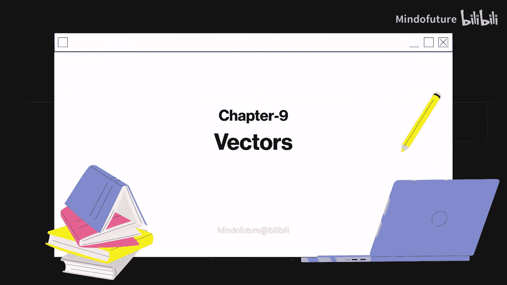

# 009：向量（数组第二部分）🚀




在本节课中，我们将学习C++中一个非常重要的数据结构——向量（Vector）。向量是一种动态数组，它克服了普通数组大小固定的限制，是解决许多编程问题的强大工具。

---

## 什么是向量？🤔

上一节我们介绍了数组，本节中我们来看看向量。向量本质上是一个动态数组。你可以把它想象成一系列可以存储数据的连续内存块，并且像数组一样拥有索引。向量与数组的主要区别在于，向量的大小是动态的，可以在运行时改变。

向量是C++标准模板库（STL）的一部分，其实现和使用在面试中非常重要。

## 向量的基本操作

以下是向量的基本创建和访问方法。

```cpp
#include <iostream>
#include <vector>
using namespace std;

int main() {
    // 创建一个大小为5的整数向量，所有元素初始化为0
    vector<int> vec(5);
    // 创建一个包含初始值的向量
    vector<int> vec2 = {1, 2, 3, 4};
    // 访问向量元素
    cout << vec2[0] << endl; // 输出 1
    // 使用 at() 函数访问，会进行边界检查
    cout << vec2.at(1) << endl; // 输出 2
    return 0;
}
```

## 遍历向量

了解如何创建向量后，我们来看看如何遍历它。除了使用普通的for循环，C++还提供了一种更简洁的“for-each”循环。

```cpp
#include <iostream>
#include <vector>
using namespace std;

int main() {
    vector<char> chars = {'A', 'B', 'C', 'D', 'E'};

    // 使用 for-each 循环遍历
    for(char ch : chars) {
        cout << ch << " ";
    }
    // 输出: A B C D E

    // 获取向量大小
    cout << "\nSize: " << chars.size() << endl; // 输出 5
    return 0;
}
```

## 向量的动态特性

向量最强大的特性是其动态性。我们可以在运行时轻松地添加或删除元素。

以下是向量的核心动态操作方法。

*   **`push_back(value)`**：在向量末尾添加一个元素。
*   **`pop_back()`**：删除向量末尾的一个元素。
*   **`front()`**：返回第一个元素。
*   **`back()`**：返回最后一个元素。

```cpp
#include <iostream>
#include <vector>
using namespace std;

int main() {
    vector<int> v; // 创建一个空向量
    cout << "初始大小: " << v.size() << endl; // 0

    v.push_back(25);
    v.push_back(35);
    v.push_back(45);
    cout << "添加元素后大小: " << v.size() << endl; // 3

    cout << "第一个元素 (front): " << v.front() << endl; // 25
    cout << "最后一个元素 (back): " << v.back() << endl; // 45

    v.pop_back(); // 删除最后一个元素 (45)
    cout << "pop_back 后大小: " << v.size() << endl; // 2
    cout << "新的最后一个元素: " << v.back() << endl; // 35

    return 0;
}
```

## 内存分配：静态 vs 动态

理解向量的工作原理，需要知道内存的静态和动态分配。

*   **静态分配**：在编译时确定大小，内存分配在栈上。普通数组就是静态分配的。
*   **动态分配**：在运行时确定大小，内存分配在堆上。向量内部使用动态分配来管理其可增长的内存。

向量内部有一个“容量”（capacity）的概念，它表示当前分配的内存可以容纳多少元素，而“大小”（size）表示实际存储了多少元素。当`push_back`新元素导致大小超过容量时，向量会自动分配一块更大的内存（通常是当前容量的两倍），并将所有元素复制过去。

```cpp
#include <iostream>
#include <vector>
using namespace std;

int main() {
    vector<int> vec;
    cout << "大小: " << vec.size() << ", 容量: " << vec.capacity() << endl;

    for(int i=0; i<5; i++) {
        vec.push_back(i);
        cout << "添加 " << i << " 后 -> 大小: " << vec.size() << ", 容量: " << vec.capacity() << endl;
    }
    // 输出可能类似：
    // 大小: 0, 容量: 0
    // 添加 0 后 -> 大小: 1, 容量: 1
    // 添加 1 后 -> 大小: 2, 容量: 2
    // 添加 2 后 -> 大小: 3, 容量: 4 (容量翻倍)
    // 添加 3 后 -> 大小: 4, 容量: 4
    // 添加 4 后 -> 大小: 5, 容量: 8 (容量再次翻倍)
    return 0;
}
```

## 实战练习：寻找唯一元素

现在，让我们运用所学知识解决一个经典问题。给定一个非空整数数组，其中每个元素都出现两次，只有一个元素出现一次。找出那个唯一的元素。

**示例**：
输入：`[4, 1, 2, 1, 2]`
输出：`4`

**解决方案思路**：
这个问题可以利用异或（XOR）运算的特性完美解决：
*   `a ^ a = 0` （任何数与自己异或结果为0）
*   `a ^ 0 = a` （任何数与0异或结果为自身）
*   异或运算满足交换律和结合律。

因此，将数组中所有数字进行异或运算，成对的数字会抵消为0，最终剩下的就是那个唯一的数字。

```cpp
#include <iostream>
#include <vector>
using namespace std;

int findUnique(vector<int>& arr) {
    int ans = 0;
    for(int num : arr) {
        ans = ans ^ num; // 对每个元素进行异或运算
    }
    return ans;
}

int main() {
    vector<int> nums = {4, 1, 2, 1, 2};
    cout << "唯一元素是: " << findUnique(nums) << endl; // 输出 4
    return 0;
}
```
**注意**：函数参数是`vector<int>& arr`（传引用），这避免了复制整个向量，提高了效率。这在处理大数据时很重要。

---


本节课中我们一起学习了C++向量的核心概念：它的动态特性、基本操作（如`push_back`、`pop_back`）、遍历方式、内部内存管理机制（大小与容量），并通过一个寻找唯一元素的实战问题巩固了知识。向量是STL中最常用的容器之一，务必熟练掌握。