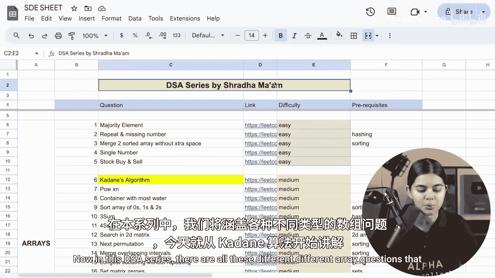
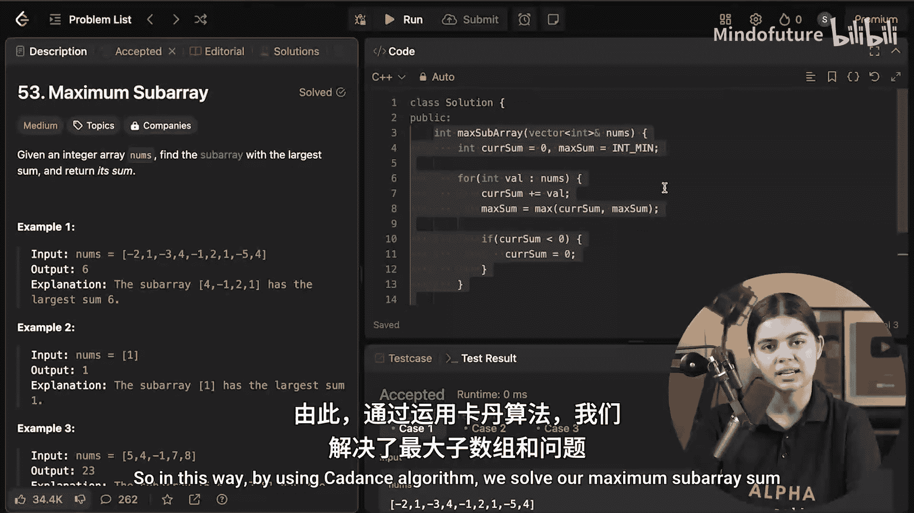
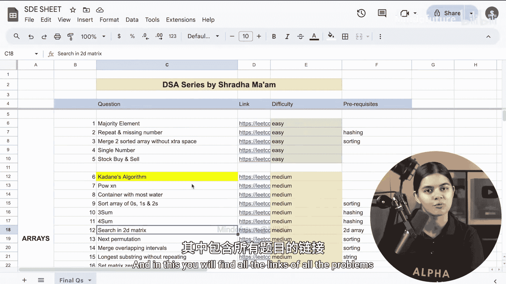

# 010：Kadane算法 - 最大子数组和 🧮

在本节课中，我们将学习如何解决“最大子数组和”问题。我们将从最直观的暴力解法开始，然后引入更高效的Kadane算法。通过对比，你将理解算法优化的思路，并掌握这一在线性时间内解决问题的核心技巧。




---

## 什么是子数组？ 📚

上一节我们介绍了课程目标，本节中我们来看看问题的基本概念。首先，需要明确“子数组”的定义。

子数组是原数组中一个**连续**的部分。例如，对于数组 `[1, 2, 3, 4, 5]`：
* 单个元素 `[1]` 是一个子数组。
* 三个连续元素 `[2, 3, 4]` 也是一个子数组。
* 但 `[1, 3, 5]` 不是子数组，因为元素不连续。

对于一个长度为 `n` 的数组，其子数组的总数可以通过以下公式计算：
**公式：** `总子数组数 = n * (n + 1) / 2`

例如，上述5个元素的数组，子数组总数为 `5 * 6 / 2 = 15`。这相当于从1加到5的和。

---

## 暴力解法 💪

理解了子数组的概念后，我们来看看最直接的解决方法——暴力枚举。

暴力解法的核心思想是：枚举所有可能的子数组，计算它们的和，并找出最大值。
*   一个子数组由其**起始索引**和**结束索引**唯一确定。
*   起始索引 `start` 可以从 `0` 到 `n-1`。
*   对于每个 `start`，结束索引 `end` 可以从 `start` 到 `n-1`。

以下是暴力解法的伪代码逻辑：

```cpp
int maxSum = INT_MIN; // 初始化最大和为最小整数
for (int start = 0; start < n; start++) {
    for (int end = start; end < n; end++) {
        int currentSum = 0;
        // 第三层循环计算从start到end的元素和
        for (int i = start; i <= end; i++) {
            currentSum += arr[i];
        }
        // 更新最大和
        maxSum = max(maxSum, currentSum);
    }
}
return maxSum;
```

这种方法的时间复杂度是 **O(n³)**，因为有三层嵌套循环。当数组很大时，效率非常低。

---

## 优化暴力解法 ⚡

在暴力解法中，我们重复计算了许多子数组的和。本节我们引入一个优化，将复杂度降低到 **O(n²)**。

优化思路是：当固定起始点 `start` 后，在遍历结束点 `end` 时，可以累加计算当前子数组的和，避免内层循环。

以下是优化后的伪代码：

```cpp
int maxSum = INT_MIN;
for (int start = 0; start < n; start++) {
    int currentSum = 0; // 对每个新的起始点，当前和重置为0
    for (int end = start; end < n; end++) {
        currentSum += arr[end]; // 累加新元素
        maxSum = max(maxSum, currentSum); // 更新最大和
    }
}
return maxSum;
```

虽然优化到了 O(n²)，但对于大规模数据仍然不够高效。接下来，我们将学习能在 **O(n)** 时间内解决问题的Kadane算法。

---

## Kadane算法 🚀

Kadane算法是解决最大子数组和问题的最优解，其核心思想是动态规划。它只需遍历数组一次。

算法的直觉是：遍历数组，不断累加当前元素到 `currentSum` 中。但如果 `currentSum` 变成负数，那么它对于后续子数组的和只会产生负面影响，因此应该将其重置为0，从下一个元素重新开始累加。同时，在每一步都记录下出现过的最大 `currentSum`。

以下是处理过程中可能遇到的情况：
1.  初始化 `currentSum = 0`, `maxSum = INT_MIN`。
2.  遍历每个数字 `num`：
    *   `currentSum = currentSum + num`
    *   `maxSum = max(maxSum, currentSum)`
    *   如果 `currentSum < 0`，则令 `currentSum = 0`

**注意**：初始化 `maxSum` 为 `INT_MIN` 是为了处理数组全为负数的情况，此时最大和就是那个最大的负数。

让我们看一个例子：数组 `[-2, 1, -3, 4, -1, 2, 1, -5, 4]`
*   步骤：`currentSum: 0 -> -2 -> 0 -> 1 -> -2 -> 0 -> 4 -> 3 -> 5 -> 6 -> 1 -> 5`
*   同时记录 `maxSum` 的变化，最终得到最大和为 `6`（对应子数组 `[4, -1, 2, 1]`）。

---

## 代码实现与总结 📝

根据以上思路，我们可以写出完整的Kadane算法代码。以下是适用于LeetCode等平台的函数实现：

```cpp
int maxSubArray(vector<int>& nums) {
    int currentSum = 0;
    int maxSum = INT_MIN;
    
    for (int num : nums) {
        currentSum += num;          // 累加当前元素
        maxSum = max(maxSum, currentSum); // 更新全局最大和
        if (currentSum < 0) {       // 如果当前和变为负数，则重置
            currentSum = 0;
        }
    }
    return maxSum;
}
```

**算法复杂度分析：**
*   **时间复杂度：O(n)**，只需一次遍历。
*   **空间复杂度：O(1)**，只使用了常数级别的额外空间。





本节课中我们一起学习了最大子数组和问题。我们从定义子数组开始，探讨了直观但低效的暴力解法（O(n³) 和 O(n²)），最终深入理解了高效且优雅的Kadane算法（O(n)）。掌握该算法的关键在于理解“当当前子数组和为负时，它对后续结果无益，应被舍弃”这一核心思想。这是动态规划思想的一个经典应用，在解决许多序列问题上都非常有用。