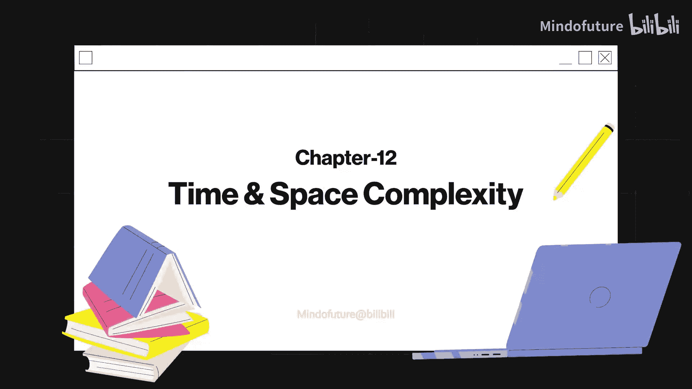
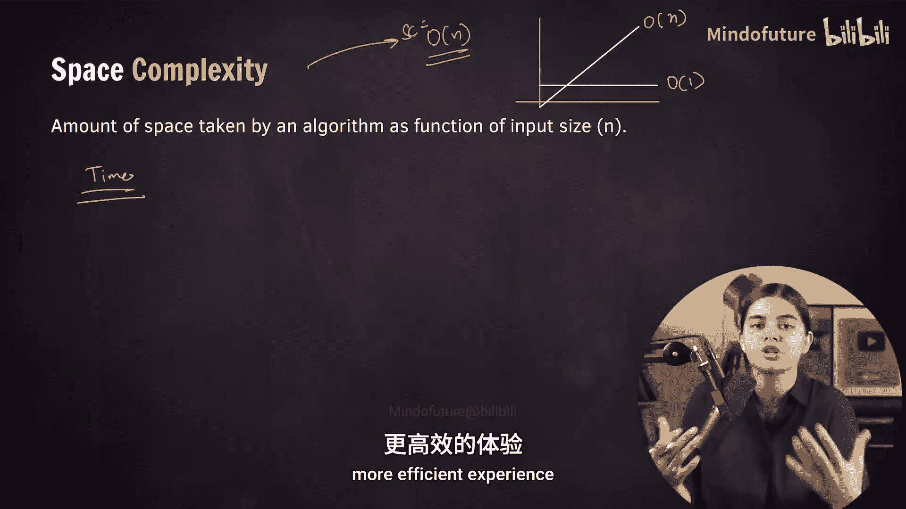
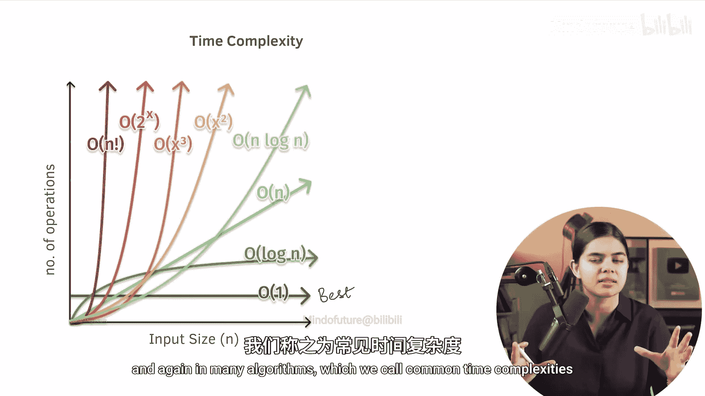
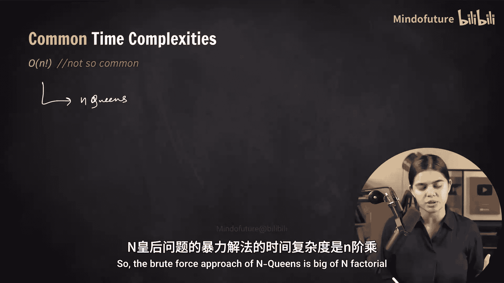
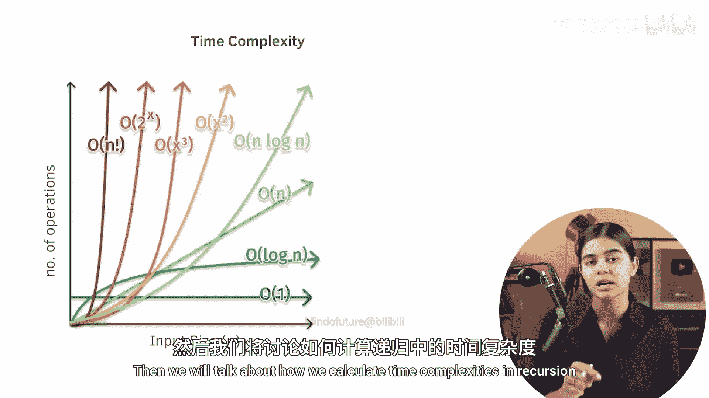
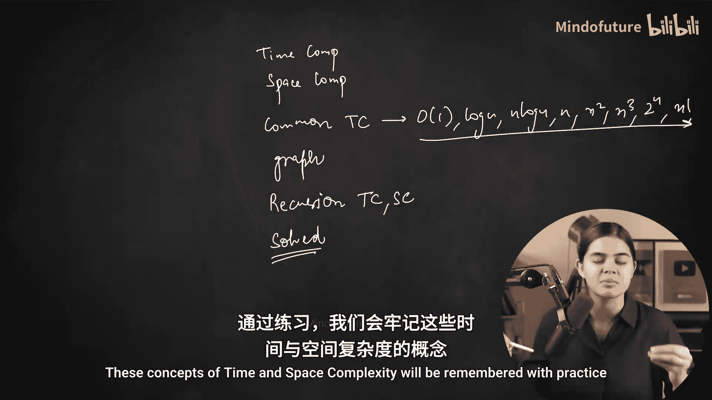

# 012：时间复杂度与空间复杂度 📊



在本节课中，我们将学习数据结构与算法中两个最核心的概念：**时间复杂度**与**空间复杂度**。理解这两个概念对于编写高效的程序、通过技术面试至关重要。我们将从基本定义出发，逐步深入到实际应用和计算方法。

---

## 什么是时间复杂度？ ⏱️

上一节我们介绍了本课程的目标，本节中我们来看看时间复杂度的定义。

时间复杂度**不是**程序运行的实际时间。实际运行时间受机器性能、操作系统、服务器负载等多种因素影响，因此在不同环境下会变化。

时间复杂度衡量的是**执行的操作数量**，将其表示为**输入大小 `n`** 的函数。它关注的是随着输入规模增长，操作次数的变化趋势。

例如，对于一个简单的操作：
```cpp
int x = 10; // 这是一个操作
```
对于一个循环：
```cpp
for(int i=0; i<10; i++) { // 这个循环将运行10次，执行大约10次操作
    // 循环体内的操作
}
```
操作次数大致与输入大小 `n`（这里是10）成正比。

我们可以用图表来理解：X轴代表输入大小 `n`，Y轴代表操作次数。对于上述循环，其关系是一条穿过原点、斜率为1的直线，即 `操作次数 = n`。这被称为**线性时间复杂度**。

在分析算法时，我们通常关注**最坏情况**下的时间复杂度，因为实际系统可能需要处理百万甚至上亿级别的数据。

---

## 大O表示法 📈

上一节我们理解了时间复杂度的概念，本节中我们来看看如何规范地表示它。

我们使用**大O表示法**来描述算法的渐进时间复杂度，它表示算法运行时间增长的上限（最坏情况）。

计算大O复杂度有三个简单步骤：
1.  **忽略常数**：在函数 `f(n) = 5n² + 3n + 20` 中，常数项20和系数5、3都被忽略。
2.  **保留最高阶项**：在 `n² + n + 1` 中，当 `n` 很大时，`n²` 的影响最大，因此保留 `n²`。
3.  **去掉系数**：`5n²` 简化为 `n²`。



因此，`f(n) = 5n² + 3n + 20` 的时间复杂度是 **O(n²)**。



除了表示最坏情况的 **大O**，还有表示平均情况的 **Θ** 和表示最好情况的 **Ω**。在面试和编程竞赛中，最常用的是大O表示法。

---

## 什么是空间复杂度？ 💾

理解了时间复杂度后，空间复杂度的概念就很容易类比了。

空间复杂度衡量的是算法运行所需的内存空间，同样表示为输入大小 `n` 的函数。它主要关注算法运行过程中**额外**或**辅助**使用的空间，不包括存储输入数据本身所占用的空间。

例如，在线性搜索中，输入数组占用的空间不计入空间复杂度。算法本身可能只使用了几个额外变量（如索引 `i`， 一个临时变量），这些辅助空间是常数级别的，因此空间复杂度为 **O(1)**。

与时间复杂度类似，空间复杂度也常用大O表示法来描述。



---



## 常见的时间复杂度类型 📊

以下是编程中几种最常见的时间复杂度，按效率从高到低排列：

*   **O(1) - 常数时间复杂度**：操作次数不随输入大小改变。例如，通过索引访问数组元素、哈希表查找。
    ```cpp
    int x = arr[5]; // O(1)
    ```
*   **O(log n) - 对数时间复杂度**：效率非常高，通常出现在“分而治之”的算法中，如二分查找。每次操作都将问题规模减半。
*   **O(n) - 线性时间复杂度**：操作次数与输入大小成正比。例如，遍历数组、线性搜索。这已经是许多问题的“好”算法。
    ```cpp
    for(int i=0; i<n; i++) { // O(n)
        // 操作
    }
    ```
*   **O(n log n) - 线性对数时间复杂度**：高效排序算法的常见复杂度，如归并排序、快速排序（平均情况）。
*   **O(n²) - 平方时间复杂度**：通常出现在嵌套循环中。例如，简单的选择排序、冒泡排序。
    ```cpp
    for(int i=0; i<n; i++) { // 外层循环n次
        for(int j=0; j<n; j++) { // 内层循环n次
            // 操作，总共执行约 n*n 次
        }
    }
    ```
*   **O(2^n) - 指数时间复杂度**：增长极其迅速，通常出现在暴力穷举所有子集或排列组合的算法中，如解决旅行商问题的朴素算法。
*   **O(n!) - 阶乘时间复杂度**：增长最快，通常出现在排列相关的暴力算法中。

---

## 如何计算时间复杂度？ 🧮

本节我们将学习计算时间复杂度的具体方法，特别是对于循环和递归函数。

**对于循环**：分析嵌套层次。单层循环通常是O(n)，双层嵌套循环通常是O(n²)。需要仔细计算内层循环的执行次数。

**对于递归函数**：有两种主要方法：
1.  **递归树法**：画出递归调用树，计算总的节点数（调用次数）。
2.  **主定理/递推关系法**：建立递归式并求解。一个通用公式是：
    `时间复杂度 = 递归调用总次数 × 每次递归调用的工作量`

**示例：计算阶乘的递归函数**
```cpp
int factorial(int n) {
    if (n == 0) return 1; // 基本操作，O(1)
    return n * factorial(n-1); // 递归调用
}
```
*   **递归总次数**：`n+1` 次（从 `n` 调用到 `0`）。
*   **每次调用的工作量**：常数时间 O(1)（乘法和返回）。
*   **总时间复杂度**：O(n) × O(1) = **O(n)**。

---

## 如何计算空间复杂度？ 🧠

空间复杂度的计算需要考虑：
1.  算法中声明的**辅助变量**所占用的空间。
2.  对于递归算法，还需要考虑**调用栈**的深度。

**递归调用的空间复杂度**公式为：
`空间复杂度 = 递归调用栈的最大深度 × 每次调用所需的辅助空间`

**示例：阶乘递归函数**
```cpp
int factorial(int n) {
    if (n == 0) return 1;
    return n * factorial(n-1);
}
```
*   **最大递归深度**：`n`（从 `n` 到 `0`）。
*   **每次调用的辅助空间**：常数 O(1)（存储参数和返回值）。
*   **总空间复杂度**：O(n) × O(1) = **O(n)**。这是因为调用栈需要同时保存 `n` 个未返回的函数调用。

相比之下，其迭代版本的阶乘函数只使用固定数量的变量，因此空间复杂度为 **O(1)**。

---

## 归并排序复杂度分析案例 🔍

让我们分析一个经典算法——归并排序的复杂度。

**归并排序过程**：
1.  **分割**：递归地将数组分成两半，直到每个子数组只有一个元素。
2.  **合并**：将两个已排序的子数组合并成一个有序数组。

**时间复杂度分析**：
*   **递归树深度**：每次分割一半，深度为 **log₂ n**。
*   **每层的工作量**：在每一层，我们需要合并所有子数组。虽然子数组变小，但每一层需要处理的总元素数仍然是 `n` 个。合并两个总长为 `k` 的数组需要 O(k) 时间。
*   **总时间复杂度**：层数 (log n) × 每层工作量 (O(n)) = **O(n log n)**。

**空间复杂度分析**：
*   合并步骤需要创建一个临时的辅助数组来存放合并后的元素，其最大大小为 **O(n)**。
*   递归调用栈的最大深度为 **O(log n)**。
*   因此，总空间复杂度为 O(n) + O(log n) = **O(n)**（因为 O(n) 是主导项）。

---

## 复杂度在实践中的应用 🚀

理论需要联系实际。在编程竞赛或面试中，题目通常会给出数据约束（如 `n ≤ 10⁵`）。我们需要根据约束选择合适复杂度的算法。

一个经验法则是：在现代在线判题系统上，1秒内大约可以执行 **10⁸** 次基本操作。

我们可以进行快速估算：
*   如果 `n ≤ 10⁵`，那么 O(n) 或 O(n log n) 的算法通常是安全的。
    *   O(n log n) 算法：`10⁵ * log₂(10⁵) ≈ 10⁵ * 17 ≈ 1.7 * 10⁶`，远小于 10⁸。
*   如果 `n ≤ 10³`，O(n²) 的算法可能勉强通过 (`10⁶` 次操作)。
*   如果 `n ≥ 20`，O(2^n) 的算法几乎肯定会超时。

因此，看到题目约束后，首先估算自己算法的大致操作次数，判断是否在时间限制内，这是解决问题的关键第一步。

---

## 总结 🎯

本节课中我们一起学习了数据结构与算法的基石——时间复杂度和空间复杂度。

*   **时间复杂度**衡量操作次数随输入规模的增长趋势，用大O表示法描述，关注最坏情况。
*   **空间复杂度**衡量算法运行所需的额外内存空间。
*   我们认识了从O(1)、O(log n)到O(n!）的常见复杂度类型及其含义。
*   我们学习了如何分析循环和递归算法的时间与空间复杂度。
*   最后，我们探讨了如何根据题目数据约束选择合适的算法，这是将理论应用于实践的关键。



掌握复杂度分析，能帮助你写出更高效的代码，并能在面试中清晰评估算法优劣。请务必通过练习来巩固这些概念。