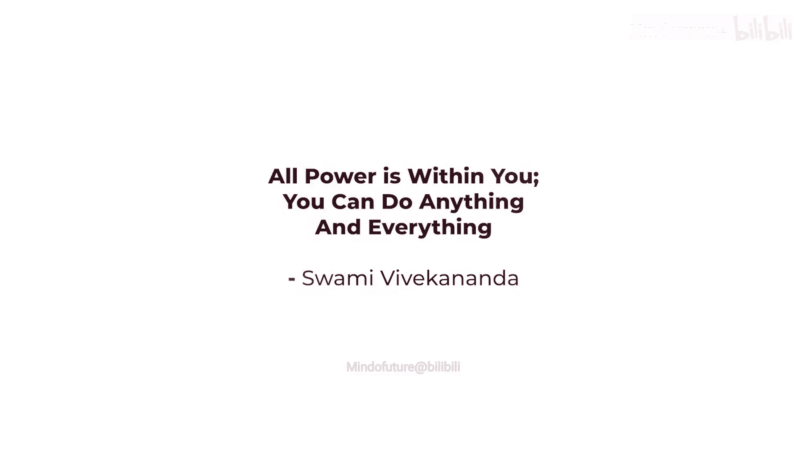
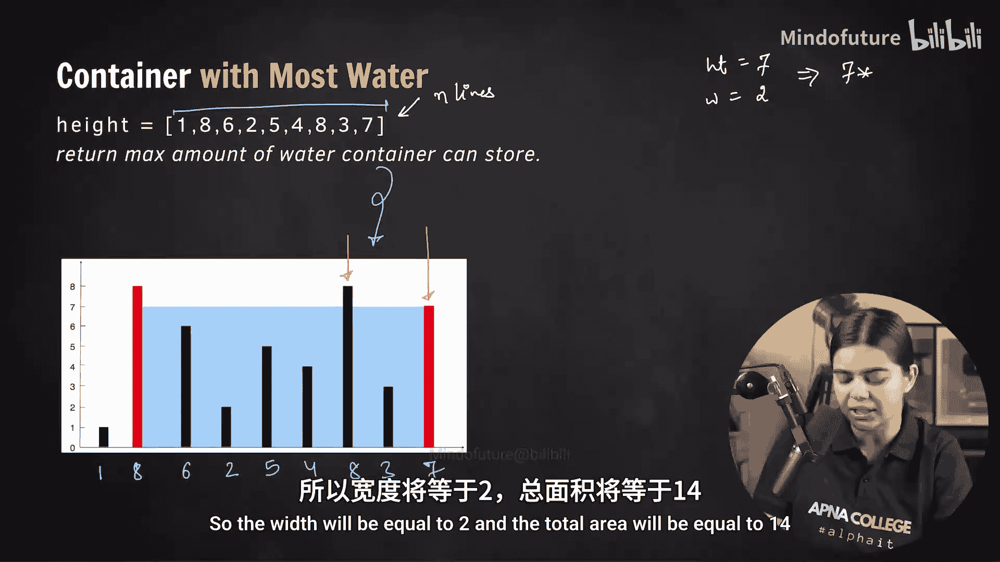
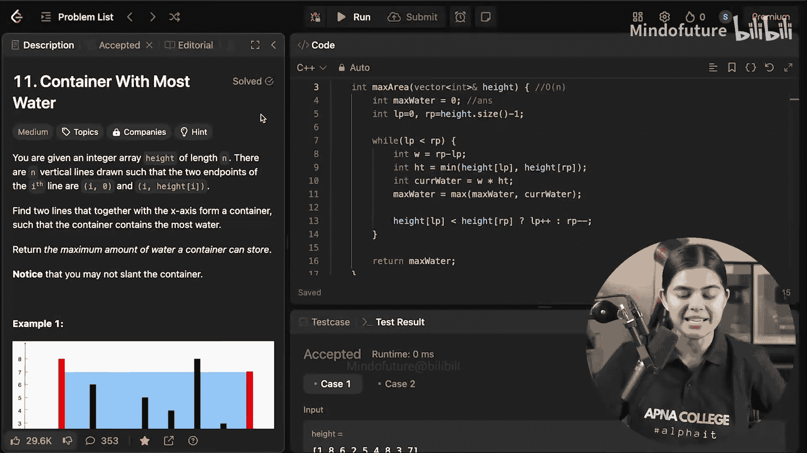

# 014：盛最多水的容器问题 - 暴力与双指针解法



## 概述

在本节课中，我们将学习 LeetCode 第 11 题“盛最多水的容器”。我们将首先理解问题，然后分析其暴力解法，最后学习并实现更优的双指针解法。通过本课，你将掌握如何通过优化算法将时间复杂度从 O(n²) 降低到 O(n)。



## 问题描述

给定一个长度为 `n` 的整数数组 `height`。数组中的每个元素代表一条垂直线的长度。这些垂直线在坐标轴上等距排列（例如，索引 i 和 i+1 之间的距离为 1）。我们需要找出由其中两条线与 x 轴共同构成的最大容器面积，该面积代表容器能盛放的最大水量。

**核心概念**：容器的面积由 **宽度** 和 **高度** 决定。
*   **宽度** = 右边界索引 - 左边界索引
*   **高度** = `min(左边界线高度， 右边界线高度)`
*   **面积** = **宽度** * **高度**

我们的目标是找到能使这个面积最大化的两条线。

## 暴力解法

上一节我们明确了问题的核心是计算面积。最直观的解法是暴力枚举所有可能的容器组合。

以下是暴力解法的思路：我们使用两个嵌套循环，外层循环固定左边界，内层循环遍历所有可能的右边界，计算每个组合的面积，并记录最大值。

**代码实现**：
```cpp
int maxArea(vector<int>& height) {
    int n = height.size();
    int maxWater = 0; // 用于记录最大面积

    // 外层循环，选择左边界
    for (int i = 0; i < n; i++) {
        // 内层循环，选择右边界（必须位于左边界右侧）
        for (int j = i + 1; j < n; j++) {
            // 计算宽度
            int width = j - i;
            // 计算有效高度（取两者中较矮的线）
            int h = min(height[i], height[j]);
            // 计算当前容器面积
            int currentWater = width * h;
            // 更新最大面积
            maxWater = max(maxWater, currentWater);
        }
    }
    return maxWater;
}
```

**时间复杂度分析**：该算法使用了双重循环，时间复杂度为 **O(n²)**。当数组长度 `n` 很大时，效率较低。

## 双指针最优解法

上一节我们介绍了暴力解法，其效率不高。本节中我们来看看如何利用双指针技巧将时间复杂度优化到 **O(n)**。

双指针解法的核心思想是：将两个指针分别置于数组的起始（`left`）和末尾（`right`），然后向中间移动。关键在于**每次移动高度较小的那个指针**。

**逻辑推导**：
容器的面积由宽度和最小高度决定。
1.  初始时，宽度最大。
2.  如果我们向内移动指针，宽度一定会减小。
3.  为了有机会获得更大的面积，我们必须尝试**增加最小高度**。
4.  因此，我们总是移动高度较小的那个指针，希望找到一个更高的线，从而可能补偿宽度减少带来的面积损失。

**算法步骤**：
1.  初始化 `left = 0`, `right = n - 1`, `maxWater = 0`。
2.  当 `left < right` 时，循环：
    *   计算当前宽度：`width = right - left`
    *   计算当前高度：`h = min(height[left], height[right])`
    *   计算当前面积：`currentWater = width * h`
    *   更新最大面积：`maxWater = max(maxWater, currentWater)`
    *   比较 `height[left]` 和 `height[right]`：
        *   如果 `height[left] < height[right]`，则移动左指针 `left++`。
        *   否则，移动右指针 `right--`。
3.  循环结束，返回 `maxWater`。

**代码实现**：
```cpp
int maxArea(vector<int>& height) {
    int left = 0;
    int right = height.size() - 1;
    int maxWater = 0;

    while (left < right) {
        // 计算当前容器的宽度和高度
        int width = right - left;
        int h = min(height[left], height[right]);

        // 计算当前面积并更新最大值
        int currentWater = width * h;
        maxWater = max(maxWater, currentWater);

        // 移动高度较小的指针
        if (height[left] < height[right]) {
            left++;
        } else {
            right--;
        }
    }
    return maxWater;
}
```

**时间复杂度分析**：两个指针从两端向中间遍历，每个元素只被访问一次，因此时间复杂度为 **O(n)**。

## 总结

本节课中我们一起学习了“盛最多水的容器”问题。
1.  我们首先理解了问题本质是寻找最大矩形面积（宽度 * 最小高度）。
2.  接着，我们实现了直观的**暴力解法**，其时间复杂度为 O(n²)。
3.  最后，我们重点学习了更高效的**双指针解法**。通过始终移动较矮的边以寻求可能的高度增加，我们在 O(n) 的时间内解决了问题。



这是一种非常重要的算法优化技巧，在解决许多数组和字符串相关问题时都非常有用。与此类似的题目还有“接雨水”问题，虽然逻辑不完全相同，但都涉及对高度和宽度的权衡，值得对比学习。