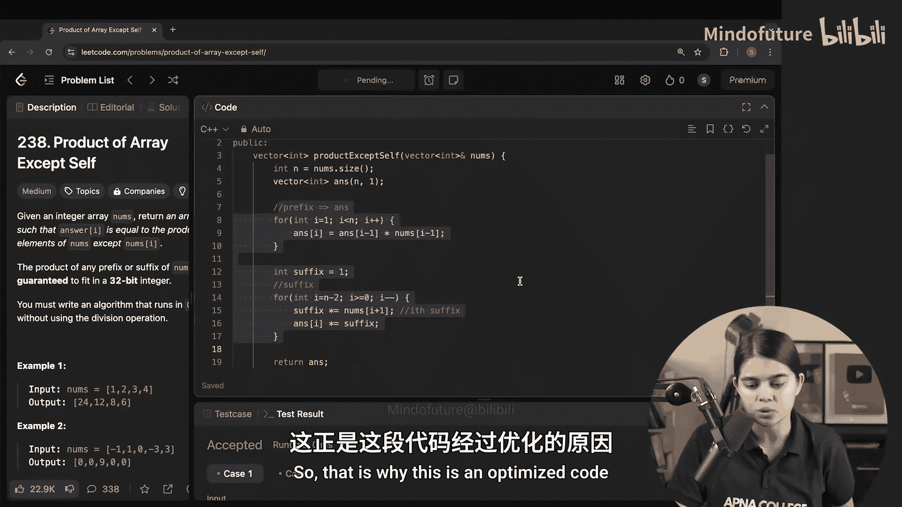

# 015：除自身以外数组的乘积 - 从暴力到最优解


## 概述
在本节课中，我们将学习如何解决LeetCode第238题“除自身以外数组的乘积”。我们将从最直观的暴力解法开始，逐步优化到空间复杂度为O(1)的最优解法。核心目标是计算一个数组，使得输出数组中的每个元素等于输入数组中除该索引元素外所有其他元素的乘积。

---

## 问题描述
给定一个整数数组 `nums`，返回一个数组 `answer`，使得 `answer[i]` 等于 `nums` 中除 `nums[i]` 之外其余各元素的乘积。

题目数据保证数组之中任意元素的全部前缀元素和后缀元素的乘积都在32位整数范围内。请不要使用除法，且在O(n)时间复杂度内完成此题。

**示例：**
输入：`nums = [1, 2, 3, 4]`
输出：`answer = [24, 12, 8, 6]`
解释：
- `answer[0] = 2 * 3 * 4 = 24`
- `answer[1] = 1 * 3 * 4 = 12`
- `answer[2] = 1 * 2 * 4 = 8`
- `answer[3] = 1 * 2 * 3 = 6`

---

## 解法一：暴力解法
首先，我们来看最直接的思路。对于输出数组的每一个位置 `i`，我们需要计算输入数组中所有除了索引 `i` 以外的元素的乘积。

### 实现思路
我们可以使用两层循环。外层循环遍历每个索引 `i`，内层循环遍历所有索引 `j` 来计算乘积，但跳过 `i == j` 的情况。

以下是暴力解法的核心代码逻辑：
```cpp
vector<int> productExceptSelf(vector<int>& nums) {
    int n = nums.size();
    vector<int> answer(n);
    for (int i = 0; i < n; i++) {
        int product = 1;
        for (int j = 0; j < n; j++) {
            if (i != j) {
                product *= nums[j];
            }
        }
        answer[i] = product;
    }
    return answer;
}
```

### 复杂度分析
- **时间复杂度**：`O(n²)`。因为对于 `n` 个元素中的每一个，我们都遍历了 `n` 个元素。
- **空间复杂度**：`O(1)`（不包括输出数组）。我们只使用了常数个额外变量。

暴力解法虽然直观，但在 `n` 较大时效率极低，无法满足题目对O(n)时间复杂度的要求。

---

## 解法二：前缀积与后缀积
为了将时间复杂度优化到O(n)，我们需要避免嵌套循环。一个关键的思路是：`answer[i]` 可以分解为 `i` 左侧所有元素的乘积（前缀积）和 `i` 右侧所有元素的乘积（后缀积）的乘积。

### 核心概念
- **前缀积** `prefix[i]`：表示 `nums[0]` 到 `nums[i-1]` 的乘积。
- **后缀积** `suffix[i]`：表示 `nums[i+1]` 到 `nums[n-1]` 的乘积。
- 那么，`answer[i] = prefix[i] * suffix[i]`。

### 实现步骤
1.  创建两个数组 `prefix` 和 `suffix`，大小均为 `n`。
2.  正向遍历计算 `prefix` 数组。
3.  反向遍历计算 `suffix` 数组。
4.  最后遍历一次，将 `prefix[i]` 和 `suffix[i]` 相乘得到 `answer[i]`。

以下是该解法的代码：
```cpp
vector<int> productExceptSelf(vector<int>& nums) {
    int n = nums.size();
    vector<int> prefix(n, 1);
    vector<int> suffix(n, 1);
    vector<int> answer(n);

    // 计算前缀积
    for (int i = 1; i < n; i++) {
        prefix[i] = prefix[i-1] * nums[i-1];
    }
    // 计算后缀积
    for (int i = n-2; i >= 0; i--) {
        suffix[i] = suffix[i+1] * nums[i+1];
    }
    // 计算最终答案
    for (int i = 0; i < n; i++) {
        answer[i] = prefix[i] * suffix[i];
    }
    return answer;
}
```

### 复杂度分析
- **时间复杂度**：`O(n)`。我们进行了三次独立的线性遍历。
- **空间复杂度**：`O(n)`。我们额外使用了两个大小为 `n` 的数组（`prefix` 和 `suffix`）。

这个方法满足了时间复杂度的要求，但仍有优化空间，可以进一步降低空间复杂度。

---

## 解法三：空间优化（最优解）
上一节我们使用了额外的数组来存储前缀和后缀信息。本节中我们来看看如何在不使用额外数组的情况下完成计算，将空间复杂度优化到O(1)（不包括输出数组）。

### 优化思路
我们可以复用输出数组 `answer` 本身。
1.  首先，用 `answer` 数组来存储前缀积。
2.  然后，使用一个变量 `suffix` 从后向前遍历，动态计算后缀积，并同时与 `answer` 中已存储的前缀积相乘，直接得到最终结果。

### 实现步骤
以下是具体的实现过程：
```cpp
vector<int> productExceptSelf(vector<int>& nums) {
    int n = nums.size();
    vector<int> answer(n, 1);

    // 第一步：answer 存储前缀积
    // answer[i] 初始为 nums[0]...nums[i-1] 的乘积
    for (int i = 1; i < n; i++) {
        answer[i] = answer[i-1] * nums[i-1];
    }

    // 第二步：用变量 suffix 计算后缀积，并直接与 answer 相乘
    int suffix = 1;
    for (int i = n-1; i >= 0; i--) {
        answer[i] = answer[i] * suffix; // 前缀积 * 当前后缀积
        suffix *= nums[i]; // 更新后缀积，为下一个元素（i-1）做准备
    }
    return answer;
}
```

### 逐步演算
以 `nums = [1, 2, 3, 4]` 为例：
1.  **计算前缀积存入 `answer`**：
    - `answer[0] = 1`
    - `answer[1] = answer[0] * nums[0] = 1 * 1 = 1`
    - `answer[2] = answer[1] * nums[1] = 1 * 2 = 2`
    - `answer[3] = answer[2] * nums[2] = 2 * 3 = 6`
    - 此时 `answer = [1, 1, 2, 6]`
2.  **从后向前计算后缀积并更新 `answer`**：
    - 初始化 `suffix = 1`
    - `i = 3`: `answer[3] = 6 * 1 = 6`，然后 `suffix *= 4` -> `suffix = 4`
    - `i = 2`: `answer[2] = 2 * 4 = 8`，然后 `suffix *= 3` -> `suffix = 12`
    - `i = 1`: `answer[1] = 1 * 12 = 12`，然后 `suffix *= 2` -> `suffix = 24`
    - `i = 0`: `answer[0] = 1 * 24 = 24`，然后 `suffix *= 1` -> `suffix = 24`
    - 最终 `answer = [24, 12, 8, 6]`

### 复杂度分析
- **时间复杂度**：`O(n)`。两次线性遍历。
- **空间复杂度**：`O(1)`（不包括输出数组 `answer`）。我们只使用了一个额外的整数变量 `suffix`。

这是该问题的最优解法，完全满足了题目的所有要求。

---

## 总结
本节课中我们一起学习了“除自身以外数组的乘积”这道经典题目的三种解法：
1.  **暴力解法**：时间复杂度 O(n²)，空间复杂度 O(1)。思路简单但效率低下。
2.  **前缀积与后缀积法**：时间复杂度 O(n)，空间复杂度 O(n)。通过空间换时间，是向最优解过渡的关键一步。
3.  **空间优化法**：时间复杂度 O(n)，空间复杂度 O(1)。最优解法，巧妙地复用输出数组，用一个变量动态维护后缀积。



理解从暴力到最优的优化过程，对于掌握数组类问题的处理技巧和培养空间优化意识非常重要。请务必动手实现并理解每一步的推导。