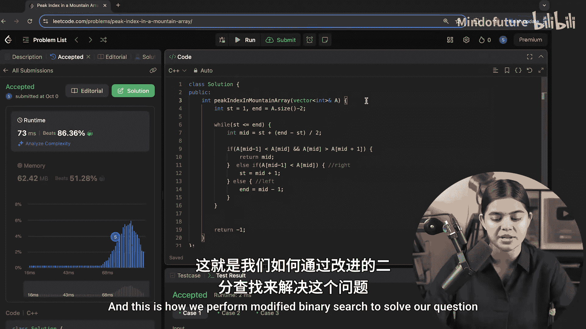

# 019：山脉数组的峰值索引（二分查找 - Leetcode 852）


## 概述
在本节课中，我们将学习如何解决一个名为“山脉数组的峰值索引”的问题。这是一个经典的二分查找应用问题，可以帮助我们理解如何在非严格单调的序列中寻找特定元素。

---

## 问题定义与示例
上一节我们介绍了二分查找的基本原理，本节中我们来看看它在特殊数组结构中的应用。

这个问题被称为“峰值索引”，编号为 Leetcode 852。题目给定一个“山脉数组”，该数组满足以下特性：存在一个索引 `i`，使得数组在 `i` 之前严格递增，在 `i` 之后严格递减。这个索引 `i` 就是峰值元素的索引。

例如，数组 `[0, 3, 8, 9, 5, 2]` 是一个山脉数组。其中，索引 `3`（值为 `9`）是峰值，因为：
*   `arr[2] (8) < arr[3] (9)`
*   `arr[3] (9) > arr[4] (5)`

峰值元素 `p` 必须满足条件：
**`arr[p-1] < arr[p]` 且 `arr[p] > arr[p+1]`**

---

## 解题思路与核心逻辑
理解问题后，我们需要设计一个高效的算法。由于数组具有先增后减的特性，我们可以使用修改版的二分查找。

以下是解题的关键步骤：

1.  **初始化指针**：设置 `start = 0`， `end = arr.size() - 1`。
2.  **循环条件**：当 `start <= end` 时，继续查找。
3.  **计算中点**：使用公式 **`mid = start + (end - start) / 2`** 来避免整数溢出。
4.  **判断峰值**：
    *   如果 **`arr[mid] > arr[mid-1]`** 且 **`arr[mid] > arr[mid+1]`**，那么 `mid` 就是峰值索引。
    *   否则，我们需要判断当前位于山脉的“上升坡”还是“下降坡”。
5.  **调整搜索范围**：
    *   如果位于上升坡（即 `arr[mid] < arr[mid+1]`），说明峰值在右侧，将 `start` 更新为 `mid + 1`。
    *   如果位于下降坡（即 `arr[mid] > arr[mid+1]`），说明峰值在左侧，将 `end` 更新为 `mid - 1`。

---

## 代码实现
根据上述逻辑，我们可以写出如下 C++ 代码：

```cpp
class Solution {
public:
    int peakIndexInMountainArray(vector<int>& arr) {
        int start = 0;
        int end = arr.size() - 1;

        while (start <= end) {
            int mid = start + (end - start) / 2;

            // 检查 mid 是否为峰值
            if (arr[mid] > arr[mid - 1] && arr[mid] > arr[mid + 1]) {
                return mid;
            }
            // 如果处于上升坡，峰值在右侧
            else if (arr[mid] < arr[mid + 1]) {
                start = mid + 1;
            }
            // 如果处于下降坡，峰值在左侧
            else { // arr[mid] > arr[mid + 1]
                end = mid - 1;
            }
        }
        // 根据题意，数组保证是山脉数组，所以理论上不会执行到此处
        return -1;
    }
};
```

---

## 复杂度分析
*   **时间复杂度**：**O(log n)**，其中 `n` 是数组长度。我们每次都将搜索区间减半。
*   **空间复杂度**：**O(1)**，只使用了常数级别的额外空间。

---



## 总结
本节课中我们一起学习了如何使用修改的二分查找算法来解决“山脉数组的峰值索引”问题。我们首先理解了山脉数组的定义和峰值元素的条件，然后分析了如何利用数组的单调性变化来缩小搜索范围，最后给出了完整的代码实现和复杂度分析。掌握这种方法，对于解决其他基于单调性变化的搜索问题非常有帮助。