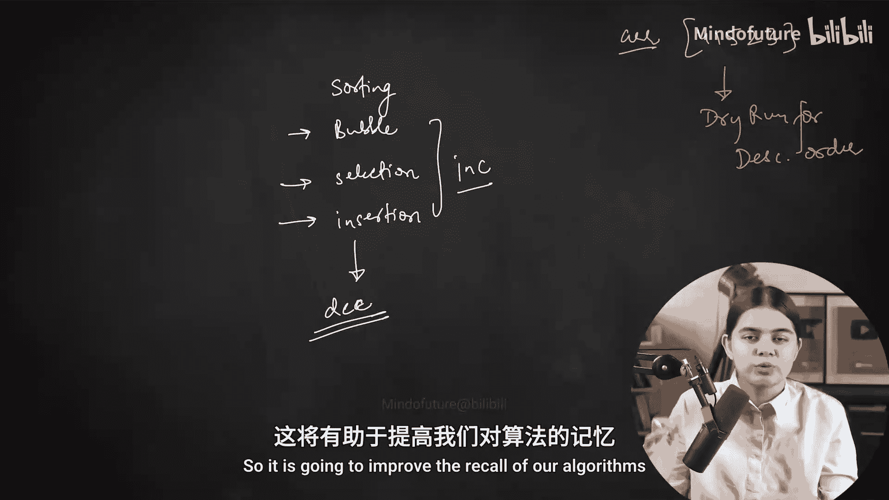

# 024：排序算法基础


## 概述
在本节课中，我们将学习三种基础的排序算法：冒泡排序、选择排序和插入排序。这些算法是理解更复杂排序技术的基础，并且在面试中经常被考察。我们将通过简单的例子和代码来理解它们的工作原理。

---

## 排序简介
排序是将一组数据按照特定顺序（如升序或降序）进行排列的过程。

例如，对于一组随机数字 `[5, 2, 3, 1]`，排序后可以得到升序结果 `[1, 2, 3, 5]` 或降序结果 `[5, 3, 2, 1]`。

---

## 冒泡排序 🫧
上一节我们介绍了排序的基本概念，本节中我们来看看第一种排序算法——冒泡排序。它的核心思想是重复地遍历要排序的列表，一次比较两个相邻元素，如果它们的顺序错误就把它们交换过来。

### 算法逻辑
1.  从第一个元素开始，比较相邻的两个元素。
2.  如果第一个比第二个大（对于升序排序），就交换它们。
3.  对每一对相邻元素做同样的工作，从开始第一对到结尾的最后一对。这步做完后，最大的元素会“冒泡”到数列的末尾。
4.  针对所有的元素重复以上的步骤，除了最后一个。
5.  持续每次对越来越少的元素重复上面的步骤，直到没有任何一对数字需要比较。

以下是冒泡排序的伪代码逻辑：
```cpp
for i from 0 to n-2:
    for j from 0 to n-i-2:
        if array[j] > array[j+1]:
            swap(array[j], array[j+1])
```

### 代码实现
```cpp
void bubbleSort(int arr[], int n) {
    for (int i = 0; i < n-1; i++) {
        for (int j = 0; j < n-i-1; j++) {
            if (arr[j] > arr[j+1]) {
                swap(arr[j], arr[j+1]);
            }
        }
    }
}
```

### 时间复杂度分析
外层循环运行 `n` 次，内层循环平均也运行 `n` 次。因此，冒泡排序的时间复杂度是 **O(n²)**。

### 优化
可以引入一个布尔变量来记录某次遍历中是否发生了交换。如果一次完整的遍历中没有发生任何交换，说明数组已经有序，可以提前终止排序。
```cpp
void optimizedBubbleSort(int arr[], int n) {
    bool swapped;
    for (int i = 0; i < n-1; i++) {
        swapped = false;
        for (int j = 0; j < n-i-1; j++) {
            if (arr[j] > arr[j+1]) {
                swap(arr[j], arr[j+1]);
                swapped = true;
            }
        }
        if (swapped == false) // 如果没有发生交换，提前结束
            break;
    }
}
```

---

## 选择排序 ⚙️
理解了冒泡排序后，我们来看选择排序。选择排序的思路是将数组分为“已排序”和“未排序”两部分，每次从未排序部分中找到最小（或最大）的元素，将其放到已排序部分的末尾。

### 算法步骤
1.  在未排序序列中找到最小（大）元素，存放到排序序列的起始位置。
2.  再从剩余未排序元素中继续寻找最小（大）元素，然后放到已排序序列的末尾。
3.  重复第二步，直到所有元素均排序完毕。

以下是寻找最小元素并交换的核心逻辑：
```cpp
for i from 0 to n-2:
    minIndex = i
    for j from i+1 to n-1:
        if array[j] < array[minIndex]:
            minIndex = j
    swap(array[i], array[minIndex])
```

### 代码实现
```cpp
void selectionSort(int arr[], int n) {
    for (int i = 0; i < n-1; i++) {
        int minIndex = i; // 假设当前索引 i 的元素是最小的
        for (int j = i+1; j < n; j++) {
            if (arr[j] < arr[minIndex]) {
                minIndex = j; // 更新最小元素的索引
            }
        }
        swap(arr[i], arr[minIndex]); // 将找到的最小元素与位置 i 的元素交换
    }
}
```

### 时间复杂度分析
和冒泡排序一样，选择排序也需要两层嵌套循环，因此其时间复杂度也是 **O(n²)**。

---

## 插入排序 🃏
学习了前两种基于比较和交换的排序后，本节我们学习插入排序。它的灵感来源于整理扑克牌：每次将一张新牌插入到手中已经排好序的牌堆中的正确位置。

### 算法过程
1.  将第一个元素视为已排序序列。
2.  取出下一个元素，在已经排序的元素序列中从后向前扫描。
3.  如果该元素（已排序）大于新元素，将该元素移到下一位置。
4.  重复步骤3，直到找到已排序的元素小于或者等于新元素的位置。
5.  将新元素插入到该位置后。
6.  重复步骤2~5。

以下是插入排序的核心逻辑描述：
```cpp
for i from 1 to n-1:
    key = array[i]
    j = i - 1
    while j >= 0 and array[j] > key:
        array[j+1] = array[j]
        j = j - 1
    array[j+1] = key
```

### 代码实现
```cpp
void insertionSort(int arr[], int n) {
    for (int i = 1; i < n; i++) {
        int key = arr[i]; // 当前需要插入的元素
        int j = i - 1; // 已排序部分的最后一个索引

        // 将大于 key 的元素向后移动
        while (j >= 0 && arr[j] > key) {
            arr[j + 1] = arr[j];
            j--;
        }
        arr[j + 1] = key; // 将 key 插入到正确位置
    }
}
```

### 时间复杂度分析
在最坏情况下（数组完全逆序），插入排序的时间复杂度是 **O(n²)**。但在数组近乎有序时，它的效率很高，接近 **O(n)**。

---

## 算法对比与总结
本节课中我们一起学习了三种基础的排序算法。

*   **冒泡排序**：通过不断交换相邻逆序元素来排序。实现简单，但效率较低。
*   **选择排序**：每次选择未排序部分的最小元素放到已排序部分末尾。交换次数少。
*   **插入排序**：像整理扑克牌一样，将每个新元素插入到已排序部分的正确位置。在数据近乎有序时效率高。

这三种算法的时间复杂度都是 **O(n²)**，属于基础排序算法，适用于小规模数据或作为理解更高效算法（如归并排序、快速排序，时间复杂度为 **O(n log n)**）的入门阶梯。



要按降序排列，只需在比较时改变条件（例如，将 `>` 改为 `<`）。掌握这些基础算法是迈向解决更复杂数据结构与算法问题的第一步。