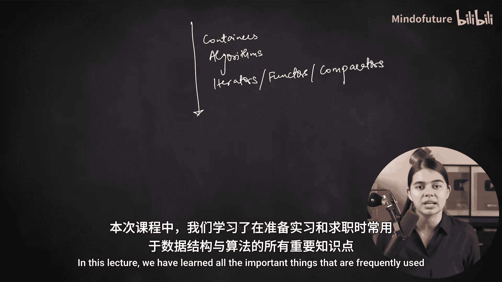

# 027：C++ STL完整教程 🚀


在本节课中，我们将深入学习C++标准模板库。STL是一个强大的库，提供了现成的数据结构和算法。使用STL，我们可以避免重复造轮子，例如，无需自己实现排序算法，直接使用 `sort()` 函数即可，这能节省大量时间。因此，STL在实践编码、求职面试和在线评测中至关重要。

STL主要包含四个部分：**容器**、**算法**、**迭代器**和**函数对象**。本教程将重点讲解容器和算法，并涵盖迭代器及一些实用的函数对象。

## 向量容器 📦

上一节我们介绍了STL的概览，本节中我们来看看第一个也是最重要的容器：**向量**。

向量类似于动态数组。普通数组的大小是固定的，而向量可以在运行时动态调整大小。创建一个空向量的语法很简单：`vector<int> v;`。初始时，其大小为0。

我们可以使用 `size()` 函数获取向量当前元素的数量：`v.size()`。

向向量添加元素的主要方法是 `push_back()` 函数。例如，`v.push_back(1);` 会将元素1添加到向量末尾。

向量有两个关键属性：
*   **大小**：当前包含的元素数量。
*   **容量**：在必须重新分配内存之前，向量可以容纳的元素总数。容量通常会以特定策略（如翻倍）增长。

我们可以使用 `capacity()` 函数查看当前容量。

以下是向量的基本操作示例：

```cpp
#include <iostream>
#include <vector>
using namespace std;

int main() {
    vector<int> v; // 创建一个空向量
    cout << "初始大小: " << v.size() << endl; // 输出 0
    cout << "初始容量: " << v.capacity() << endl; // 输出 0

    v.push_back(1);
    v.push_back(2);
    v.push_back(3);
    cout << "添加元素后大小: " << v.size() << endl; // 输出 3
    cout << "添加元素后容量: " << v.capacity() << endl; // 输出 4

    // 使用范围for循环遍历向量
    for(int value : v) {
        cout << value << " ";
    }
    cout << endl; // 输出: 1 2 3

    return 0;
}
```

向量还提供了其他常用成员函数：
*   `pop_back()`: 删除最后一个元素。
*   `at(index)` 或 `[index]`: 访问特定索引处的元素（`at`会进行边界检查）。
*   `front()`: 获取第一个元素。
*   `back()`: 获取最后一个元素。
*   `clear()`: 清空所有元素。
*   `empty()`: 检查向量是否为空。

初始化向量有多种方式：
```cpp
vector<int> v1 = {1, 2, 3, 4, 5}; // 初始化列表
vector<int> v2(5, 10); // 创建包含5个元素，每个元素值都是10的向量
vector<int> v3(v1.begin(), v1.end()); // 通过另一个向量的迭代器范围初始化
```

需要注意的是，在向量中间进行 `insert()` 或 `erase()` 操作代价较高，因为可能涉及大量元素的移动。而 `push_back()` 和 `pop_back()` 通常是常数时间复杂度。

## 列表与双端队列 🔄

了解了动态数组（向量）后，我们来看看其他顺序容器：列表和双端队列。

**列表** 在内部实现为双向链表。因此，它支持高效的 front 和 back 插入删除操作。
```cpp
#include <iostream>
#include <list>
using namespace std;

int main() {
    list<int> l;
    l.push_back(1);
    l.push_back(2);
    l.push_front(3); // 在头部插入
    // 列表内容: 3 -> 1 -> 2

    for(int val : l) {
        cout << val << " ";
    }
    cout << endl;

    l.pop_front(); // 删除头部元素 3
    l.pop_back();  // 删除尾部元素 2
    // 列表剩余: 1
    return 0;
}
```
列表不支持像数组那样的随机访问（即通过索引直接访问）。

**双端队列** 结合了向量和列表的一些特性，支持两端的快速插入删除，并且**支持随机访问**。
```cpp
#include <iostream>
#include <deque>
using namespace std;

int main() {
    deque<int> dq;
    dq.push_back(1);
    dq.push_front(2);
    dq.push_back(3);
    // 队列内容: [2, 1, 3]

    cout << "第二个元素是: " << dq[1] << endl; // 输出 1，支持随机访问
    return 0;
}
```

## 对组与栈、队列 🧱

现在我们来学习几种实用的数据结构和工具：对组、栈和队列。

**对组** 用于将两个值组合成一个单一对象，非常实用。
```cpp
#include <iostream>
#include <utility> // 包含 pair
using namespace std;

int main() {
    pair<string, int> p = make_pair("Alice", 25);
    // 或者直接初始化: pair<string, int> p("Alice", 25);
    cout << p.first << " is " << p.second << " years old." << endl;

    // 对组可以嵌套
    pair<int, pair<char, double>> nestedPair = {1, {'A', 3.14}};
    cout << nestedPair.first << " " << nestedPair.second.first << endl;
    return 0;
}
```

**栈** 是一种后进先出的数据结构。
```cpp
#include <iostream>
#include <stack>
using namespace std;

int main() {
    stack<int> s;
    s.push(10);
    s.push(20);
    s.push(30);

    cout << "栈顶元素: " << s.top() << endl; // 输出 30
    s.pop(); // 弹出30
    cout << "弹出后栈顶元素: " << s.top() << endl; // 输出 20
    cout << "栈大小: " << s.size() << endl; // 输出 2
    return 0;
}
```

**队列** 是一种先进先出的数据结构。
```cpp
#include <iostream>
#include <queue>
using namespace std;

int main() {
    queue<int> q;
    q.push(10);
    q.push(20);
    q.push(30);

    cout << "队首元素: " << q.front() << endl; // 输出 10
    cout << "队尾元素: " << q.back() << endl;  // 输出 30
    q.pop(); // 移除10
    cout << "弹出后队首元素: " << q.front() << endl; // 输出 20
    return 0;
}
```

## 优先队列与关联容器 🗺️

本节我们将探讨两种强大的容器：能自动排序的优先队列，以及用于快速查找的关联容器。

**优先队列** 默认是一个最大堆，队首元素始终是当前最大的元素。
```cpp
#include <iostream>
#include <queue>
using namespace std;

int main() {
    // 最大优先队列（默认）
    priority_queue<int> maxHeap;
    maxHeap.push(5);
    maxHeap.push(1);
    maxHeap.push(10);
    cout << "最大优先队列顶部: " << maxHeap.top() << endl; // 输出 10

    // 最小优先队列
    priority_queue<int, vector<int>, greater<int>> minHeap;
    minHeap.push(5);
    minHeap.push(1);
    minHeap.push(10);
    cout << "最小优先队列顶部: " << minHeap.top() << endl; // 输出 1
    return 0;
}
```

**映射** 存储键值对，键是唯一的，并且默认按键升序排序。
```cpp
#include <iostream>
#include <map>
using namespace std;

int main() {
    map<string, int> inventory;
    inventory["Apple"] = 50;
    inventory["Banana"] = 30;
    inventory["Orange"] = 20;

    // 遍历映射（按键排序）
    for(auto& item : inventory) {
        cout << item.first << ": " << item.second << endl;
    }
    // 输出:
    // Apple: 50
    // Banana: 30
    // Orange: 20

    // 查找键
    if(inventory.find("Banana") != inventory.end()) {
        cout << "找到香蕉，库存为: " << inventory["Banana"] << endl;
    }
    return 0;
}
```
映射的插入、删除、查找操作时间复杂度通常是 **O(log n)**。

**无序映射** 与映射类似，但不保证顺序，其操作平均时间复杂度为 **O(1)**。
```cpp
#include <iostream>
#include <unordered_map>
using namespace std;

int main() {
    unordered_map<string, int> quickLookup;
    quickLookup["zebra"] = 1;
    quickLookup["apple"] = 2;
    quickLookup["mango"] = 3;
    // 元素存储顺序不确定
    for(auto& p : quickLookup) cout << p.first << " ";
    return 0;
}
```

**集合** 存储唯一元素，并自动排序。**无序集合** 存储唯一元素但不排序。
```cpp
#include <iostream>
#include <set>
#include <unordered_set>
using namespace std;

int main() {
    set<int> orderedSet = {5, 2, 8, 2, 1}; // 插入 5,2,8,1
    for(int num : orderedSet) cout << num << " "; // 输出: 1 2 5 8

    unordered_set<int> unorderedSet = {5, 2, 8, 2, 1}; // 插入 5,2,8,1
    // 输出顺序不确定
    return 0;
}
```

## STL算法 ⚙️

掌握了主要容器后，我们来看看STL提供的强大通用算法，它们通过迭代器作用于容器。

**排序算法** 是最常用的算法之一。
```cpp
#include <iostream>
#include <vector>
#include <algorithm>
using namespace std;

int main() {
    vector<int> nums = {5, 3, 1, 4, 2};
    sort(nums.begin(), nums.end()); // 默认升序排序
    for(int n : nums) cout << n << " "; // 输出: 1 2 3 4 5
    cout << endl;

    // 降序排序
    sort(nums.begin(), nums.end(), greater<int>());
    for(int n : nums) cout << n << " "; // 输出: 5 4 3 2 1
    cout << endl;

    // 对自定义类型（如pair）排序
    vector<pair<int, int>> points = {{1,3}, {2,2}, {1,2}};
    // 默认按first排序，再按second排序
    sort(points.begin(), points.end());
    return 0;
}
```

**自定义排序规则** 可以通过定义比较函数来实现。
```cpp
bool sortBySecond(const pair<int,int> &a, const pair<int,int> &b) {
    if(a.second == b.second) {
        return a.first < b.first; // 如果second相等，按first升序
    }
    return a.second < b.second; // 主要按second升序
}
// 使用: sort(points.begin(), points.end(), sortBySecond);
```

其他常用算法包括：
*   `reverse()`: 反转序列。
*   `next_permutation()`: 生成下一个排列。
*   `max_element()`, `min_element()`: 查找最大/最小元素。
*   `binary_search()`: 在已排序范围中进行二分查找。
*   `swap()`: 交换两个值。

```cpp
// 算法示例
vector<int> v = {1,2,3,4,5};
reverse(v.begin(), v.end()); // v变为 {5,4,3,2,1}

auto maxIt = max_element(v.begin(), v.end());
cout << "最大值是: " << *maxIt << endl;

bool found = binary_search(v.begin(), v.end(), 3); // 返回 true
```

## 总结 🎯

本节课中我们一起深入学习了C++标准模板库的核心内容。我们从**向量**这个动态数组开始，逐步了解了**列表**、**双端队列**等顺序容器，以及**对组**、**栈**、**队列**等适配器。接着，我们探索了强大的关联容器，包括自动排序的**映射**、**集合**及其无序版本。最后，我们学习了STL的通用**算法**，如排序、查找和反转，它们通过迭代器与容器协作，极大地提升了代码效率和简洁性。



STL是C++编程的利器，熟练掌握它能让你在解决数据结构和算法问题时事半功倍。请务必动手实践每个示例代码，加深理解。