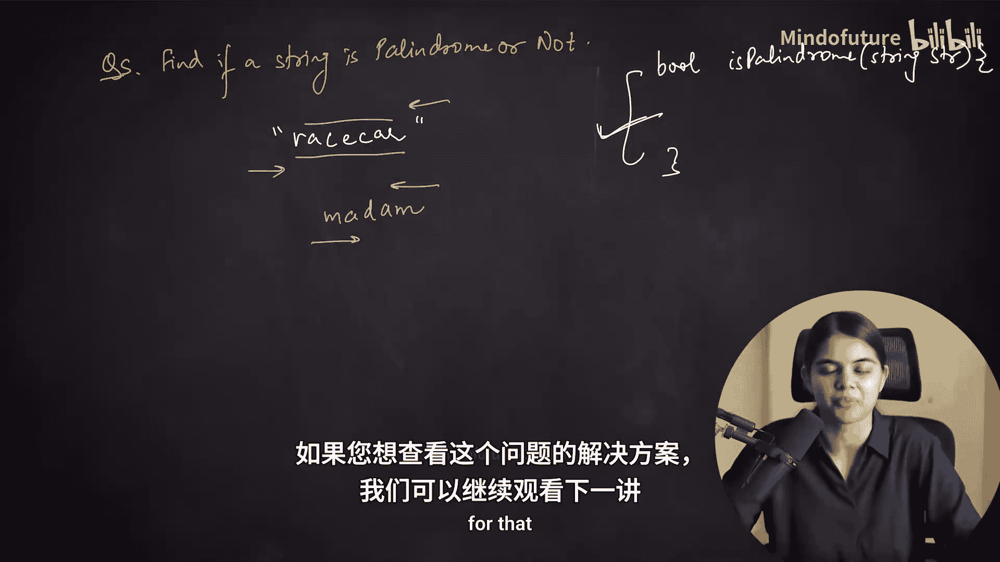

# 029：C++中的字符串和字符数组 - 第一部分 🧵

在本节课中，我们将要学习C++编程中一个核心且重要的概念：**字符串**。我们将从基础开始，理解什么是字符串，它与字符数组的关系，并学习如何声明、初始化和操作它们。

## 概述


字符串是编程中用于表示文本数据的基本结构。在C++中，处理字符串主要有两种方式：使用**字符数组**和使用**字符串类**。本节课程将首先介绍字符数组，它是C语言风格的字符串表示方法，也是理解C++字符串类的基础。

## 字符数组：C语言风格的字符串

上一节我们介绍了数组的概念，本节中我们来看看如何用数组来存储文本，即字符数组。

在编程中，如果某些内容被双引号 `" "` 包围，它就是一个字符串。例如，`"Hello"` 就是一个字符串。字符串本质上是一个字符序列。

### 字符数组的表示

字符数组用于存储字符串。它是一系列字符的集合，以特殊的**空字符** `\0` 结尾。这个空字符标志着字符串的结束。

**代码示例：声明字符数组**
```cpp
char arr[100]; // 声明一个可以存储最多99个字符和1个空字符的数组
```

即使我们只写了一个单词，比如 `"Hello"`，它在内存中实际上存储为 `'H'`, `'e'`, `'l'`, `'l'`, `'o'`, `'\0'`。最后一个字符 `\0` 就是空字符。

### 字符数组的初始化与输出

我们可以像初始化普通数组一样初始化字符数组。

**代码示例：初始化与输出**
```cpp
char arr[] = {'H', 'e', 'l', 'l', 'o', '\0'}; // 手动添加空字符
char arr2[] = "Hello"; // 编译器会自动添加空字符
cout << arr2; // 输出: Hello
```

需要注意的是，当我们用 `cout` 打印字符数组名时，它会从数组起始地址开始打印，直到遇到空字符 `\0` 为止。如果数组中没有 `\0`，`cout` 会继续打印后面的内存内容，直到偶然遇到一个 `\0`，这会导致输出乱码。

### 字符数组的输入

从用户那里获取字符串输入也很简单。

**代码示例：输入字符串**
```cpp
char str[100];
cout << "Enter a string: ";
cin >> str; // 输入字符串，但遇到空格会停止
cout << "You entered: " << str;
```

使用 `cin` 输入字符串时有一个限制：它会在遇到空格、制表符或换行符时停止读取。因此，它只能读取一个单词。

为了读取包含空格的整行文本，我们可以使用 `cin.getline()` 函数。

**代码示例：使用 `cin.getline()`**
```cpp
char sentence[200];
cout << "Enter a sentence: ";
cin.getline(sentence, 200); // 读取一行，最多199个字符（留一个给\0）
cout << "Sentence is: " << sentence;
```

### 遍历字符数组

我们可以使用循环来逐个访问字符数组中的每个字符。

以下是遍历字符数组的两种常用方法：

**方法一：使用 `for` 循环**
```cpp
char str[] = "Hello";
int length = 0;
for(int i = 0; str[i] != '\0'; i++) {
    cout << str[i] << " ";
    length++;
}
cout << "\nLength of string is: " << length;
```

**方法二：使用 `for-each` 循环**
```cpp
char str[] = "Apna College";
for(char ch : str) {
    if(ch == '\0') break; // 遇到空字符时停止
    cout << ch << " ";
}
```

## 字符串类：C++风格的字符串

字符数组虽然基础，但操作起来有时不够方便，例如不能直接使用 `+` 进行拼接。C++提供了一个更强大的工具：**`string` 类**。

`string` 是一个类（对象），它封装了字符数组，并提供了许多便捷的操作方法。它是动态的，意味着其大小可以根据需要自动调整。

### 字符串的声明与操作

**代码示例：基本操作**
```cpp
#include <iostream>
#include <string>
using namespace std;

int main() {
    string str1 = "Apna";
    string str2 = "College";
    
    // 1. 输出
    cout << str1 << endl;
    
    // 2. 拼接
    string str3 = str1 + " " + str2;
    cout << str3 << endl; // 输出: Apna College
    
    // 3. 比较
    if(str1 == "Apna") {
        cout << "Strings are equal" << endl;
    }
    
    // 4. 获取长度
    cout << "Length of str3: " << str3.length() << endl;
    
    return 0;
}
```

### 字符串的输入与遍历

对于 `string` 类，使用 `getline(cin, str)` 来读取包含空格的整行输入。

**代码示例：输入与遍历**
```cpp
string str;
cout << "Enter your full name: ";
getline(cin, str); // 读取整行
cout << "Hello, " << str << "!" << endl;

// 遍历字符串
for(int i = 0; i < str.length(); i++) {
    cout << str[i] << "-";
}
cout << endl;

// 使用 for-each 循环
for(char ch : str) {
    cout << ch << " ";
}
```

## 实践练习：反转字符串

让我们解决一个基于字符串的简单问题：反转一个字符串。

**问题描述**：给定一个字符串，将其字符顺序反转。例如，`"Hello"` 反转为 `"olleH"`。

**解题思路**：使用两个指针，一个从字符串开头（`start`）向后移动，一个从字符串末尾（`end`）向前移动，交换它们指向的字符，直到两个指针相遇。

**代码实现**：
```cpp
#include <iostream>
#include <string>
using namespace std;

int main() {
    string s = "ApnaCollege";
    
    int start = 0;
    int end = s.length() - 1;
    
    while(start < end) {
        // 交换字符
        swap(s[start], s[end]);
        start++;
        end--;
    }
    
    cout << "Reversed string: " << s << endl; // 输出: egelloClanpA
    return 0;
}
```

C++的 `string` 类甚至内置了 `reverse()` 函数，可以更简洁地完成这个任务。

**代码示例：使用 `reverse()` 函数**
```cpp
#include <iostream>
#include <algorithm> // 需要包含这个头文件
#include <string>
using namespace std;

int main() {
    string str = "College";
    reverse(str.begin(), str.end());
    cout << str << endl; // 输出: egelloC
    return 0;
}
```

## 总结

本节课中我们一起学习了C++中字符串处理的基础知识：
1.  **字符数组**：C语言风格的字符串，以空字符 `\0` 结尾，需要手动管理内存和边界。
2.  **字符串类 (`string`)**：C++风格的字符串，是一个类对象，动态管理内存，支持拼接、比较等直观操作，使用起来更加方便安全。

我们学习了如何声明、初始化、输入输出以及遍历这两种形式的字符串，并通过反转字符串的例子进行了实践。

## 课后作业

请尝试解决以下问题，以巩固所学知识：

**问题**：判断一个字符串是否是回文串。
**描述**：回文串是指正着读和反着读都一样的字符串，例如 `"racecar"`、`"madam"`。
**你的任务**：编写一个函数 `bool isPalindrome(string s)`，如果 `s` 是回文串则返回 `true`，否则返回 `false`。



**提示**：你可以使用本节课中学到的双指针技巧，或者利用 `reverse()` 函数。

如果你成功完成了今天的课程，可以在学习记录中标记你的进度。继续探索，加油！