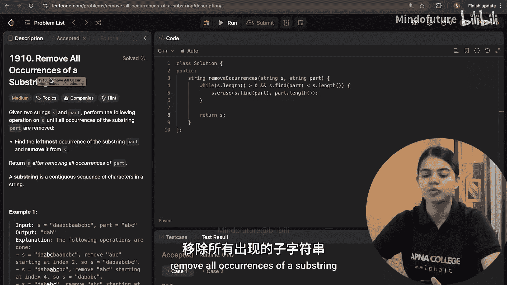

# 030：有效回文与移除所有出现 - 字符串第二部分


在本节课中，我们将学习两个重要的字符串问题：**有效回文**和**移除所有出现**。我们将通过具体的代码示例和逻辑分析，帮助你掌握解决这类问题的核心技巧。

## 有效回文

上一节我们介绍了字符串的基础操作，本节中我们来看看如何判断一个字符串是否是有效回文。有效回文是指一个字符串在忽略非字母数字字符、忽略大小写后，正读和反读都相同。

以下是解决此问题的核心逻辑步骤：

1.  使用两个指针，一个从字符串开头（`start`）向后移动，另一个从字符串末尾（`end`）向前移动。
2.  在指针移动过程中，跳过所有非字母数字字符。
3.  将指针指向的字符转换为小写后进行比较。
4.  如果所有对应的字符都匹配，则字符串是有效回文。

以下是实现此逻辑的伪代码框架：

```cpp
bool isPalindrome(string s) {
    int start = 0;
    int end = s.length() - 1;
    
    while(start <= end) {
        // 跳过 start 指针的非字母数字字符
        while(start < end && !isalnum(s[start])) {
            start++;
        }
        // 跳过 end 指针的非字母数字字符
        while(start < end && !isalnum(s[end])) {
            end--;
        }
        // 转换为小写后比较
        if(tolower(s[start]) != tolower(s[end])) {
            return false;
        }
        start++;
        end--;
    }
    return true;
}
```

其中，`isalnum` 函数用于判断一个字符是否是字母或数字。其逻辑可以用以下条件判断：

**公式：** 字符 `c` 是字母数字的条件是：
`(c >= ‘0’ && c <= ‘9’)` **或** `(tolower(c) >= ‘a’ && tolower(c) <= ‘z’)`

这个算法的时间复杂度是 **O(n)**，其中 n 是字符串的长度，因为我们只遍历了字符串一次。

## 移除所有出现

接下来，我们看第二个问题：从一个主字符串中移除所有给定的子字符串。例如，从 “daabcbaabcbc” 中移除所有 “abc”。

解决这个问题的思路是重复查找并删除子串，直到主串中不再包含该子串为止。

以下是解决此问题的步骤：

1.  在主字符串 `s` 中查找子串 `part` 第一次出现的位置。
2.  如果找到了（即位置索引有效），则从该位置开始，删除长度为 `part.length()` 的字符。
3.  重复步骤1和2，直到 `s` 中再也找不到 `part` 为止。

C++ 的 `string` 类提供了两个非常实用的成员函数：
*   `find()`: 查找子串位置，返回其起始索引，若未找到则返回 `string::npos`。
*   `erase()`: 从指定位置开始删除一定长度的字符。

以下是利用这两个函数的实现代码：

```cpp
string removeOccurrences(string s, string part) {
    while(s.length() != 0 && s.find(part) < s.length()) {
        // 找到子串位置并删除
        s.erase(s.find(part), part.length());
    }
    return s;
}
```

**代码解释：**
*   `s.find(part)` 返回子串 `part` 在 `s` 中第一次出现的起始索引。
*   `s.erase(pos, len)` 从索引 `pos` 开始，删除 `len` 个字符。
*   `while` 循环会持续执行，直到 `s` 中不再包含 `part` 子串。

## 总结

本节课中我们一起学习了两个字符串处理问题。
1.  **有效回文**：我们学会了使用双指针技巧，在跳过非字母数字字符并统一大小写后，比较字符串的首尾字符。
2.  **移除所有出现**：我们掌握了如何利用 `find()` 和 `erase()` 函数，循环查找并删除字符串中所有指定的子串。

理解并熟练运用这些基础算法和字符串库函数，是解决更复杂数据结构与算法问题的关键。



