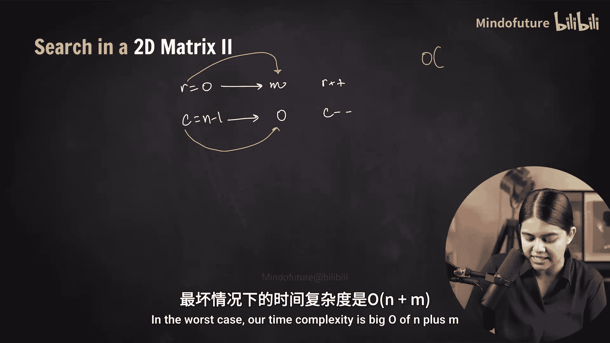

# 035：搜索二维矩阵变体I与II

## 概述
在本节课中，我们将学习如何在二维矩阵中高效地搜索目标值。我们将重点分析两种变体问题：第一种是矩阵的每一行和每一列都严格排序；第二种是矩阵的每一行从左到右递增，每一列从上到下递增。我们将探讨暴力解法，并重点讲解基于二分查找的优化解法。


---

## 搜索二维矩阵（变体I）

上一节我们介绍了二维数组的基本概念，本节中我们来看看一个经典问题：在完全排序的二维矩阵中搜索目标值。

**问题描述**：给定一个 `m x n` 的二维整数矩阵 `matrix`，该矩阵满足以下性质：
*   每行中的整数从左到右按**非递减**顺序排列。
*   每行的第一个整数大于前一行的最后一个整数。

我们需要编写一个高效的算法来判断目标值 `target` 是否存在于矩阵中。

### 暴力解法分析
最直观的方法是遍历整个矩阵的每一个元素。以下是暴力解法的核心逻辑：

```cpp
bool searchMatrix(vector<vector<int>>& matrix, int target) {
    int m = matrix.size(); // 行数
    int n = matrix[0].size(); // 列数
    for(int i = 0; i < m; i++) {
        for(int j = 0; j < n; j++) {
            if(matrix[i][j] == target) {
                return true;
            }
        }
    }
    return false;
}
```
该解法的时间复杂度为 **O(m * n)**，在矩阵较大时效率很低。

### 优化解法：两次二分查找
由于矩阵整体可以被视为一个展开后有序的一维数组，我们可以使用两次二分查找来优化。

**核心思路**：
1.  首先，对矩阵的“第一列”进行二分查找，找到**最后一个**其值小于等于目标值的行。这确定了目标值可能存在的行。
2.  然后，在找到的特定行中，进行标准的二分查找，以确定目标值是否存在。

以下是实现步骤：

1.  **初始化变量**：获取矩阵的行数 `m` 和列数 `n`。设置查找行的起始 `startRow = 0` 和结束 `endRow = m - 1`。
2.  **查找目标行**：
    *   当 `startRow <= endRow` 时，计算中间行 `midRow = startRow + (endRow - startRow) / 2`。
    *   比较 `matrix[midRow][0]`（中间行的第一个元素）与 `target`。
    *   如果 `target >= matrix[midRow][0]` 且 `target <= matrix[midRow][n-1]`（目标值在该行的值域内），则锁定该行为 `targetRow`。
    *   如果 `target < matrix[midRow][0]`，说明目标值可能在更上面的行，令 `endRow = midRow - 1`。
    *   如果 `target > matrix[midRow][n-1]`，说明目标值可能在更下面的行，令 `startRow = midRow + 1`。
3.  **在目标行中搜索**：如果找到了 `targetRow`，则在该行 `matrix[targetRow]` 中使用标准二分查找来寻找 `target`。

**代码实现**：
```cpp
bool searchMatrix(vector<vector<int>>& matrix, int target) {
    int m = matrix.size();
    int n = matrix[0].size();
    int startRow = 0, endRow = m - 1;
    int targetRow = -1;

    // 第一次二分：查找目标所在的行
    while(startRow <= endRow) {
        int midRow = startRow + (endRow - startRow) / 2;
        if(target >= matrix[midRow][0] && target <= matrix[midRow][n-1]) {
            targetRow = midRow;
            break;
        } else if(target < matrix[midRow][0]) {
            endRow = midRow - 1;
        } else { // target > matrix[midRow][n-1]
            startRow = midRow + 1;
        }
    }
    if(targetRow == -1) return false;

    // 第二次二分：在目标行中查找目标值
    int left = 0, right = n - 1;
    while(left <= right) {
        int mid = left + (right - left) / 2;
        if(matrix[targetRow][mid] == target) {
            return true;
        } else if(matrix[targetRow][mid] < target) {
            left = mid + 1;
        } else {
            right = mid - 1;
        }
    }
    return false;
}
```
**时间复杂度**：两次二分查找的时间复杂度分别为 **O(log m)** 和 **O(log n)**，总时间复杂度为 **O(log m + log n)**，优于暴力解法。

---

## 搜索二维矩阵（变体II）

现在，我们来看一个更普遍的变体问题，其排序规则有所不同。

**问题描述**：给定一个 `m x n` 的二维整数矩阵 `matrix`，该矩阵满足以下性质：
*   每行中的整数从左到右按**非递减**顺序排列。
*   每列中的整数从上到下按**非递减**顺序排列。

与变体I不同，这里行与行之间的值域是**重叠**的。例如，下一行的最小值可能小于上一行的最大值。

### 解法分析：从右上角（或左下角）开始搜索
由于排序规则的特性，我们可以选择一个特殊的起点进行线性搜索。

**核心思路**：从矩阵的**右上角** `(0, n-1)` 开始搜索。
*   如果 `target` 等于当前元素，返回 `true`。
*   如果 `target` **小于**当前元素，由于该列是递增的，当前元素下方的所有元素都更大，因此目标值不可能在当前列。我们将搜索位置**向左移动一列**（`col--`）。
*   如果 `target` **大于**当前元素，由于该行是递增的，当前元素左方的所有元素都更小，因此目标值不可能在当前行。我们将搜索位置**向下移动一行**（`row++`）。
*   重复此过程，直到找到目标或越界。

选择**左下角** `(m-1, 0)` 作为起点，逻辑是镜像对称的。

以下是实现步骤：

1.  **初始化指针**：从右上角开始，`row = 0`, `col = n - 1`。
2.  **搜索循环**：在 `row < m` 且 `col >= 0` 的条件下循环。
    *   比较 `matrix[row][col]` 与 `target`。
    *   根据比较结果，更新行或列的索引。
3.  **返回结果**：找到则返回 `true`，循环结束未找到则返回 `false`。

**代码实现（从右上角开始）**：
```cpp
bool searchMatrix(vector<vector<int>>& matrix, int target) {
    int m = matrix.size();
    int n = matrix[0].size();
    int row = 0, col = n - 1; // 起始位置：右上角

    while(row < m && col >= 0) {
        if(matrix[row][col] == target) {
            return true;
        } else if(matrix[row][col] > target) {
            // 目标值更小，向左移动一列
            col--;
        } else {
            // 目标值更大，向下移动一行
            row++;
        }
    }
    return false;
}
```
**时间复杂度**：在最坏情况下（从右上角走到左下角），我们需要走 `m + n` 步，因此时间复杂度为 **O(m + n)**。这比变体I的解法慢，但在此问题的约束下是最优的线性解法之一，并且远优于 `O(m * n)` 的暴力解法。

---



## 总结
本节课中我们一起学习了两种在排序二维矩阵中搜索目标值的算法：
1.  **变体I（行首尾相接有序）**：利用矩阵可视为完全有序一维数组的特性，通过**两次二分查找**高效解决问题，时间复杂度为 **O(log m + log n)**。
2.  **变体II（行、列分别有序）**：利用行列的排序规则，从**右上角或左下角**开始进行**线性搜索**，每次比较可以排除一行或一列，时间复杂度为 **O(m + n)**。

理解这两种问题的区别及其对应解法的原理，对于解决基于二维数组的搜索问题至关重要。