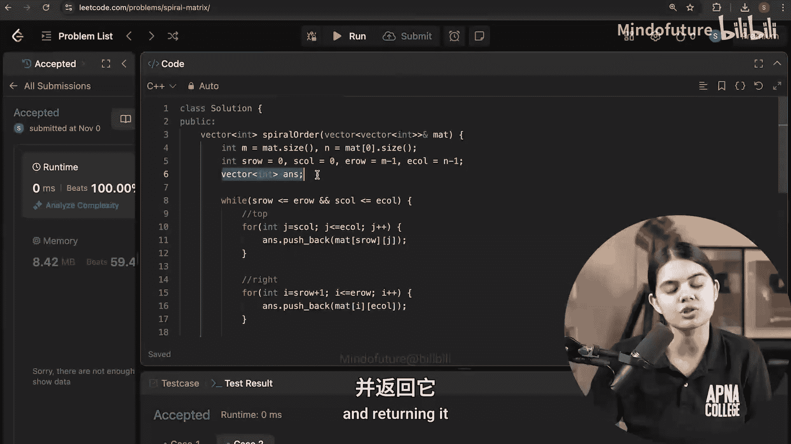

# 036：螺旋矩阵（二维数组第三部分）Leetcode 54


## 概述
在本节课中，我们将学习一个经典的二维数组面试问题：螺旋矩阵。我们将详细解析Leetcode第54题，学习如何按螺旋顺序遍历一个给定的二维矩阵，并返回所有元素。核心在于理解并实现边界控制逻辑。

---

## 螺旋矩阵问题解析

上一节我们探讨了二维数组的基本操作，本节中我们来看看如何按螺旋顺序遍历矩阵。

给定一个 `m x n` 的矩阵，我们需要按照从外圈到内圈、顺时针的方向，依次返回所有元素。

### 核心思路：边界收缩法
解决此问题的关键在于使用四个变量来动态定义矩阵的边界：
*   **起始行** (`startRow`)
*   **结束行** (`endRow`)
*   **起始列** (`startCol`)
*   **结束列** (`endCol`)

初始时，边界就是整个矩阵的范围。我们按照 **上边界 -> 右边界 -> 下边界 -> 左边界** 的顺序遍历元素，每完成一个边界的遍历，就向内收缩对应的边界。

以下是遍历一个边界的通用逻辑框架：
```cpp
// 遍历上边界 (从左到右)
for (int j = startCol; j <= endCol; j++) {
    result.push_back(matrix[startRow][j]);
}
// 完成后，上边界下移
startRow++;

// 遍历右边界 (从上到下)
for (int i = startRow; i <= endRow; i++) {
    result.push_back(matrix[i][endCol]);
}
// 完成后，右边界左移
endCol--;

// 遍历下边界 (从右到左)
for (int j = endCol; j >= startCol; j--) {
    result.push_back(matrix[endRow][j]);
}
// 完成后，下边界上移
endRow--;

// 遍历左边界 (从下到上)
for (int i = endRow; i >= startRow; i--) {
    result.push_back(matrix[i][startCol]);
}
// 完成后，左边界右移
startCol++;
```

### 关键细节与边界条件
上述循环需要持续进行，直到所有元素都被遍历。循环继续的条件是：
```cpp
while (startRow <= endRow && startCol <= endCol)
```

然而，这里存在一个特殊情况需要处理。当矩阵的行数或列数为奇数时，最内层可能只剩一行或一列。如果继续执行完整的四步遍历，会导致元素被重复添加。

以下是需要处理的特殊情况：
1.  **只剩一行**：当 `startRow == endRow` 时，只需遍历上边界，并跳过右、下、左边界的遍历，因为它们是同一行。
2.  **只剩一列**：当 `startCol == endCol` 时，只需遍历右边界，并跳过下、左边界的遍历，因为它们是同一列。

因此，在遍历右边界和下边界之前，需要增加条件判断：
```cpp
// 遍历上边界后...
// 遍历右边界前，检查是否还有多行
if (startRow <= endRow) {
    for (int i = startRow; i <= endRow; i++) {
        result.push_back(matrix[i][endCol]);
    }
    endCol--;
}

// 遍历下边界前，检查是否还有多列
if (startCol <= endCol) {
    for (int j = endCol; j >= startCol; j--) {
        result.push_back(matrix[endRow][j]);
    }
    endRow--;
}

// 遍历左边界前，检查是否还有多行
if (startRow <= endRow) {
    for (int i = endRow; i >= startRow; i--) {
        result.push_back(matrix[i][startCol]);
    }
    startCol++;
}
```

### 完整代码示例
结合以上逻辑，以下是该问题的完整C++解决方案：

```cpp
class Solution {
public:
    vector<int> spiralOrder(vector<vector<int>>& matrix) {
        vector<int> result;
        if (matrix.empty()) return result;

        int startRow = 0;
        int endRow = matrix.size() - 1;
        int startCol = 0;
        int endCol = matrix[0].size() - 1;

        while (startRow <= endRow && startCol <= endCol) {
            // 遍历上边界
            for (int j = startCol; j <= endCol; j++) {
                result.push_back(matrix[startRow][j]);
            }
            startRow++;

            // 遍历右边界
            if (startRow <= endRow) {
                for (int i = startRow; i <= endRow; i++) {
                    result.push_back(matrix[i][endCol]);
                }
                endCol--;
            }

            // 遍历下边界
            if (startCol <= endCol) {
                for (int j = endCol; j >= startCol; j--) {
                    result.push_back(matrix[endRow][j]);
                }
                endRow--;
            }

            // 遍历左边界
            if (startRow <= endRow) {
                for (int i = endRow; i >= startRow; i--) {
                    result.push_back(matrix[i][startCol]);
                }
                startCol++;
            }
        }
        return result;
    }
};
```

---



## 总结
本节课我们一起学习了如何解决螺旋矩阵问题。我们掌握了**边界收缩法**这一核心策略，通过动态调整四个边界变量来模拟螺旋遍历的过程。更重要的是，我们深入分析了当矩阵行数或列数为奇数时可能出现的**元素重复**问题，并通过增加条件判断巧妙地解决了它。理解这个遍历顺序和边界处理是解决此类二维数组问题的关键。