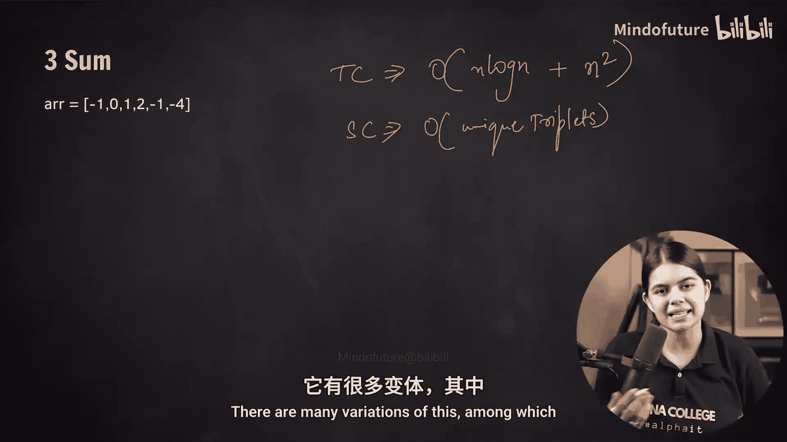

# 038：三数之和问题详解 🎯


在本节课中，我们将学习如何解决一个重要的算法问题——“三数之和”（LeetCode 15）。我们将从最直观的暴力解法开始，逐步优化到最高效的双指针法，并理解每种方法背后的逻辑与复杂度。

## 概述

“三数之和”问题的目标是：给定一个整数数组 `nums`，找出所有满足 `a + b + c = 0` 的三元组 `[a, b, c]`。返回的三元组必须是不重复的。

例如，对于数组 `[-1, 0, 1, 2, -1, -4]`，满足条件的三元组是 `[-1, -1, 2]` 和 `[-1, 0, 1]`。注意，即使有多个 `-1`，`[-1, 0, 1]` 也只应出现一次。

---

## 方法一：暴力解法（三重循环）

最直接的思路是使用三重循环遍历所有可能的三元组组合，检查它们的和是否为零。

以下是该方法的实现步骤：

1.  使用三层嵌套循环，分别用索引 `i`、`j`、`k` 选取三个数。
2.  确保 `i < j < k` 以避免重复选取同一个元素。
3.  检查 `nums[i] + nums[j] + nums[k] == 0`。
4.  将满足条件的三元组存储起来，并确保最终结果的唯一性。

**代码实现：**
```cpp
vector<vector<int>> threeSum(vector<int>& nums) {
    int n = nums.size();
    set<vector<int>> uniqueTriplets; // 用于去重的集合
    vector<vector<int>> answer;

    for (int i = 0; i < n; i++) {
        for (int j = i + 1; j < n; j++) {
            for (int k = j + 1; k < n; k++) {
                if (nums[i] + nums[j] + nums[k] == 0) {
                    vector<int> triplet = {nums[i], nums[j], nums[k]};
                    sort(triplet.begin(), triplet.end()); // 排序以实现标准化
                    if (uniqueTriplets.find(triplet) == uniqueTriplets.end()) {
                        uniqueTriplets.insert(triplet);
                        answer.push_back(triplet);
                    }
                }
            }
        }
    }
    return answer;
}
```

**复杂度分析：**
*   **时间复杂度：O(n³)**。三重循环嵌套。
*   **空间复杂度：O(1)** 或 **O(T)**，其中 T 是结果三元组的数量，用于存储输出。

暴力解法虽然简单，但效率很低，在数据量较大时不可行。

---

## 方法二：哈希表优化法

上一节我们介绍了暴力解法，本节中我们来看看如何利用哈希表进行优化。核心思路是固定第一个数 `a` 后，将三数之和问题转化为寻找两数之和 `b + c = -a` 的问题。

以下是该方法的实现步骤：

1.  外层循环固定第一个数 `nums[i]`，计算目标值 `target = -nums[i]`。
2.  在内层循环中，遍历 `j` 从 `i+1` 到 `n-1`。
3.  对于每个 `nums[j]`，计算所需的第三个数 `complement = target - nums[j]`。
4.  使用一个哈希集合（`unordered_set`）来存储内层循环中已经遍历过的数字。如果在集合中找到 `complement`，则说明找到了一个有效三元组。
5.  将找到的三元组排序后存入一个集合中以去重。

**代码实现：**
```cpp
vector<vector<int>> threeSum(vector<int>& nums) {
    int n = nums.size();
    set<vector<int>> uniqueTriplets;
    vector<vector<int>> answer;

    for (int i = 0; i < n; i++) {
        int target = -nums[i];
        unordered_set<int> s;
        for (int j = i + 1; j < n; j++) {
            int complement = target - nums[j];
            if (s.find(complement) != s.end()) {
                vector<int> triplet = {nums[i], nums[j], complement};
                sort(triplet.begin(), triplet.end());
                uniqueTriplets.insert(triplet);
            }
            s.insert(nums[j]); // 将当前数字加入集合，供后续查找
        }
    }
    // 将集合中的唯一三元组转移到答案中
    answer.assign(uniqueTriplets.begin(), uniqueTriplets.end());
    return answer;
}
```

**复杂度分析：**
*   **时间复杂度：O(n²)**。外层循环 O(n)，内层循环与哈希查找 O(n)。
*   **空间复杂度：O(n)**。主要用于哈希集合存储。

哈希表法将时间复杂度从 O(n³) 降到了 O(n²)，是一个显著的优化。

---

## 方法三：排序 + 双指针法（最优解）

上一节我们利用哈希表去除了一个循环，本节我们介绍最优解——排序后使用双指针法。此方法无需额外的集合来去重，效率更高。

以下是该方法的实现步骤：

1.  **排序**：首先将数组排序。这是后续去重和双指针移动的基础。
2.  **固定第一个数**：遍历数组，将 `nums[i]` 作为第一个数。如果 `nums[i] > 0`，由于数组已排序，后面的数都为正，和不可能为零，可以直接结束循环。
3.  **去重**：如果 `nums[i]` 与前一个数相同（`i > 0 && nums[i] == nums[i-1]`），则跳过，以避免重复的三元组。
4.  **双指针寻找**：在 `i` 之后的子数组中，设置左指针 `j = i+1`，右指针 `k = n-1`。
    *   计算当前和 `sum = nums[i] + nums[j] + nums[k]`。
    *   如果 `sum == 0`，找到一组解，记录。然后同时移动 `j` 和 `k`，并跳过所有重复的 `nums[j]` 和 `nums[k]`。
    *   如果 `sum < 0`，说明总和太小，需要增大，因此将左指针 `j` 右移。
    *   如果 `sum > 0`，说明总和太大，需要减小，因此将右指针 `k` 左移。

**代码实现：**
```cpp
vector<vector<int>> threeSum(vector<int>& nums) {
    int n = nums.size();
    vector<vector<int>> answer;
    sort(nums.begin(), nums.end()); // 关键步骤：排序

    for (int i = 0; i < n; i++) {
        // 优化1：第一个数大于0，后续无解
        if (nums[i] > 0) break;
        // 去重：跳过相同的第一个数
        if (i > 0 && nums[i] == nums[i-1]) continue;

        int j = i + 1;
        int k = n - 1;
        while (j < k) {
            int sum = nums[i] + nums[j] + nums[k];
            if (sum == 0) {
                answer.push_back({nums[i], nums[j], nums[k]});
                // 去重：跳过相同的第二个数和第三个数
                while (j < k && nums[j] == nums[j+1]) j++;
                while (j < k && nums[k] == nums[k-1]) k--;
                j++;
                k--;
            } else if (sum < 0) {
                j++; // 和太小，左指针右移
            } else {
                k--; // 和太大，右指针左移
            }
        }
    }
    return answer;
}
```

**复杂度分析：**
*   **时间复杂度：O(n²)**。排序消耗 O(n log n)，双指针循环消耗 O(n²)，总体为 O(n²)。
*   **空间复杂度：O(1)** 或 **O(log n)**（取决于排序算法的空间开销，忽略存储答案的空间）。

这是解决“三数之和”问题的最优方法，也是面试中最常被要求实现的方法。

---

## 总结

本节课中我们一起学习了“三数之和”问题的三种解法：
1.  **暴力三重循环**：思路简单但效率低下（O(n³)），仅适用于理解问题。
2.  **哈希表优化法**：将问题转化为两数之和，利用集合查找，将时间复杂度优化到 O(n²)。
3.  **排序+双指针法**：最优解法。通过排序预处理，利用双指针在单次扫描中高效地找到所有解，并巧妙地通过跳过重复值来实现去重，时间复杂度为 O(n²)。



理解从暴力解法到最优解的优化路径，对于培养算法思维至关重要。请务必掌握双指针法的实现细节和去重逻辑。