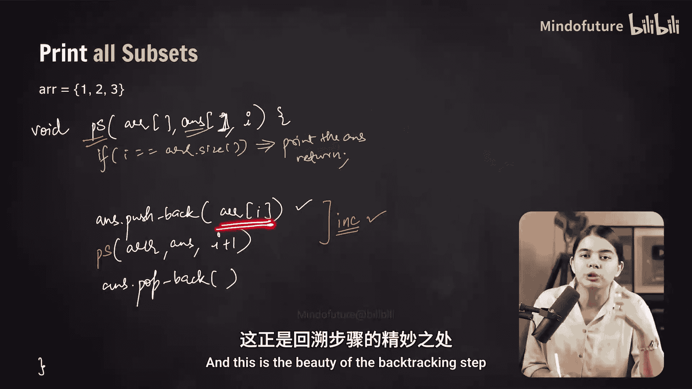
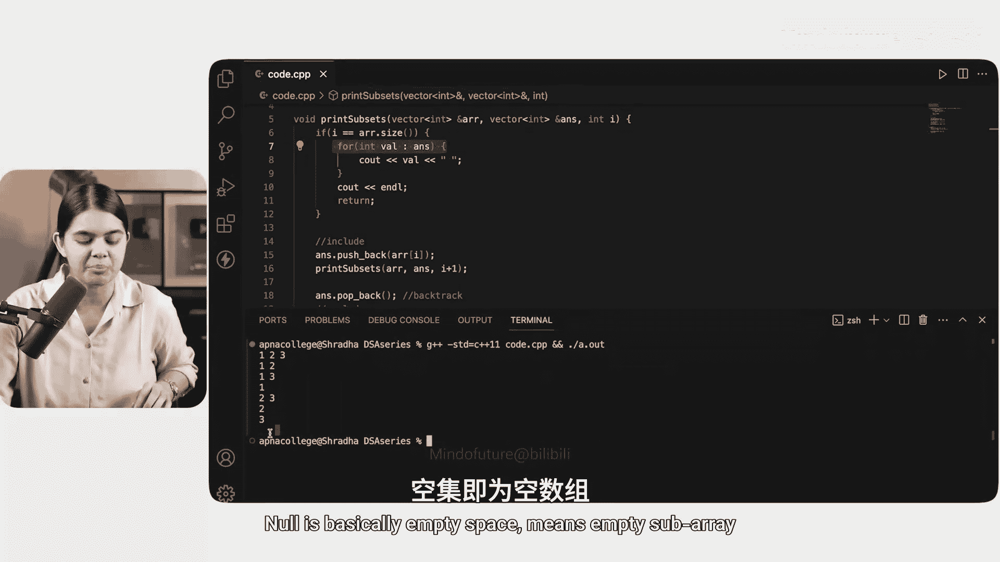
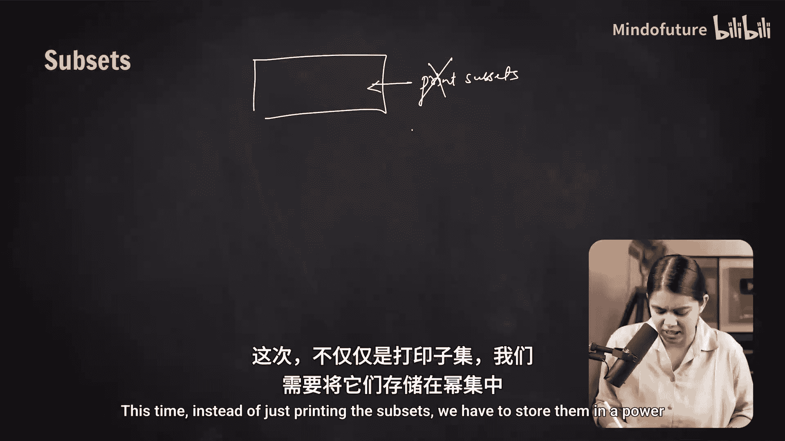
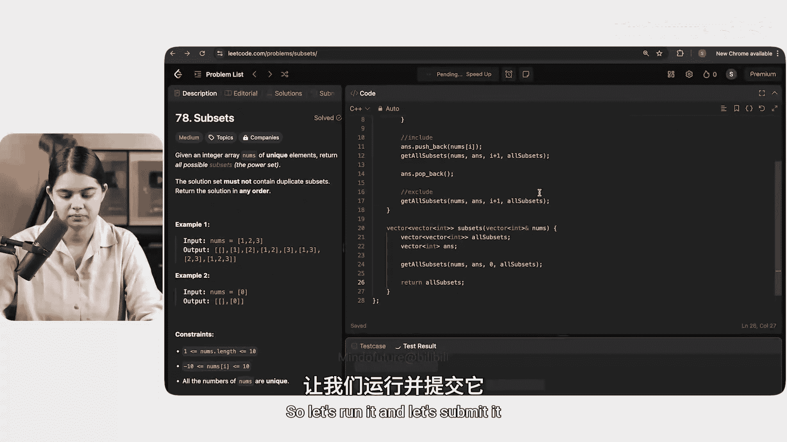
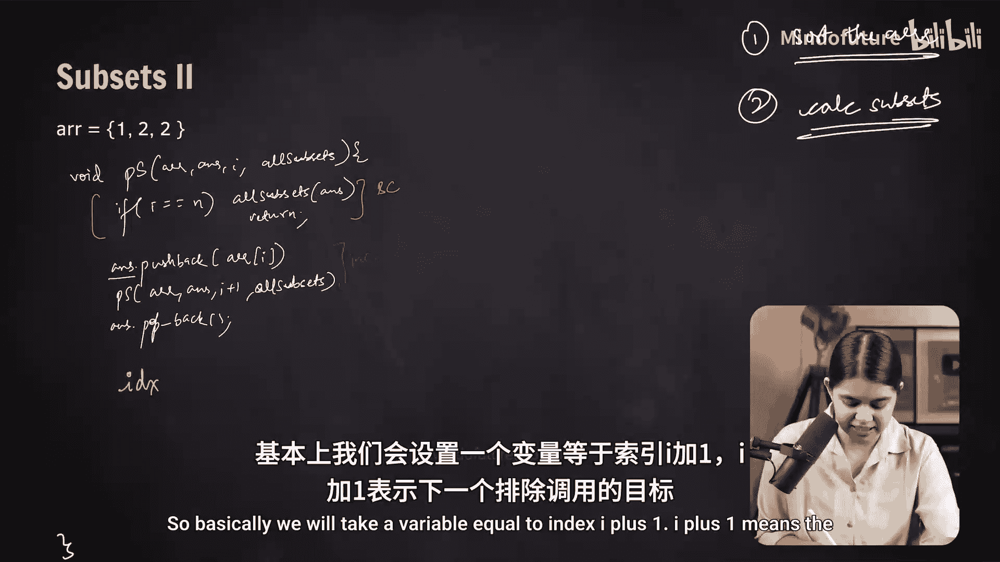
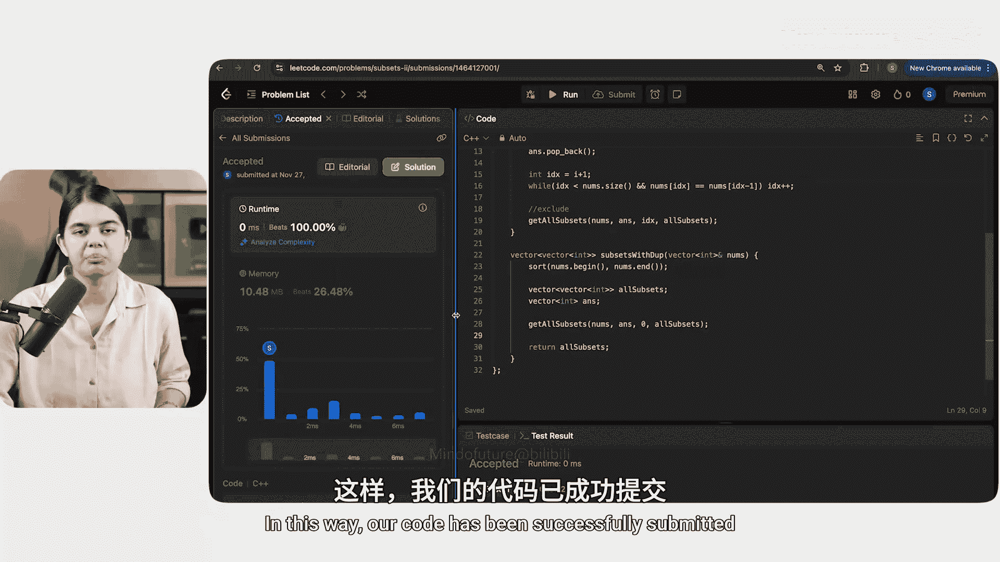
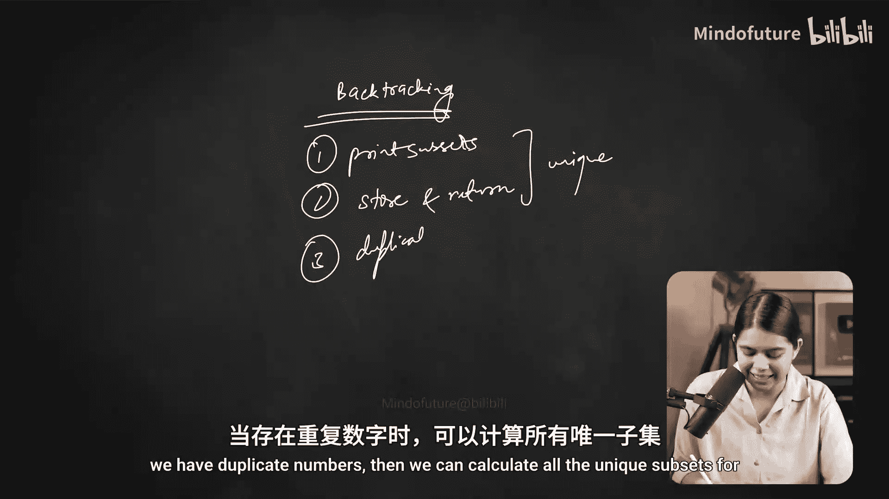

# 043：递归第三部分-回溯详解-打印所有子集-子集II


## 概述
在本节课中，我们将深入学习递归中的**回溯**概念，并详细讲解基于子集的问题。这些知识对于求职和实习面试至关重要。我们将从打印给定字符串或数组的所有子集这一基本问题开始，逐步深入到处理包含重复元素的数组，并生成所有不重复的子集。

## 打印所有子集
上一节我们介绍了递归的基本概念，本节中我们来看看如何使用回溯法生成一个集合的所有子集。



核心思想是：对于集合中的**每一个元素**，我们都有两种选择：**包含**它或**排除**它。通过递归地做出这些选择，我们可以遍历所有可能的组合。

我们可以用一个索引 `i` 来跟踪当前正在处理的元素。递归函数的基本结构如下：
```cpp
void printSubsets(vector<int>& nums, vector<int>& answer, int i) {
    // 函数体
}
```
以下是实现步骤：
1.  **基础情况**：当索引 `i` 等于数组 `nums` 的大小时，表示我们已经处理完所有元素，此时打印 `answer` 中存储的当前子集。
2.  **包含当前元素**：将 `nums[i]` 加入 `answer`，然后递归调用函数处理下一个元素（`i+1`）。
3.  **回溯**：在递归调用返回后，我们需要撤销上一步的选择，即从 `answer` 中移除刚才添加的 `nums[i]`（例如使用 `answer.pop_back()`）。这一步就是**回溯**，它确保我们能够探索其他分支。
4.  **排除当前元素**：不将 `nums[i]` 加入 `answer`，直接递归调用函数处理下一个元素（`i+1`）。



通过这种方式，递归树会生成所有 `2^n` 个子集。时间复杂度为 **O(n * 2^n)**，其中 n 是数组长度。

## 返回所有子集（无重复元素）
现在，我们不再打印子集，而是将它们存储在一个集合中并返回。这被称为求解**幂集**。



逻辑与打印所有子集几乎完全相同，唯一的区别是我们将结果存储在一个 `vector<vector<int>>` 中，而不是直接打印。



以下是修改后的函数签名和关键步骤：
```cpp
void getAllSubsets(vector<int>& nums, vector<int>& answer, int i, vector<vector<int>>& allSubsets) {
    // 函数体
}
```
实现步骤：
1.  当到达基础情况（`i == nums.size()`）时，将当前 `answer` 添加到 `allSubsets` 中。
2.  包含当前元素：`answer.push_back(nums[i])`，递归调用 `getAllSubsets(nums, answer, i+1, allSubsets)`。
3.  回溯：`answer.pop_back()`。
4.  排除当前元素：递归调用 `getAllSubsets(nums, answer, i+1, allSubsets)`。

主函数初始化一个空的 `answer` 和 `allSubsets`，然后调用此递归函数，最后返回 `allSubsets`。时间复杂度仍为 **O(n * 2^n)**。

## 子集II（处理重复元素）
上一节我们处理了元素不重复的情况，本节中我们来看看当输入数组可能包含**重复元素**时，如何生成所有**不重复**的子集。

如果直接使用之前的方法，重复的元素会导致生成重复的子集。例如，数组 `[1,2,2]` 会生成两个 `[1,2]` 子集。



解决这个问题的关键在于**排序**和**跳过重复分支**。
1.  **排序**：首先对输入数组 `nums` 进行排序，使得所有相同的元素相邻。
2.  **跳过逻辑**：在“排除当前元素”的递归分支中，如果发现下一个要处理的元素 (`nums[i+1]`) 与当前元素 (`nums[i]`) 相同，那么直接跳过这些重复元素，直到找到一个不同的元素再开始递归。这样可以避免生成重复的子集。

以下是修改后的排除步骤伪代码：
```cpp
// 排除当前元素 nums[i] 后
int nextIndex = i + 1;
// 跳过所有与 nums[i] 相同的元素
while (nextIndex < nums.size() && nums[nextIndex] == nums[i]) {
    nextIndex++;
}
// 从第一个不重复的元素开始递归
getAllSubsets(nums, answer, nextIndex, allSubsets);
```
包含当前元素的步骤保持不变。通过这种剪枝操作，我们确保了结果集中每个子集都是唯一的。时间复杂度在排序后为 **O(n log n + n * 2^n)**。

## 总结
本节课中我们一起学习了回溯法的核心应用——生成子集。
1.  我们首先学习了如何使用“包含/排除”的递归模型打印一个集合的所有子集，并理解了**回溯**（`pop_back`）在这一过程中的关键作用。
2.  接着，我们将打印逻辑改为存储逻辑，实现了返回幂集的函数。
3.  最后，我们解决了更复杂的“子集II”问题，通过**先排序**，然后在递归的排除分支中**跳过重复元素**，高效地生成了所有不重复的子集。





理解并掌握这种回溯框架对于解决许多组合、排列和搜索问题都至关重要。