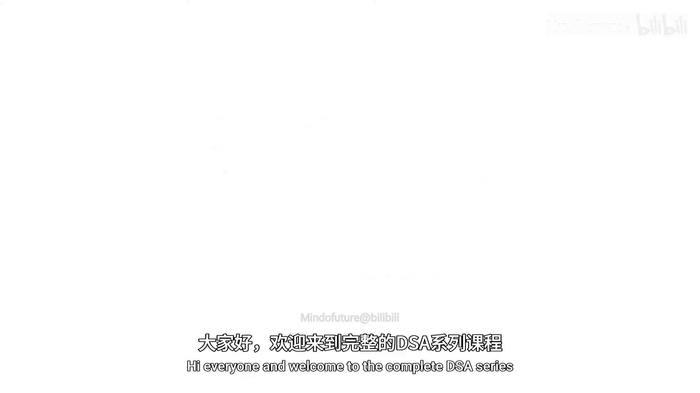
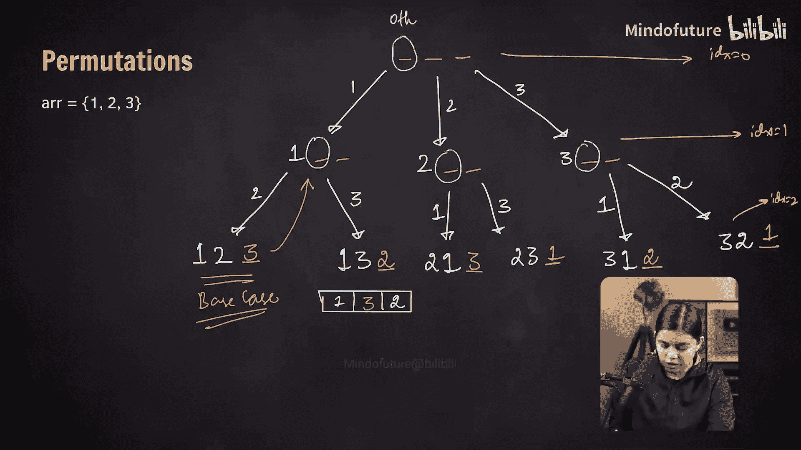
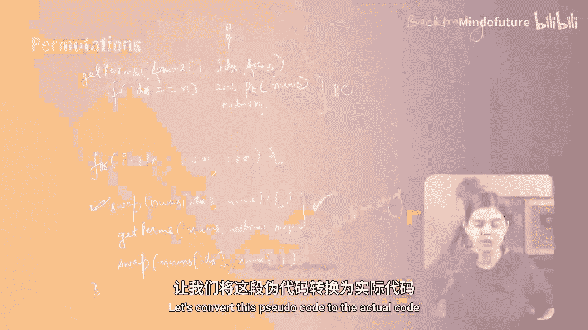
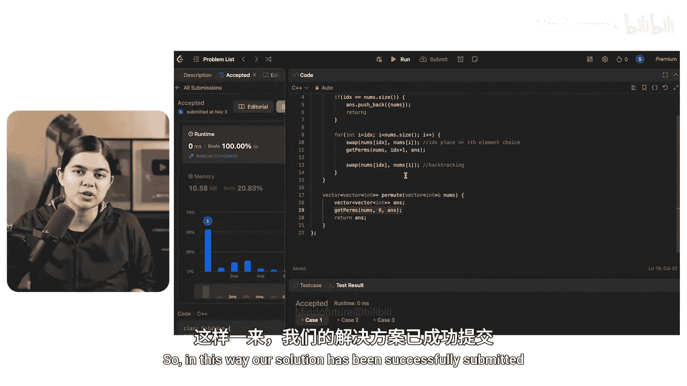
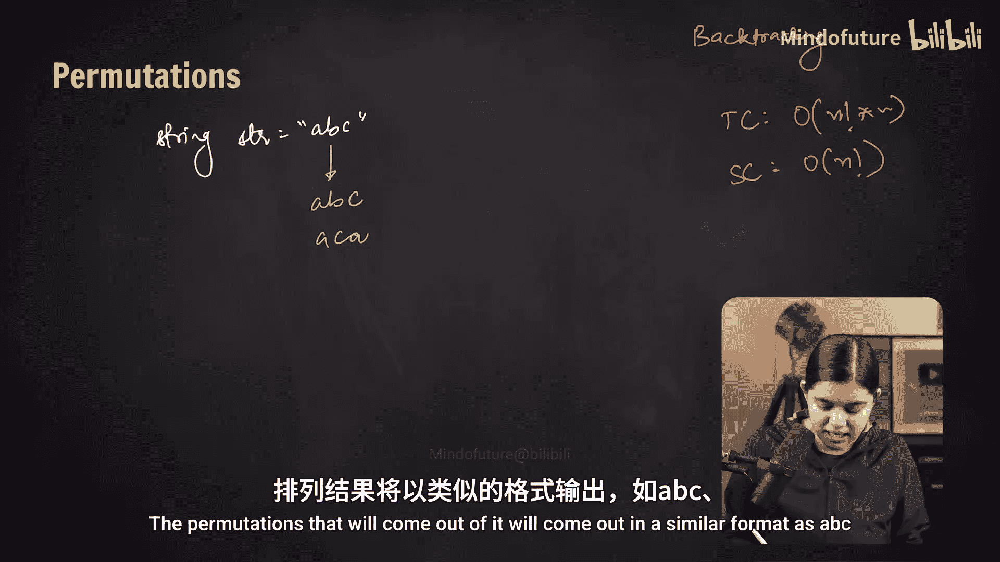

# 044：数组与字符串的排列（递归与回溯）

在本节课中，我们将学习如何使用递归与回溯算法解决一个核心问题：生成数组或字符串的所有可能排列。理解排列是掌握递归思想的关键一步。



## 概述

排列是指将一组元素进行所有可能的顺序安排。例如，对于元素 `[1, 2, 3]`，其所有排列包括 `[1,2,3]`、`[1,3,2]`、`[2,1,3]` 等。对于 `n` 个不同的元素，其排列总数是 **n的阶乘**，数学公式表示为：

**n! = n × (n-1) × (n-2) × ... × 2 × 1**

本节课我们将以LeetCode第46题“全排列”为例，详细讲解其递归与回溯的实现逻辑。

## 问题分析与思路

我们的目标是编写一个函数，输入一个不含重复数字的数组，返回其所有可能的全排列。

我们可以将生成排列的过程想象成填充一系列空位。假设有 `n` 个空位需要填充 `n` 个不同的数字：
*   第一个空位有 `n` 种选择。
*   选定一个数字后，第二个空位剩下 `n-1` 种选择。
*   以此类推，直到最后一个空位只有 `1` 种选择。

这个过程天然适合用递归来模拟。每一次递归调用负责填充一个特定位置（索引）。关键在于，我们需要一种方法来标记哪些数字已经被使用过，以确保排列中元素的唯一性。

一种高效的方法是**原地交换**，而不使用额外的存储空间来标记。思路如下：
1.  对于当前需要填充的位置 `index`，我们将数组中从 `index` 到末尾的每一个元素，依次交换到 `index` 这个位置上。
2.  每次交换后，我们固定了 `index` 位置的元素，然后递归地处理下一个位置 `index + 1`。
3.  当递归调用返回后，我们需要进行**回溯**，即将交换过的元素再交换回来，恢复数组状态，以便进行下一个选择。

## 算法实现步骤

以下是实现排列生成的核心步骤。

1.  **定义主函数**：创建一个函数 `permute`，接收输入数组 `nums`。
2.  **初始化结果容器**：创建一个二维向量 `ans` 用于存储所有排列结果。
3.  **调用递归辅助函数**：从第一个位置（索引0）开始调用递归函数。
4.  **实现递归辅助函数**：
    *   **基准情况**：如果当前索引 `index` 等于数组长度 `n`，说明所有位置都已填满，将当前数组 `nums` 的一个副本存入结果 `ans`。
    *   **递归情况**：遍历 `index` 到 `n-1` 的每个位置 `i`。
        *   交换 `nums[index]` 和 `nums[i]`，将 `nums[i]` 固定到 `index` 位置。
        *   递归调用函数处理下一个位置 `index + 1`。
        *   **回溯**：再次交换 `nums[index]` 和 `nums[i]`，将数组恢复原状，以便进行下一轮循环尝试其他元素。

## 代码实现

根据上述思路，具体的C++实现代码如下。

```cpp
#include <vector>
#include <algorithm>
using namespace std;



class Solution {
private:
    void solve(vector<int>& nums, int index, vector<vector<int>>& ans) {
        // 基准情况：所有位置都已确定，保存当前排列
        if (index >= nums.size()) {
            ans.push_back(nums);
            return;
        }
        // 递归情况：为当前位置 index 尝试所有可能的数字
        for (int i = index; i < nums.size(); i++) {
            // 将 nums[i] 交换到 index 位置
            swap(nums[index], nums[i]);
            // 递归处理下一个位置
            solve(nums, index + 1, ans);
            // 回溯：撤销交换，恢复状态
            swap(nums[index], nums[i]);
        }
    }
public:
    vector<vector<int>> permute(vector<int>& nums) {
        vector<vector<int>> ans;
        int index = 0;
        solve(nums, index, ans);
        return ans;
    }
};
```

## 复杂度分析



理解算法效率对于评估解决方案至关重要。

*   **时间复杂度**：**O(n × n!)**。总共有 `n!` 种排列，而生成每种排列我们需要 `O(n)` 的时间（例如，复制数组到结果中）。因此总时间复杂度为 `O(n × n!)`。
*   **空间复杂度**：**O(n!)**。主要用于存储输出结果，需要容纳 `n!` 个长度为 `n` 的排列。递归调用栈的深度为 `O(n)`，但通常不计入返回答案所需的空间。

## 延伸练习：字符串排列

我们已经学会了如何生成数字数组的排列。现在，我们可以将完全相同的逻辑应用到字符串上。



以下是给你的一个练习：编写一个函数，输入一个字符串（如 `"ABC"`），打印或返回其所有可能的排列。你可以尝试修改上面的代码，将 `vector<int>` 替换为 `string`，其核心的交换与回溯思想完全一致。

通过完成这个练习，你将能巩固对递归回溯生成排列的理解。



## 总结

本节课我们一起学习了排列问题的递归与回溯解法。我们首先理解了排列的数学定义 `n!`，然后通过“填充空位”的模型将问题分解。我们重点掌握了**通过交换元素进行选择**以及**递归后必须回溯**的核心技巧，并实现了完整的代码。最后，我们还探讨了如何将此法应用于字符串。掌握这个模式是深入理解递归算法的重要基石。